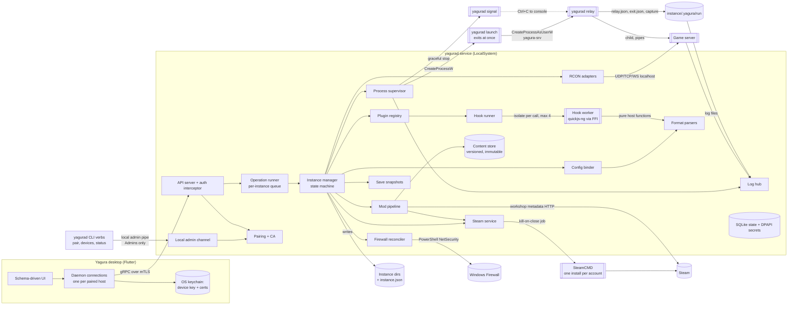
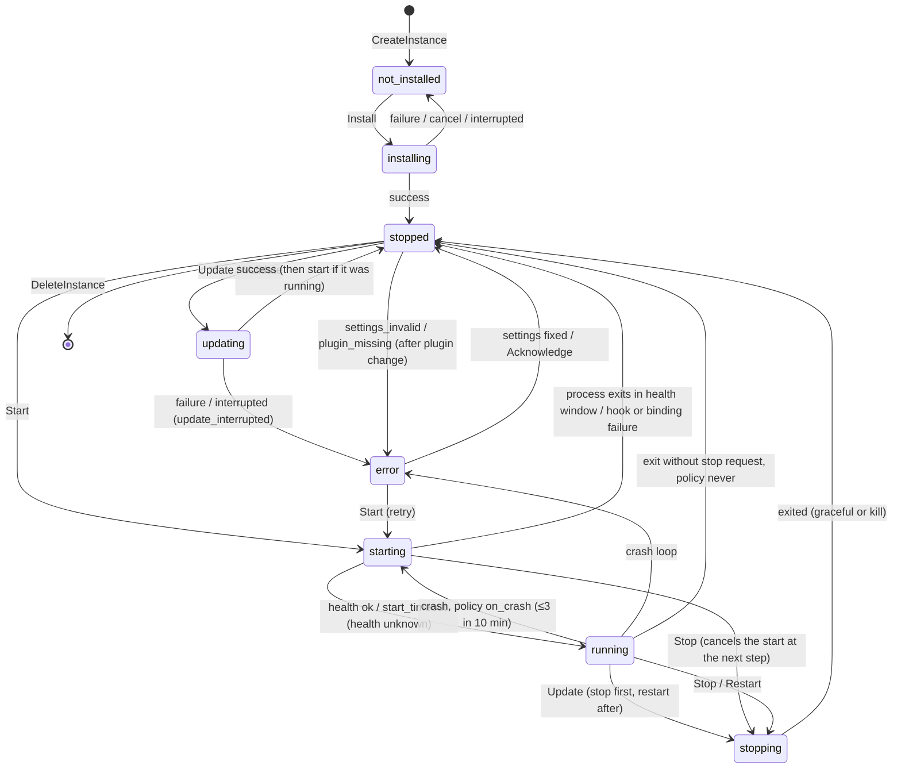

# Yagura Architecture

Yagura is two applications sharing one protocol: `yagurad`, a headless Dart daemon (AOT-compiled) that owns a host and its game servers, and the Yagura desktop client (Flutter, Windows and Linux; macOS not yet decided) that manages one or more paired daemons. Games are plugins: a manifest plus optional JavaScript hooks run inside the daemon. A narrative walk-through of the main flows is in [docs/overview.md](../docs/overview.md), and the wire protocol and its security in [docs/protocol.md](../docs/protocol.md); this file is the baseline that change designs read first.

## System triage

- **T1 Components:** applies. Daemon with ~13 internal components, worker isolates for hooks, helper entry points (launcher, relay, signal), SteamCMD and game server processes, the desktop client, external Steam services and OS services.
- **T2 State:** applies. SQLite state, a versioned content store, instance directories, an 8-state instance machine, cached Steam logins, CA and device certificates, a game-server OS account.
- **T3 Concurrency:** applies. Concurrent operations across instances, long installs, log tailing, RCON sessions, client streams, hook workers with deadlines, reconcile loops, a mod update timer.
- **T4 Boundaries:** applies. gRPC protocol, local admin channel, plugin manifest and hook contract, config file formats, `instance.json`, relay files, SteamCMD output, OS firewall/service/DPAPI/account APIs.
- **T5 Volume:** applies. Logs, operation history, audit log, workshop content versions (GBs), save snapshots, number of instances and mods.
- **T6 Risk:** applies. Remote admin access to a host, Steam credentials, firewall changes, third-party code in game servers, deletion of game data (worlds, player saves).

## Components

| Component | Responsibility | Owns (state) | Talks to via (contract) |
|---|---|---|---|
| API server | gRPC services, mTLS, device check, audit of mutating and auth calls | none (stateless) | `proto/yagura/v1` (ADR 0006, 0007) |
| Local admin channel | CLI verbs on the host (`pair`, `devices`, `status`) | none | Named pipe ACL'd to SYSTEM + Administrators (ADR 0012) |
| Pairing + CA | CA, server cert, pairing codes, device enrollment, renewal, revocation | CA key (secret), devices, pairing codes | SQLite, SecretStore |
| Operation runner | Serialises operations per instance, host-wide heavy limit, progress, cancellation, startup recovery | operations table, in-memory progress | Operation events stream |
| Instance manager | Instance CRUD, revisions, state machine; orchestrates install/update/start/stop | instances, settings, revisions, `instance.json` | Plugin registry, binder, mods, process, steam, firewall, snapshots |
| Plugin registry | Discovers and validates plugins, serves schemas, explicit reload, settings re-validation | loaded manifests (memory) | `plugin.yaml` + JSON Schema (ADR 0002) |
| Hook runner | Runs one hook in a fresh worker isolate with deadline and memory cap; returns file edits to the binder | none | Hook contract: JSON in/out, pure host API (ADR 0003) |
| Config binder | Sole writer of bound files and hook-requested edits; detects external edits | last-applied hashes per file | Format parsers (ADR 0004) |
| Mod pipeline | Resolve, acquire (single-flight), stage (junctions), keys, load order, update checks | instance-mod rows with pinned versions | Steam service, content store (ADR 0005) |
| Steam service | SteamCMD installs per account (one run at a time each), app/workshop downloads, Guard relay | SteamCMD dirs, account rows | SteamCMD args and output patterns (ADR 0010) |
| Process supervisor | Native spawn via launcher and relay, stop strategies, exit waiters, re-attach | run records (relay/server PID, exe, start time) | Relay files, Win32/POSIX process APIs (ADR 0009) |
| Save snapshots | Copies of declared `data_paths` before update and before delete with files | snapshot rows, `snapshots/` | Filesystem |
| Log hub | Tails declared sources, decodes, ring-buffers, fans out | ring buffers, file offsets | Log stream messages |
| RCON adapters | BattlEye, Source RCON, Rust WebRCON sessions | open sessions (memory) | Game wire protocols |
| Firewall reconciler | Desired vs actual owned rules | owned rule rows | NetSecurity cmdlets (ADR 0012) |
| Desktop client | Multi-daemon UI rendered from schemas and streams | device keys/certs, per-daemon UI prefs | gRPC, OS keychain |

Out of scope for v1: a scheduler for timed restarts or updates (the only timer is the mod update check inside the mod pipeline), world backups beyond the pre-update/pre-delete snapshots, roles per device.

## Instance state machine

## State ownership

| State | Sole writer | Lifetime | Invalidation / rebuild | Authoritative copy |
|---|---|---|---|---|
| Instances, settings, ports, revision | Instance manager | Until instance deleted | — | SQLite |
| `instance.json` | Instance manager | Instance dir lifetime | Rewritten after each instance commit and at startup | Derived from SQLite (ADR 0008) |
| Instance state | Instance manager | Instance lifetime | Re-derived at startup (Failure and recovery) | SQLite + live process check |
| Run records (relay/server PID, exe, start time) | Process supervisor | One server run | Cleared on observed exit | Launcher report (relay) plus `relay.json` (server) verified by parent PID and token user |
| Operations + history | Operation runner | 30 days or 1,000 per instance | Pruned at startup and daily | SQLite |
| Loaded manifests | Plugin registry | Daemon process | Explicit `ReloadPlugins` only; operations use a snapshot | Plugin files on disk |
| Content store versions | Steam service (publishes), mod pipeline (GC) | Until unreferenced for 7 days | Immutable once published | Disk |
| Instance-mod rows (`staged_version`, `desired_version`, order, staged name; GC treats both versions as references) | Mod pipeline | Until removed | — | SQLite |
| Bound file hashes | Config binder | Per bound file | Updated after each apply | SQLite |
| SteamCMD installs + cached logins | Steam service | Per Steam account | Re-login on expiry | SteamCMD's own files (ACL'd) |
| Secrets (CA key, Steam pw, RCON pw, GSLT, `yagura-srv` pw) | SecretStore, called by the owning component | Until replaced/deleted | — | SQLite blobs, DPAPI user scope of LocalSystem (ADR 0011) |
| Devices, pairing codes | Pairing + CA | Device: until revoked; code: 10 min, single use | Expired codes pruned | SQLite |
| Owned firewall rules | Firewall reconciler | While the port is wanted | Reconcile at startup, on port change, on request | Windows Firewall (actual) vs SQLite (desired) |
| Save snapshots | Save snapshots | Last 3 per instance | Oldest deleted | Disk + SQLite rows |
| Log ring buffers + offsets | Log hub | Daemon process; offsets persisted | Refilled from file tail on restart | Log files on disk |
| Client device key + certs | Desktop client | Until unpaired | Renew before expiry; re-pair if expired | OS keychain |

## Boundaries and contracts

- **gRPC API** — `proto/yagura/v1/*.proto`, package `yagura.v1`. Additive changes only within v1; a breaking change creates `v2` served side by side for one minor release. `System.GetInfo` reports `daemon_version` and `api_versions` (every major.minor served); the client picks the highest major it shares. Plugin-shaped data is JSON with `schema_version`; mutating instance calls carry `expected_revision`. (ADR 0006, 0008)
- **Local admin channel** — length-prefixed JSON over a named pipe / Unix socket, versioned by `admin_api: 1`; serves only host-local administration. (ADR 0012)
- **Plugin manifest** — `plugin.yaml`, `manifest_version: 1`, validated by `schemas/plugin-manifest.v1.json`. Unknown `manifest_version` → plugin rejected with a visible error. (ADR 0002)
- **Hook contract** — `hooks.js` exports named functions; input one JSON context, output one JSON result validated per hook (file edits are returned, never written); host API `yagura.*` versioned with the manifest version. (ADR 0003)
- **Config formats** — `ini`, `ue-ini`, `json`, `xml`, `vdf`, `dayz-cfg`, `kv`, each with a byte-identical round-trip guarantee and a corpus of real files. (ADR 0004)
- **`instance.json`** — `format_version: 1`, no secrets, read only by import. (ADR 0008)
- **Relay files** — `relay.json` and `exit.json` in `<instance>/.yagura/run/`, `format_version: 1`, written by the relay, read by the supervisor. (ADR 0009)
- **SteamCMD** — `+force_install_dir`, `+login`, `+app_update`/`+workshop_download_item`, `+quit` as arguments; output-pattern table in `steam/patterns.yaml`. (ADR 0010)
- **OS** — CreateProcess/LogonUser, DPAPI, NetSecurity cmdlets, WinSW config, NTFS ACLs and junctions; Linux equivalents behind the same interfaces. (ADR 0009, 0011, 0012, 0013)

## Failure and recovery

| Component | Dies or fails mid-operation → | Recovery | Retry safe? | Who finds out |
|---|---|---|---|---|
| Daemon process | Operations cut; SteamCMD dies with its job; game servers keep running under their relays | Startup: kill stray SteamCMD under Yagura dirs; mark `queued`/`running` operations `interrupted`; re-derive states (`installing` → `not_installed`, `updating` → `error: update_interrupted`, `starting`/`running`/`stopping` → re-attach or `stopped`); re-run mod staging and firewall reconcile idempotently; rewrite every `instance.json` | Yes, admin retries | Client: `interrupted` operations and per-instance notices |
| Launcher / relay | Launcher fails: start fails with the Win32 error. Relay killed: server loses its stdout pipe | Server alive → `running` with `capture: broken`; server dead → crash handling via `exit.json` or `lost_while_daemon_down` | Yes | Client notice + log source status |
| Game server | Exits without a stop request | Restart policy (≤3 in 10 min, then `error: crash_loop`) | Policy-limited | Client `crashed` / `crash_loop` notices with last 50 lines |
| Hook worker | Timeout, OOM, exception, native hang | Interrupt handler, then watchdog kills the isolate; operation fails | Yes, after fixing the hook | Client operation error with hook name and stack |
| SteamCMD | Crash, hang, no progress 15 min, network loss | Killed; operation fails with classified or raw output | Yes (downloads resume) | Client operation error + last 50 lines (password scrubbed) |
| Config binder | Parse error, file lock, crash mid-write | Atomic replace leaves old or new file; operation fails | Yes | Client error with file/line |
| Mod pipeline | Download, link or key copy fails; crash mid-stage | Staging recomputes links and keys from the desired list each run; partial downloads stay in `.staging` and are deleted at startup | Yes | Client mod status `failed` |
| Firewall reconciler | PowerShell or firewall service unavailable | Warning, `firewall: degraded`, retried at each reconcile | Yes | Client instance badge + warning |
| Log tailer | File gone, permission denied | Source `error`, keeps polling | Yes | Client log source status |
| RCON adapter | Disconnect / auth failure | Backoff reconnect / stops until password changes | Yes / no | Client console events |
| SQLite | Disk full, corruption | Call fails `INTERNAL` with incident id; `GetHealth.database_ok=false` | After the admin fixes it | Client error + health; daemon log |
| Secret store | DPAPI failure | Daemon refuses to start (identity) or the call fails | No | Service exit code; client error |
| Client connection | Network drop | Backoff reconnect; streams resume (`after_sequence`, fresh snapshot) | Yes | Client daemon status |

## Resource bounds

| Flow / store | Bound | At the bound | On failure | Who finds out |
|---|---|---|---|---|
| Hook call | 5 s default deadline (manifest up to 60 s), 64 MiB heap, 4 MiB context, 1 MiB result; host call input/output 16 MiB; 4 workers per host | Interrupt / rejected / queued | Operation fails with hook name, JS stack | Client, daemon log |
| Operations | 1 running per instance, 10 queued per instance; 4 heavy (install/update/validate/mods) per host | Queued with position / rejected `RESOURCE_EXHAUSTED` | Operation `failed` | Client |
| SteamCMD | 1 run per installation; fail after 15 min without progress; 12 h hard cap; login step 10 min | Queued / killed | Raw last 50 lines attached | Client |
| Content store | free space ≥ 2× expected size before acquisition; GC of versions unreferenced 7 days | Refuse `insufficient_disk` | — | Client |
| Save snapshots | last 3 per instance; free space ≥ 2× data size | Oldest deleted / refuse with `insufficient_disk` (update or delete does not proceed) | — | Client |
| Log ring buffer | 10,000 lines or 4 MiB per source | Oldest evicted | Source event | Client log view |
| Stdout capture | 10 MiB × 5 files per instance | Oldest file deleted | — | — |
| Client log stream | 1,000 lines behind per subscriber | `dropped N` marker | Stream closed with status | Client |
| Backlog request | 5,000 lines | Truncated with marker | — | Client |
| Instance watch subscribers | 32 per daemon; 1,000 events behind | `resync_required` + new snapshot | — | Client |
| Operations history | 1,000 per instance / 30 days | Pruned | — | — |
| Audit log (mutating + auth calls only) | 100,000 rows | Oldest pruned | — | — |
| RCON | 1 session per instance, 8 console subscribers, 10 s command timeout | Rejected | Reconnect 1→30 s backoff | Client console |
| Pairing attempts | 5 wrong codes per 10 min | Code invalidated | — | CLI + audit |
| Plugin files | manifest ≤ 256 KiB, hooks.js ≤ 1 MiB | Plugin rejected | — | Client plugin list |
| Messages | 4 MiB request, 16 MiB response | `RESOURCE_EXHAUSTED` / paging | — | Client |

## In-force ADRs

| ADR | Decision | Supersedes |
|---|---|---|
| [0001](../docs/adr/0001-daemon-owns-the-host.md) | The daemon owns the host; the client is a view | — |
| [0002](../docs/adr/0002-plugins-are-manifest-plus-hooks.md) | Game plugins are a declarative manifest plus optional JS hooks | — |
| [0003](../docs/adr/0003-hooks-in-quickjs-ng-via-ffi.md) | Hooks run in quickjs-ng through an in-repo FFI binding, one disposable runtime per call | — |
| [0004](../docs/adr/0004-config-bindings-with-round-trip-parsers.md) | Settings reach files through declarative bindings and round-tripping parsers | — |
| [0005](../docs/adr/0005-mods-are-a-daemon-capability.md) | Mods are a daemon capability with a versioned, immutable content store | — |
| [0006](../docs/adr/0006-grpc-with-json-documents-for-plugin-structures.md) | gRPC over HTTP/2; plugin-declared structures travel as JSON documents | — |
| [0007](../docs/adr/0007-mtls-with-daemon-ca-and-pairing.md) | mTLS with a daemon-local CA and one-time pairing codes | — |
| [0008](../docs/adr/0008-sqlite-authoritative-instance-json-derived.md) | SQLite is authoritative; instance.json is a derived, portable copy | — |
| [0009](../docs/adr/0009-game-processes-outlive-the-daemon.md) | Game servers run under a relay, spawned outside the daemon's process tree | — |
| [0010](../docs/adr/0010-steamcmd-non-interactive.md) | SteamCMD runs non-interactively; Steam Guard is relayed to the client | — |
| [0011](../docs/adr/0011-secrets-are-dpapi-blobs.md) | Secrets are DPAPI-protected blobs in the daemon database | — |
| [0012](../docs/adr/0012-windows-host-integration.md) | Windows host integration: WinSW service and group-owned firewall rules | — |
| [0013](../docs/adr/0013-game-servers-run-as-a-low-privilege-account.md) | Game servers run under a dedicated low-privilege account | — |
