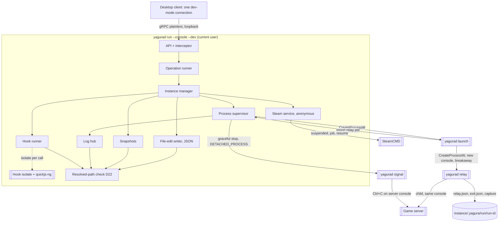
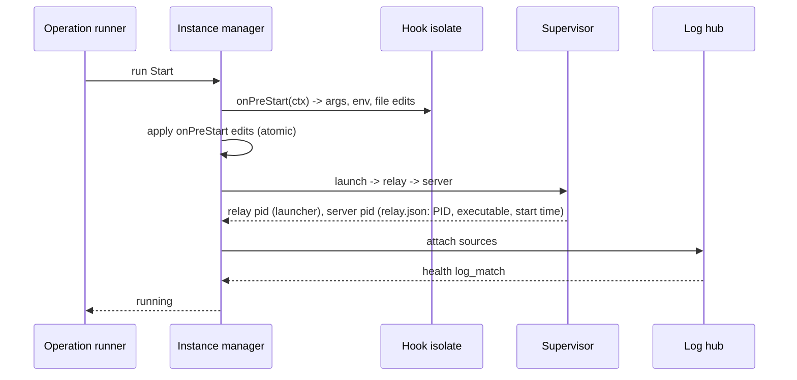
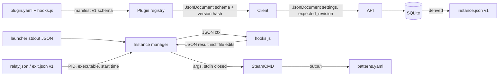

# Design

## Triage

| Trigger | Applies? | Evidence |
|---|---|---|
| T1 Components (new component, or 3+ with directed relationships) | yes | New system: daemon core (API, operation runner, instance manager, process supervisor, Steam service, hook runner, snapshots, log hub), launcher/relay/signal entry points, hook workers, SteamCMD, game servers, desktop client (`openspec/architecture.md` Components) |
| T2 State (persistent state, caches, 3+ state machine) | yes | SQLite state, 8-state instance machine with error reasons, operation queues, snapshots, persisted log offsets |
| T3 Concurrency (background work, workers/isolates, async, retries) | yes | Per-instance operation queues, heavy-operation slots, SteamCMD installation lock, hook isolates with watchdogs, log tailers, autostart spacing |
| T4 Boundaries (data format, migration, shared interface, IPC, external) | yes | gRPC `yagura.v1` (dev mode), plugin manifest v1 + hook contract, `instance.json`, launcher report and relay files, SteamCMD output, Win32 process and console APIs |
| T5 Volume (grows without a fixed bound) | yes | Logs, operation events and history, snapshots |
| T6 Risk (security, money, data loss, unrecoverable user data) | yes | World saves (graceful stop, snapshots, delete), game servers that must outlive the daemon, untrusted plugin JavaScript in the daemon process |

TIER: FULL

## Context

This change is milestone M1 (Walking skeleton) of `openspec/roadmap.md`. It was taken out of the original whole-platform change: the requirements, decisions and task groups for M2-M5 are parked in `openspec/changes/platform-backlog/`, which keeps decisions D8, D13, D16, D19 and D20. Decision numbers are kept so references stay valid. Where a decision below is only partly built in M1, its **M1 scope** line says which part.

Greenfield: no code exists. The baseline in `openspec/architecture.md` (components, instance state machine, state ownership, contracts, failure and recovery, resource bounds) and ADRs 0001-0013 (`docs/adr/`, accepted after two baseline review rounds) are the frame; this design does not restate them. The protocol is `proto/yagura/v1/*.proto`, explained in `docs/protocol.md`; flows are in `docs/overview.md`.

Where this design refines a baseline table (the error-state exits in D17, the bounds in Resource Bounds), the refinement is authoritative for this change and task 9.6 writes it back into `openspec/architecture.md`.

Verified on 2026-10-16 against package docs and source: `package:grpc` server supports `requestClientCertificate`/`requireClientCertificate`, exposes `ServiceCall.clientCertificate`, and enforces a server keepalive policy (configured per ADR 0009 review, `docs/protocol.md`); Dart build hooks exist since Dart 3.10 and `native_toolchain_c` compiles C sources; `dart:io` `Process.start(detached)` on Windows sets only `DETACHED_PROCESS` (hence ADR 0009's native spawn); `quickjs_runtime` 0.3.6 has no Windows build path and no interrupt or memory limit; `x509` 0.2.4 lists `TbsCertificate` and `Signer`; WinSW 2.x is the stable line.

Unverified assumptions, each closed by a spike task in `tasks.md`: MSVC compile of quickjs-ng through `native_toolchain_c` (1.2); Ctrl+C delivery to a server on the relay's console and Valheim saving on it, a detached `signal` helper attaching to that console, `CREATE_BREAKAWAY_FROM_JOB` being allowed from a console window and on the Windows CI runner, and Valheim starting with `-public 0` and no password (1.3). The later spikes (TLS request mode, WinSW and `yagura-srv`, Steam Guard, SCUM) are in the backlog.

## Decisions

### D1: Dart pub workspace with apps, packages and plugins in one repo

- **Choice:** one repository, a pub workspace: `apps/yagurad` (daemon, AOT), `apps/yagura_desktop` (Flutter), `packages/yagura_proto` (generated from `proto/`), `packages/yagura_js` (quickjs-ng FFI + build hook), `packages/yagura_formats` (parsers), `packages/yagura_plugin` (manifest model, validation, templates; also behind `yagura plugin lint`), `plugins/<id>/`, `schemas/plugin-manifest.v1.json`, `tool/`.
- **Rejected:** separate repositories per app because protocol and manifest changes would need coordinated releases before any external consumer exists.
- **Reversal cost:** low.

### D2: One binary, four entry modes, implementing ADR 0009

- **Choice:** `yagurad` dispatches on its first argument: `run` (default; `--console` for development without a service account), `launch`, `relay`, `signal`. `launch` (service mode) logs on `yagura-srv`, loads its profile, builds its environment, and starts the relay with `CREATE_NEW_CONSOLE | CREATE_BREAKAWAY_FROM_JOB` (no `CREATE_NEW_PROCESS_GROUP`) on window station/desktop `YaguraSrv\Default`; it writes `{relay_pid, relay_created}` as one JSON line to its stdout and exits. `relay` calls `SetConsoleCtrlHandler(NULL, FALSE)` to clear any inherited ignore flag, installs a handler that returns TRUE for itself, starts the server without `CREATE_NEW_PROCESS_GROUP` on the same console with stdout/stderr pipes, writes `relay.json` (relay and server PID, start times, executable paths; no command line) and later `exit.json`. `signal --console-of <server pid>` (falling back to the relay pid) attaches and calls `GenerateConsoleCtrlEvent(CTRL_C_EVENT, 0)`; the helper ignores the event itself (`SetConsoleCtrlHandler(NULL, TRUE)` in the helper only) and exits 0 after `GenerateConsoleCtrlEvent` returns. On Linux, `launch` asks systemd for a transient scope (`StartTransientUnit`) and `signal` sends SIGTERM to the server. Win32 calls sit behind a `ProcessHost` interface.
- **Signal helper and jobs:** the daemon spawns `signal` with `DETACHED_PROCESS`, so the helper has no console of its own and `AttachConsole` can succeed; it installs its ignore handler only after attaching, and exits non-zero with the Win32 error when attaching or `GenerateConsoleCtrlEvent` fails, which the stop treats as a failed graceful step (grace period, then kill). If `CREATE_BREAKAWAY_FROM_JOB` is refused because an enclosing job forbids breakaway, Start fails `launch_failed` naming breakaway; the daemon never drops the flag, because a server inside the daemon's job would die with it.
- **Launch records:** each Start gets a run id and a run directory `.yagura/run/<run-id>/`, recorded in SQLite as `pending` before `launch` is spawned. The relay writes its own identity (PID, start time, executable) into `relay.json` before it starts the server and adds the server's identity after; the supervisor marks the run `running` once it has verified both. At startup a `pending` run is resolved from its directory: the daemon waits up to 10 s for a live relay to record its server, re-attaches a verified server, kills a verified relay that recorded none, and otherwise marks the run lost and the instance `stopped`. No new run starts for an instance while one is unresolved.
- **Stop records:** a Stop writes `stop_requested_at` on the run record before the stop strategy is sent. A run re-attached at startup that carries it resumes `stopping` with the rest of its grace period, then kills; its exit records `stopped_by` and never counts as a crash.
- **M1 scope:** `run --console`, `launch` with `CreateProcessW` as the current user (no service, no window station), `relay` and `signal` on Windows. The `yagura-srv` logon path is M2 and the Linux path M5.
- **Rejected:** separate helper executables because they add build and signing targets while sharing all their code with the daemon.
- **Reversal cost:** low.

### D3: Operations are persisted rows driven by an in-memory runner

- **Choice:** each request inserts an operation row (`queued`) and enqueues it on the instance's FIFO (10 queued max, `queue_full`). Heavy operations are `install`, `update`, `validate`, `apply_mods` and `update_mods`; one of 4 host heavy slots is taken only when the operation is about to start real work, per step: a step acquires the SteamCMD installation lock it needs, then a heavy slot, and releases both when the step ends; no step holds a lock or slot while waiting for another installation's lock; while waiting the operation reports step `waiting_for_steamcmd` with its position. Events get per-operation sequence numbers; `Progress` events are coalesced per step (only the latest is retained), other events are retained up to 2,000 per operation. A resume below the retained window starts with `events_dropped{from,to}` followed by the current `Operation`. Gaps left by coalescing are not drops: a resume gets every retained event that is not progress plus the latest progress of each step, with no `events_dropped`. Terminal state is persisted; at startup unfinished operations become `interrupted` (D9).
- **M1 scope:** the heavy operations are `install`, `update` and `validate`; `apply_mods` and `update_mods` join with mods in M3.
- **Rejected:** a durable, resumable job queue because SteamCMD runs, hooks and spawns are not resumable and half-resumed work is riskier than an explicit retry.
- **Reversal cost:** low.

### D4: Hook worker is a fresh isolate per call, bounded from inside, with leak accounting

- **Choice:** each hook call takes one of 4 worker slots (waiting for a slot does not count against the hook deadline; the wait is bounded by the operation's own cancellation), spawns an isolate, creates a quickjs-ng runtime with 64 MiB heap, a 512 KiB script stack (the isolate thread's native stack is 1 MiB on Windows, and a 1 MiB script limit overran it with access violations in task 2.2) and an interrupt handler on a monotonic deadline, registers the pure `yagura.*` host functions, runs the hook and frees the runtime. A watchdog fires at deadline + 2 s: the operation fails with `hook_timeout`, `Isolate.kill` is requested, and the slot stays reserved until the isolate exits, so at most 4 hook isolates ever exist. An isolate that has not exited 5 s after its watchdog is counted as leaked and keeps its slot. `GetHealth` reports leaked workers; at 2 leaked, hooks are refused with `hook_runtime_degraded` until the daemon restarts.
- **Rejected:** a warm runtime pool because state can leak between calls and instances, and hooks run a few times per operation.
- **Reversal cost:** low.

### D5: Settings schema version is a content hash

- **Choice:** `schema_version` = first 32 bits of SHA-256 of the canonical settings-schema JSON, so a reload that changes the schema changes the version.
- **Rejected:** a manually bumped number because authors forget to bump it and stale forms write removed fields.
- **Reversal cost:** low.

### D6: Log tailers poll files

- **Choice:** each source is tailed by polling (250 ms while followed, 2 s otherwise), truncation detection, `newest` switching by creation time, offsets persisted every 10 s.
- **Current run:** before each Start, for every `fixed` file source the evaluator records the file's size and a SHA-256 of its first 4 KiB. A later poll that finds a smaller size or a different first-4-KiB hash treats the file as rewritten and reads it from offset 0. `log_match` considers only lines read after this point, so a rewrite that grows past the old size before the next poll is still seen.
- **Rejected:** `FileSystemEntity.watch` because change notifications are unreliable for appended data on some Windows volumes.
- **Reversal cost:** low.

### D7: SteamCMD runs are serialised per installation; only content-store items are single-flight

- **Choice:** the Steam service holds one lock per SteamCMD installation; app runs are keyed `(app, branch, instance directory)` and queue on the lock, so two instances of the same app each get their own run into their own directory. Single-flight applies only to content-store acquisitions, keyed `(source, app, item, version)`: concurrent requesters attach as waiters; cancelling one detaches it, and the shared run is killed only when no waiter remains. SteamCMD is spawned suspended, assigned to the daemon's kill-on-close job, then resumed, so its self-update relaunch cannot escape the job.
- **M1 scope:** the anonymous installation and app runs only; content-store single-flight comes with workshop items in M3.
- **Rejected:** single-flight for app installs because each instance has its own target directory; joining would report success for an empty directory.
- **Reversal cost:** low.

### D9: Startup separates fatal steps from degraded ones

- **Choice:** fatal (exit non-zero, nothing served): data-directory lock (`LockFileEx`/`flock` on `yagurad.lock`, released by the OS when the holder dies; the holder writes its PID at offset 0 and locks one byte at offset 2^32, so a refused daemon can read the PID, which is informational), database open and migration. The secret store and daemon identity join the fatal steps, and firewall reconcile the degraded ones, in M2. Degraded (listener still opens, notice + `GetHealth` flag): stray SteamCMD sweep (if a stray cannot be terminated, that installation is unavailable and operations needing it fail `steamcmd_unavailable` without spawning; the Steam service retries the sweep every 60 s), plugin load failures, state recovery (`installing` → `not_installed`; `updating` → `error: update_interrupted`; `starting`/`running`/`stopping` → re-attach by PID, executable and start time, else `stopped` or crash handling; a run with a stop request resumes `stopping` (D2); an interrupted restore → `error: restore_interrupted`; an instance directory with a `.yagura/deleting` marker and no row is removed (D25)), log tailing, autostart (D14), `instance.json` rewrite. Per-instance failures affect only that instance.
- **Rejected:** "any failure before the listener exits" because a stopped firewall service would make WinSW restart the daemon in a loop and the admin could not connect to see why.
- **Reversal cost:** low.

### D10: Desktop client state per daemon connection

- **Choice:** one connection object per paired daemon owns its `WatchInstances` stream and snapshot cache; views subscribe through Riverpod providers keyed by daemon id; forms come from a schema-to-widget renderer with a read-only fallback. The connection renews the device certificate when under 30 days remain.
- **M1 scope:** one dev-mode (loopback, plaintext) connection; pairing, several daemons and certificate renewal are M2.
- **Rejected:** per-view polling because it multiplies calls and shows stale state.
- **Reversal cost:** low.

### D11: Plugins ship with the daemon and may be overridden locally

- **Choice:** reference plugins are installed into `<data>/plugins/` and updated with the daemon unless locally modified (shipped-file hashes compared, changed plugins skipped and reported).
- **Rejected:** a plugin download service because there is no second plugin author yet.
- **Reversal cost:** low.

### D12: Snapshots are directory copies on the snapshots volume

- **Choice:** snapshots copy `data_paths` into `<snapshots root>/<instance>/<id>/` (default `<data>/snapshots`, configurable per host) with a manifest; the free-space check is made on the snapshots volume. Retention: last 3 per instance; a snapshot being restored is pinned against pruning until the restore ends; a restore takes its `pre_restore` snapshot before it replaces any data path, and one interrupted by a daemon crash leaves the instance in `error: restore_interrupted` (D17), so a half-replaced world is never started; `pre_delete` snapshots of deleted instances are kept 30 days and listed through `ListOrphanSnapshots`. `skip_snapshot` on Update is allowed and recorded in the operation result as `snapshot: skipped`; the audit entry comes with the audit log in M2.
- **M1 scope:** the snapshots root is fixed at `<data>/snapshots`; making it configurable comes with the local admin channel in M2.
- **Rejected:** zip archives because compressing multi-GB worlds would dominate update time.
- **Reversal cost:** low.

### D14: Instances that were running restart after a host or daemon restart

- **Choice:** each instance has `autostart` (default true). At startup, an instance whose last requested state was running (set when a Start succeeds; cleared by Stop, Delete, or an operation that ends with the server stopped, such as a cancelled or failed Update, Validate or Restart; internal stops inside an operation that restarts the server do not clear it) and that is not running after re-attach is started through the normal Start operation, subject to the restart policy, 10 s apart per instance to avoid a thundering start. Instances in `error` are not autostarted; entering `error: crash_loop` clears the last requested state.
- **Rejected:** no autostart in v1 because Windows Update reboots are routine and every server would stay down until the admin notices.
- **Reversal cost:** low.

### D15: Instance stream sends slim deltas

- **Choice:** `WatchInstances` deltas omit `settings` (`settings_omitted: true`) unless settings changed; clients fetch with `GetInstance` on demand. Each subscriber queue is bounded at 1,000 events and 8 MiB, whichever comes first, then `resync_required`. Mod update counts travel on `Instance` (`mods_update_available`).
- **M1 scope:** no mod update counts; they join with mods in M3.
- **Rejected:** full documents on every state flip because 32 stalled subscribers × 1,000 large documents can reach gigabytes.
- **Reversal cost:** low.

### D17: Error-state reasons and their exits

- **Choice:** `error` always carries a reason, and each reason allows specific exits (this table refines the architecture state machine):

| Reason | Allowed | Result |
|---|---|---|
| `crash_loop` | Start | `starting` (restart counter reset) |
| `crash_loop` | Acknowledge | `stopped` |
| `update_interrupted`, update failure | Update, Validate | `updating` |
| `update_interrupted`, update failure | Acknowledge | `stopped` (warning kept: files may be inconsistent) |
| `restore_interrupted` | RestoreSnapshot | `stopped` once the restore ends |
| `restore_interrupted` | Acknowledge | `stopped` (warning kept: data paths may be mixed) |
| `settings_invalid` | UpdateSettings with valid settings | `stopped` |
| `plugin_missing` | ReloadPlugins that restores the plugin | `stopped` |
| any | Stop | refused only while an operation runs |
| any | Delete | refused while another operation is queued or running (D25) |

Start from `error: settings_invalid` or `plugin_missing` fails `invalid_state`. A running instance whose settings become invalid on reload keeps running with flag `settings_invalid` and a notice; its next Start is refused.
- **Rejected:** a single generic `error` that any Start clears because it would restart a crash-looping or half-updated server without the admin seeing why.
- **Reversal cost:** low.

### D18: Cancellation and stop-while-busy

- **Choice:** cancellation takes effect at the next step boundary, except SteamCMD and health waits, which are interruptible. Outcomes: Install → `not_installed`; Update/Validate before `stop` → state unchanged; after `stop` → `stopped`, snapshot kept, not restarted; Start during health wait → `stopping` then `stopped` within the grace period; ApplyMods → staging re-run on next start. A Stop request cancels any queued Start/Restart ahead of it and the running Start, then runs next; it does not cancel queued Update/Install.
- **Rejected:** strict FIFO for Stop because an admin trying to stop a misbehaving server would wait behind restarts.
- **Reversal cost:** low.

### D21: Instance directories are placed and ACL'd by the daemon

- **Choice:** create and import accept a directory only under a configured instance root (default `<data>/instances`; admins add roots with `yagurad roots add`), not overlapping another instance, the data directory, the content store, the snapshots root or a system directory (`directory_not_allowed`). The daemon applies the ADR 0013 ACLs on create and import.
- **M1 scope:** the default root `<data>/instances` and the overlap checks (the `instances/` subtree of the data directory is the allowed root; the rest of the data directory is not); `yagurad roots add|remove` comes with the local admin channel and the ACLs with the game-server account, both in M2.
- **Rejected:** any path the client sends because an ACL grant or `delete_files` on a mistyped `D:\` would hit unrelated data.
- **Reversal cost:** low.

### D22: M1 file access is checked by resolved path

- **Choice:** every daemon file access inside an instance (hook reads and lists, hook file edits, log tailing, snapshots and restores, delete) resolves the final path, following links, and refuses one outside the instance root with `sandbox_violation`. Writes go to a temporary file in the target directory, then an atomic rename.
- **M1 scope:** M1 servers run as the current user, so this check guards against mistakes and plugin bugs, not against a hostile server racing the daemon. The race-free InstanceFs that never follows reparse points (backlog D13) replaces it in M2, when the daemon runs as LocalSystem next to the `yagura-srv` account.
- **Rejected:** building InstanceFs in M1 because without the service account there is no privilege boundary for it to protect yet.
- **Reversal cost:** low.

### D23: Hook file edits support JSON only in M1

- **Choice:** `packages/yagura_formats` gets a lossless JSON tree (keeps key order and formatting) with parse, merge-patch and serialise; the daemon's file-edit writer applies a hook's edits through it under D22, all edits of one hook result or none. `yagura.formats.json` exposes the same parser to hooks. Any other format in an edit or in `yagura.formats` fails `unsupported_in_this_version`. No file hashes are recorded and no external edits are detected.
- **M1 scope:** all of it. The `ini`, `dayz-cfg` and `kv` parsers, hash tracking and `external_edit` arrive with config bindings in M3 (backlog task 15.3), which reuses this writer.
- **Rejected:** stubbing the format layer in M1 because the hook file-edit scenarios would then have nothing to run against.
- **Reversal cost:** low.

### D24: The M1 API surface

- **Choice:** M1 serves `System`, `Plugins`, `Instances`, `Operations` and `Logs`. Methods of those services that M1 does not build fail `UNIMPLEMENTED` with reason `not_implemented`. The other v1 services (`Pairing`, `Steam`, `Mods`, `Rcon`, `Firewall`) are registered as stubs whose every method fails the same way, because `package:grpc` answers an unknown service before any interceptor runs and would send no `ErrorDetail`. `docs/protocol.md` lists the methods each version implements.

| Service | Implemented in M1 | Not in M1 |
|---|---|---|
| System | `GetInfo`, `GetHealth` | `ListAudit` (M2) |
| Plugins | all | — |
| Instances | `ListInstances`, `GetInstance`, `WatchInstances`, `CreateInstance`, `UpdateSettings`, `DeleteInstance` (an operation, D25), `Install`, `Update`, `Validate`, `Start`, `Stop`, `Restart`, `Acknowledge`, snapshots | `SetSecret`, `DeleteSecret` (fail `FAILED_PRECONDITION` / `secret_store_unavailable`), `ImportInstance`, `ExportInstance` (M4), `ApplyConfig` (M3) |
| Operations | `GetOperation`, `ListOperations`, `WatchOperation`, `CancelOperation` | `RespondToPrompt` (M3) |
| Logs | all | — |
| Pairing, Steam, Mods, Rcon, Firewall | — | all (stubs; M2-M4) |

M1 sets every instance `revision` to 0 and does not check `expected_revision`, so the last write wins; revision checks arrive with remote clients in M2. `GetHealth` lists components a version does not have in `not_built` (M1: `secret_store`, `firewall`); their `*_ok` fields are false and carry no meaning.
- **Rejected:** serving only the methods M1 builds from a trimmed proto because the wire contract would then change in every milestone.
- **Reversal cost:** low.

### D25: Delete is an operation with a crash-safe order

- **Choice:** `DeleteInstance` returns an `Operation` on the instance's queue and is refused with `invalid_state` while another operation is queued or running; a wrong confirmation fails the call before an operation exists. With `delete_files` the steps are: `pre_delete` snapshot, `.yagura/deleting` marker written into the instance directory, the instance's database rows removed, directory removed. Operation records are not instance rows: they outlive the instance and are pruned by the normal history bound (30 days or 1,000 per instance), so the delete operation stays readable through `GetOperation` and `WatchOperation` after the instance is gone. Cancellation is honoured only before the rows are removed; after that the delete runs to the end. At startup a marked directory with no instance row is removed again (D9), and a marked directory whose row still exists is left alone with its marker removed, because the rows were never deleted.
- **Rejected:** a unary call returning `Empty`, because copying a snapshot and removing a 1-2 GB directory blocks the call past the 30 s client deadline and has no defined outcome on cancel or crash.
- **Reversal cost:** low before M1 ships the v1 contract; a breaking change after.

## Diagrams (FULL)

### T1 Components: process view

M1 only. The target view with the mod pipeline, config binder, firewall reconciler, RCON adapters, InstanceFs and the `yagura-srv` logon is in `openspec/architecture.md` and the backlog.

### T2 State

The instance state machine is the one in `openspec/architecture.md` (Instance state machine), with the error-reason exits of D17. The content-store version lifecycle is in the backlog (M3).

### T3 Concurrency: start operation

M1 steps. Mod staging, config bindings and firewall rules join this sequence in M2-M3 (backlog).

### T4 Boundaries

## State & Ownership (FULL)

The system table is in `openspec/architecture.md`. Additions and refinements:

| State | Owner (sole writer) | Lifetime | Invalidation / rebuild | Authoritative copy |
|---|---|---|---|---|
| Per-instance operation queue | Operation runner | Daemon process | Unfinished rows become `interrupted` at startup (D9) | SQLite (terminal), memory (order) |
| Operation events | Operation runner | Until the operation is pruned | Progress coalesced per step; others ≤ 2,000; `events_dropped` on gaps (D3) | Memory; terminal persisted |
| Run record (`pending` → `running` → ended), stop request | Process supervisor | One run | Created before `launch`; resolved at startup from the run directory; `stop_requested_at` written before the stop strategy is sent (D2) | SQLite + run directory |
| Relay record | Process supervisor | One run | From `relay.json` (relay identity, written before the server starts) and the launcher report | Verified copy in SQLite |
| Server record | Process supervisor | One run | Accepted from `relay.json` when PID, executable and start time match (parent and token checks join in M2) | Verified copy in SQLite |
| Last requested state (for autostart) | Instance manager | Instance lifetime | Set on successful Start; cleared by Stop, Delete, or an operation that ends with the server stopped (D14) | SQLite |
| Restart counter and crash window | Process supervisor | Instance lifetime | Reset by Start from `crash_loop`, Acknowledge and a client Stop; crashes older than 10 min drop out of the window | SQLite (crash timestamps), so the crash-loop guard holds across daemon restarts |
| Error reason, `settings_invalid` flag | Instance manager | Until an allowed exit (D17) | — | SQLite |
| Snapshot rows + files | Snapshots | Last 3 per instance; orphans 30 days | Pinned while restoring (D12) | Disk + SQLite |
| Hook worker slots (active, timed out, leaked) | Hook runner | Daemon process | A timed-out worker keeps its slot until its isolate exits; leaked count reset on restart (D4) | Memory |
| SteamCMD installation availability | Steam service | Daemon process | Unavailable while a stray could not be terminated; sweep retried every 60 s (D9) | Memory |
| Current-run mark of a `fixed` log source (size, first-4-KiB hash) | Health evaluator | One start | Taken before each Start; a smaller size or a different hash means rewritten, read from 0 (D6) | Memory |
| Delete marker (`.yagura/deleting`) | Instance manager | One delete | Written before the rows are removed; a marked directory without a row is removed at startup (D25) | Instance directory |
| Instance roots | Instance manager (default root in M1; admin channel from M2) | Host | — | SQLite |

## Failure & Visibility (FULL)

System-level rows are in `openspec/architecture.md` (Failure and recovery). Additions:

| Component | Fails / dies mid-operation → | Recovery | Retry safe? | Who finds out |
|---|---|---|---|---|
| Startup step (non-fatal, D9) | Plugin load, re-attach, log tailing, autostart fails | Listener opens; component retried on its own schedule | Yes | Client notices; `GetHealth` flags |
| Hook worker stuck in native code | Watchdog fires; isolate does not exit | Slot released, leak counted; at 2 leaks hooks refused until restart (D4) | Yes after restart | Client `hook_timeout` / `hook_runtime_degraded`; `GetHealth.leaked_hook_workers` |
| Launcher | Process creation fails, or breakaway is refused | Start fails `launch_failed` with the Win32 error (breakaway named) | Yes | Client error |
| Daemon dies during a Start | Run left `pending` | Resolved at startup from the run directory: re-attach, kill a server-less relay, or mark lost (D2) | Yes | Client notice |
| Signal helper | Attach or Ctrl+C fails | Graceful step counted as failed; kill after the grace period; `stopped_by: kill` | Yes | Operation result |
| Stray SteamCMD sweep | A stray cannot be terminated | Installation unavailable, `steamcmd_unavailable`; sweep retried every 60 s | Yes | Client notice |
| Hook file edit | Parse or write fails | No edit of that hook result is applied; operation fails | Yes | Client error |
| Delete with files | Daemon dies after the rows were removed | Marked directory removed again at startup; `pre_delete` snapshot listed as an orphan (D25) | Yes | Instance gone from listings; orphan snapshot listed |
| Restore | Daemon dies while replacing data paths | Instance `error: restore_interrupted`; Start refused; restore again or Acknowledge (D17) | Yes | Client notice; instance error reason |
| Stop | Daemon dies after the stop strategy was sent | Re-attached run resumes `stopping`, kill after the rest of the grace period; not a crash (D2) | Yes | Client notice |
| Snapshot | Copy fails mid-way | Partial snapshot directory deleted; operation fails before any destructive step | Yes | Client error |
| Autostart | Start fails after reboot | Normal Start failure handling; no retry loop beyond the restart policy | Yes | Client notice |
| `instance.json` write | Fails after DB commit | Call succeeds; warning event; rewritten at next change and at startup | Yes | Client warning |

## Resource Bounds (FULL)

System-level bounds are in `openspec/architecture.md` (Resource bounds). This design adds or refines (refinements marked *):

| Queue / buffer / cache / transfer | Bound | At the bound | Timeout | At 10x / 100x |
|---|---|---|---|---|
| Per-instance operation queue | 10 queued | `RESOURCE_EXHAUSTED` / `queue_full` | — | 200 instances × 10 rows |
| Heavy slots* | 4 per host, taken after any SteamCMD lock is held | Wait with `waiting_for_steamcmd` / queue position | Stall timer starts when SteamCMD starts | Anonymous-installation games serialise; documented |
| Operation events* | Progress coalesced per step; other events 2,000 per operation | `events_dropped` marker on resume | — | 12 h install ≈ hundreds of non-progress events |
| Hook workers* | 4 isolates at once, timed-out ones included; 2 leaked max | Queue (not counted in deadline) / `hook_runtime_degraded` | Deadline + 2 s watchdog; leaked 5 s later | — |
| Log line | 64 KiB | Cut, `truncated: true`, rest of the line discarded | — | A newline-free stream costs one 64 KiB buffer |
| Log follow subscriber | 1,000 lines or 4 MiB behind | `dropped` marker, continue from newest | — | — |
| Desktop paused log view | 10,000 lines | Oldest held lines dropped, count shown on resume | — | — |
| WatchInstances subscriber* | 1,000 events or 8 MiB | `resync_required` | — | 32 × 8 MiB = 256 MiB worst case |
| Snapshots* | 3 per instance; orphans 30 days; space check on the snapshots volume | Oldest pruned (never the one restoring) / `insufficient_disk` | — | Large worlds: admin moves the snapshots root |
| Autostart | 1 start per 10 s | Spaced | Normal start timeout | 20 instances ≈ 3 min after boot |

## Flow & State Gaps (FULL)

- **Daemon restart mid-operation:** D9; operations `interrupted`.
- **Daemon dies between starting a server and recording it:** the pending run record (D2).
- **Settings changed while running:** saved, `restart_required`, applied at next start.
- **Plugin reload during an operation:** the operation keeps its manifest snapshot; reload effects per D17.
- **Two instances installing the same app:** separate runs, one after the other on the installation lock (D7).
- **Stop while busy:** D18.
- **Relay killed, server alive:** `capture: broken`; file logs continue.
- **Host reboot:** D14 autostart.
- **Clock changes:** monotonic clocks for deadlines, windows and timers.
- **Instance directory deleted by hand:** next operation fails `instance_directory_missing`.

## Mechanism Ledger (FULL)

| Mechanism | Built? | Why (harm nobody catches / expensive later) | Evidence that would change the call |
|---|---|---|---|
| Relay + launcher (ADR 0009, D2) | yes | Without them servers die with the daemon, stdout is lost and graceful stop is impossible | — |
| Hook watchdog + leak cap (D4) | yes | A native hang would otherwise block every hook forever | — |
| Pending run records (D2) | yes | A daemon crash during Start would leave an untracked server or start a second one | — |
| Resolved-path checks (D22) | yes | A hook edit or snapshot through a link writes or copies outside the instance | — |
| Race-free InstanceFs | no (M2) | No privilege boundary in M1: servers run as the current user | The `yagura-srv` account (M2) |
| Settings schema version hash (D5) | yes | Stale forms write removed fields | — |
| Pre-update / pre-delete snapshots (D12) | yes | Broken updates or deletes destroy unrecoverable worlds | — |
| Autostart after restart (D14) | yes | Routine reboots leave every server down | Admins report unwanted starts |
| Scheduled backups and restarts | no | Out of v1 scope (strategy) | Admin requests |
| Plugin signing / marketplace | no | Plugins installed by the admin | Remote plugin install |
| Resumable operations | no | Steps are not resumable (D3) | Large installs cut repeatedly by restarts |
| Metrics endpoint | no | Health visible in client and `GetHealth` | Admin runs monitoring |
| Hook async / timers | no | Hooks are short (ADR 0003) | A game needs waiting in a hook |

## Risks / Trade-offs

- [quickjs-ng does not build with MSVC through `native_toolchain_c`] → spike 1.2; fallback clang-cl, then a CI-built DLL loaded by path. A fallback does not meet the M1 MSVC exit criterion; using one needs the roadmap criterion amended by the user first.
- [Ctrl+C does not reach the server on the relay console] → spike 1.3 before the process model is built; fallback: RCON or `kill` with a warning that the plugin cannot stop gracefully, which blocks the Valheim exit criterion and is escalated.
- [Valheim refuses to start without a password] → spike 1.3 checks `-public 0` with no password; if a password is required, the M1 Valheim manifest cannot run until the secret store (M2), and this is escalated before group 9.
- [A relay dies between starting the server and recording it] → that server is untracked; accepted as a residual risk (the relay does almost nothing in that window), visible as a port conflict at the next start.
- [SteamCMD output wording changes] → patterns are data; unknown output shown raw and never retried blindly.
- [M1 runs servers as the current user in console mode, so the `yagura-srv` path is untested until M2] → the M2 change re-verifies the Valheim graceful stop under the service (backlog task 11.3) before its exit.

## ADRs

- **In force, constraining this change:** 0001-0013.
- **To record during apply:** none.

## Open Questions

None.
