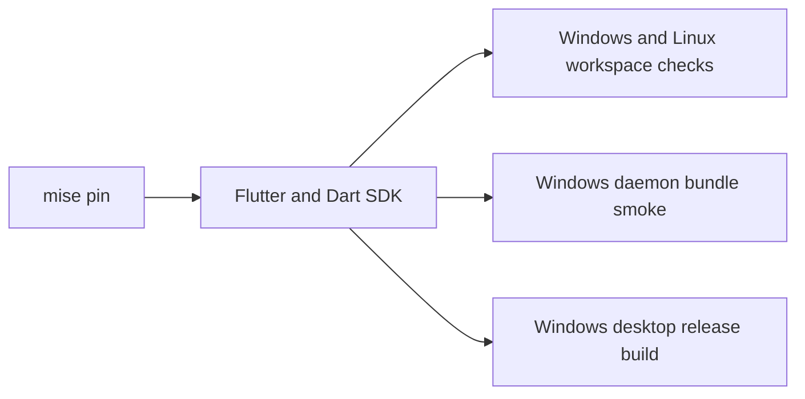
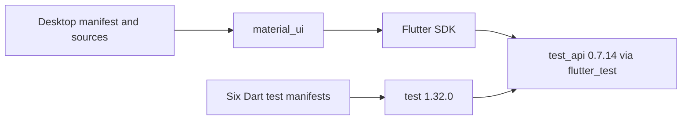
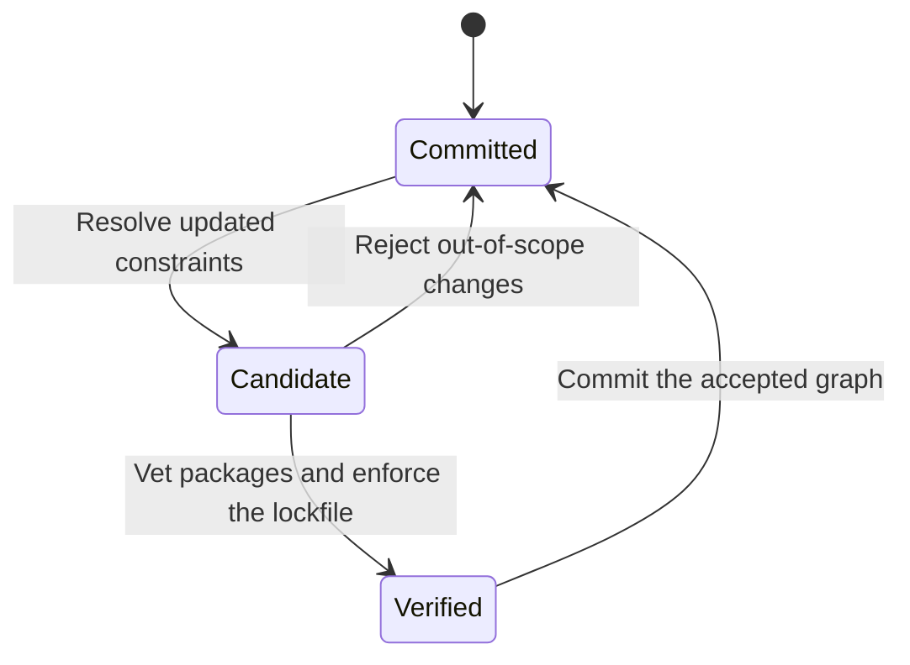

# Design

## Triage

| Trigger | Applies? | Evidence |
|---|---|---|
| T1 Components | Yes | The mise pin feeds the workspace resolver, desktop widget tests and daemon AOT smoke. The desktop also gains a runtime library (`mise.toml:1-2`, `pubspec.yaml:8-15`, `.github/workflows/ci.yml:28-59`, `apps/yagura_desktop/lib/main.dart:19-26`). |
| T2 State | Yes | Pub updates the committed workspace dependency resolution, not the app's persistent state (`pubspec.yaml:8-15`, `pubspec.lock:1-11`). |
| T3 Concurrency | No | The change adds no worker, timer or asynchronous work. The existing package test driver awaits each runner before starting the next (`tool/test.dart:11-27`). |
| T4 Boundaries | Yes | The change crosses the desktop-to-Material package API and Flutter's shared test tooling boundary (`apps/yagura_desktop/lib/main.dart:1-3,19-26`, `apps/yagura_desktop/pubspec.yaml:23-26`, `apps/yagurad/pubspec.yaml:28-30`). |
| T5 Volume | No | The upgrade adds no app input or collection. The workspace package list drives the existing package test loop (`pubspec.yaml:8-15`, `tool/test.dart:11-27,34-44`). |
| T6 Risk | Yes | The bundled SDK includes the VM that ships in the daemon and is subject to the advisory in the proposal. The Windows smoke builds and uses the AOT bundle (`tool/bundle_smoke.dart:140-150,343-359`, `.github/workflows/ci.yml:56-59`). |

TIER: FULL

## Context

The Windows and Linux CI jobs and the manual Elevated job install the tools from `mise.toml` and resolve the workspace at its root (`mise.toml:1-4`, `.github/workflows/ci.yml:20-41`, `.github/workflows/elevated.yml:24-38`). Their `version: 2026.10.12` pins mise itself, not Flutter. CI invokes the mise analyzer and test tasks (`.github/workflows/ci.yml:43-51`, `mise.toml:6-12`). The test driver reads the root workspace list, uses Flutter only for members that declare it, and waits for each runner before starting another (`tool/test.dart:11-27,34-44`). Windows CI compiles, copies and smokes a fresh daemon bundle; it does not compile the desktop executable (`.github/workflows/ci.yml:42-62`, `tool/bundle_smoke.dart:140-150,343-359`).

The desktop directly imports Material and initializes `MaterialApp` at its entry point (`apps/yagura_desktop/lib/main.dart:1-3,19-26`). Both dropdowns supply `onChanged`: the game selector stores the selected plugin ID and the settings field updates the draft and marks it edited (`apps/yagura_desktop/lib/src/ui/instance_list.dart:296-309`, `apps/yagura_desktop/lib/src/ui/settings_form.dart:292-307`). The instance test selects a game and asserts its ID in the request; the form test submits and checks the schema's enum default (`apps/yagura_desktop/test/instance_actions_test.dart:132-145`, `apps/yagura_desktop/test/forms_rendered_from_plugin_schemas_test.dart:325-339,389-396`).

The desktop registry loads the saved list at startup and sweeps the keychain (`apps/yagura_desktop/lib/src/registry.dart:28-58,163-175`). Keep build verification separate from launching with a live Windows profile. The existing startup widget test runs `YaguraApp` and checks the visible app title, instance and connection state (`apps/yagura_desktop/test/app_test.dart:8-21`).

The desktop remains a view of daemon-owned state (`docs/adr/0001-daemon-owns-the-host.md:10-11`). Its existing plugin form validation and editing contract stays in `openspec/specs/desktop-client/spec.md:9-10`; the migration changes neither requirement.

## Decisions

### D1: Resolve against the existing workspace lockfile

- **Choice:** Start from the checked-in root lockfile. Resolve with the new SDK, exact `test` and desktop-only `material_ui` constraints. Check the dry-run delta and accept only required changes. Record the selected versions and release evidence. Verify the accepted graph with `flutter pub get --enforce-lockfile` under the pinned SDK. Both PR jobs then enforce that lockfile and check it against their checkout after the last Pub-capable command.
- **Rejected:** Run a broad package upgrade or add solver overrides. Either would obscure which changes the SDK and Material import require.
- **Reversal cost:** low; revert the lockfile and manifests together.
- **Important:** no; the workspace layout and package boundaries do not change.
- **Chosen by:** agent.

### D2: Import the published Material library directly

- **Choice:** Change the imports in the app and its tests. Add a direct framework import only if a name is not exported from `material_ui`. Keep dropdown arguments, theme construction and existing assertions unchanged. Extend the settings widget coverage to submit a selected non-default enum and to reject a required enum with no selection.
- **Rejected:** Add a local forwarding library or install a compatibility bridge by default. Neither is required for app-owned imports, and a bridge changes inherited widget state.
- **Reversal cost:** medium; the direct dependency and its imports move together.
- **Important:** yes; `material_ui` is a desktop runtime dependency.
- **Chosen by:** user.

### D3: Prove the daemon and desktop release targets separately

- **Choice:** Use the existing PR matrix and checks for the Windows daemon AOT bundle and both platforms' workspace tests, including the desktop startup widget test. The implementer must complete and record the separate Windows desktop release build under the pinned SDK before completing apply. Check gaming before heavy local work. If the owner is gaming, use CI for the checks it already runs; leave the desktop build task open until the workstation is available or the owner approves hosted desktop verification. An isolated-account release launch is optional (C1).
- **Rejected:** Infer desktop AOT success from daemon compilation or widget tests. Neither compiles the desktop release target.
- **Reversal cost:** low; no persistent CI job is added.
- **Important:** yes; a green widget test cannot rule out the known AOT crash.
- **Chosen by:** agent.

### Decision summary

| # | Decision | Choice | Rejected | Reversal cost | Important | Chosen by |
|---|---|---|---|---|---|---|
| S1 | Upgrade scope | Pin SDK and compatible test runner; migrate Material in this change | Defer Material, mute analysis or override Flutter's test pin | Medium | Yes | User |
| S2 | AOT regression | Keep SDK pin; reword only the function named by a matching failure | Skip AOT, alter production compiler flags or defer the upgrade | Low | Yes | User |
| D1 | Dependency resolution | Resolve from the checked-in lockfile and enforce it locally and in PR CI | Broad upgrade or overrides | Low | No | Agent |
| D2 | Material API | Import the published library directly | Forwarding library or default compatibility bridge | Medium | Yes | User |
| D3 | AOT verification | Compile desktop separately from the existing daemon smoke | Infer desktop AOT success from daemon or widget tests | Low | Yes | Agent |

## Assumptions

- **A1:** The targeted resolve changes only the packages needed by Flutter, `test` and Material. Pub has not resolved the proposed manifests yet. Depends on D1 and the dependency task.
- **A2:** Existing desktop widgets get equivalent names and behavior from `material_ui` without a theme bridge. The upstream migration supports direct imports, but the apply run must check Yagura's analyzer and widget tests. Depends on D2 and desktop verification.
- **A3:** It is not yet known whether either Yagura release target reaches Dart SDK #64917. Dart VM widget and unit tests cannot answer that question. Depends on S2 and D3.

## Carried constraints

- **C1:** Release smoke launches must use an isolated Windows account without live Yagura credentials. Redirecting app data alone does not isolate the OS keychain (`apps/yagura_desktop/lib/src/providers.dart:19-27`, `apps/yagura_desktop/lib/src/keychain.dart:20-33`). Kind: invariant. Destination: `doc comment: apps/yagura_desktop/lib/src/registry.dart _load`.
- **C2:** Only if a matching AOT trace identifies a function and the workaround ships: explain the Dart SDK #64917 workaround at that function and remove it once Flutter bundles Dart 3.14.1 or later. Kind: invariant while the workaround exists. Destination: the doc comment on the rewritten function, with the exact path and symbol recorded by the apply evidence once the trace identifies it.

## Diagrams (FULL)

T1: shared SDK and separate release targets.

T4: dependency and import boundaries.

T2: committed dependency resolution.

## State & Ownership (FULL)

| State | Owner (sole writer) | Lifetime | Invalidation / rebuild | Authoritative copy |
|---|---|---|---|---|
| SDK pin | Repository maintainer | Commit | Change the checked-in toolchain declaration | `mise.toml` |
| Resolved packages | Pub | Commit | Resolve the workspace against its manifests and the SDK | Root `pubspec.lock` |
| Native executable and bundle | Respective build command | Build | Rebuild for a changed source or SDK | The desktop release output or CI daemon smoke output, respectively |

## Failure & Visibility (FULL)

| Component | Fails / dies mid-operation → | Recovery | Retry safe? | Who finds out |
|---|---|---|---|---|
| SDK or Pub | SDK unavailable, version conflict, or unexpected package | Diagnose the failing install or constraint; do not substitute a version | Yes after correcting the cause | Worker, CI |
| Analyzer or tests | Missing import, deprecation or changed behavior | Fix only mechanical migration failures; ask before changing behavior or expectations | Yes after correcting the cause | Worker, CI |
| AOT build | Compiler exits without a usable bundle | Preserve the diagnostic; for #64917 identify the function and retest the same release target after the permitted rewrite | Yes after correcting the cause | Worker, CI for daemon |

## Resource Bounds (FULL)

No app queue, cache, transfer, timeout or data volume changes. The existing CI and Elevated jobs each retain their 60-minute limit (`.github/workflows/ci.yml:25`, `.github/workflows/elevated.yml:22`). The resolver starts from the existing workspace lockfile. At 10× or 100× today's job time, the CI deadline remains a visible failure, not a reason to weaken tests.

## Flow & State Gaps (FULL)

- Start resolution from the committed lockfile and complete dependency vetting before accepting the generated graph. Run `flutter pub get --enforce-lockfile` under Flutter 3.50.1. In both PR jobs, enforce it at setup and require `git diff --exit-code -- pubspec.lock` after the last Pub-capable command.
- Run the enum selection and required-field widget checks with the existing instance creation and startup widget tests against the final SDK. The selection check must submit a non-default value; the validation check must show `Choose a value` and make no submission.
- Record Windows desktop release and CI daemon results separately. The implementer records the desktop build command, Flutter and Dart versions, source SHA and successful exit before completing apply. A failed build does not count if an older executable exists.
- If a build hits the matching signature, capture its function from the trace and retain the red evidence. Re-run the same release target after the narrow rewording, run the existing function and caller tests without changing their assertions or timing, write C2 at the function, and record the labeled Yagura follow-up issue.
- Wait for fresh PR CI on the archived head. The desktop AOT result carries forward from its recorded source SHA only if intervening changes contain planning records alone. Rebuild after any other change.

## Mechanism Ledger (FULL)

| Mechanism | Built? | Why | Evidence that would change the call |
|---|---|---|---|
| Targeted Pub resolution and enforced lockfile check | Yes | An unnoticed package update makes compatibility and advisory results ambiguous | A constraint that cannot resolve within the approved scope |
| Material compatibility bridge | No | No mixed theme consumer has been identified in the app | A failing existing consumer that still requires SDK Material theme or localization state |
| Permanent desktop build job | No | One separate desktop AOT proof is enough for this migration | The owner elects to make the desktop build a recurring gate |
| AOT source workaround | Only if the failure occurs | Flutter 3.50.1 bundles the affected Dart compiler | Same-target release compilation with no crash, or a Flutter SDK bundling Dart 3.14.1 or later |

## Risks / Trade-offs

- The extracted Material library releases independently of Flutter. Preserve the existing UI assertions and report any observed layout change. Do not refresh golden expectations or adjust timing to get a passing result.
- The Windows Elevated workflow changes local accounts and services on its hosted runner (`.github/workflows/elevated.yml:3-8,39-45`). Do not run those tests on the workstation; the Windows PR checks do not replace them.
- Keep upstream rendering changes separate from observations in Yagura. The desktop startup widget test checks the first screen, not the release executable or Linux rendering.

## ADRs

- **In force, constraining this change:** [ADR 0001](../../../docs/adr/0001-daemon-owns-the-host.md).
- **To record during apply:** None. The upgrade does not change who owns state or how the desktop talks to the daemon.
