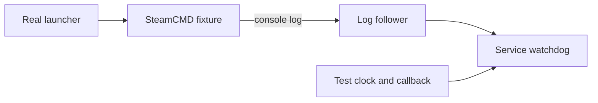
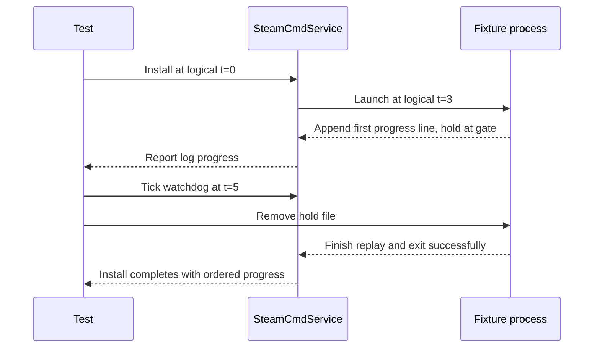

# Design

## Triage

| Trigger | Applies? | Evidence |
|---|---|---|
| T1 Components | Yes | The test crosses the launcher, child fixture, log follower and service watchdog (`apps/yagurad/test/support/steam_support.dart:75-129`, `apps/yagurad/test/fixtures/fake_steamcmd/fake_steamcmd.dart:309-329`, `apps/yagurad/lib/src/steam/steamcmd_service.dart:887-922,969-981`). |
| T2 State | No | The watchdog timestamps and stop reason live within one call (`apps/yagurad/lib/src/steam/steamcmd_service.dart:854-885`). The test reuses an ephemeral fixture gate. |
| T3 Concurrency | Yes | The launcher awaits a real process, its output is read asynchronously, and the watchdog runs concurrently with the log follower (`apps/yagurad/lib/src/steam/steamcmd_service.dart:919-995`). |
| T4 Boundaries | Yes | The existing standalone child writes the console log while withholding stdout, and accepts a filesystem hold flag (`apps/yagurad/test/fixtures/fake_steamcmd/fake_steamcmd.dart:74-79,309-329`). The test still crosses that interface. |
| T5 Volume | No | The test replays the existing finite transcript (`apps/yagurad/test/fixtures/fake_steamcmd/output/update_ok.txt:9-17`); it adds no production data or work. |
| T6 Risk | No | The change does not alter the runtime process security, timeout defaults, or data handling. Existing constraints are in ADR 0014. |

TIER: FULL

## Context

`SteamCmdService` records the initial watchdog time before launching the child. Changed log progress refreshes that time. A periodic callback compares the most recent timestamp to `noProgressTimeout` and kills the child if the limit is reached. The service awaits the process exit, then cancels the watchdog and stops its log readers (`apps/yagurad/lib/src/steam/steamcmd_service.dart:854-901,923-942,969-1006`). Its defaults are fifteen minutes without progress and twelve hours in total (`apps/yagurad/lib/src/steam/steamcmd_service.dart:53-57`). Keep the production behavior required by `openspec/specs/steam-content/spec.md:85-94` and `docs/adr/0014-steamcmd-runs-as-a-low-privilege-account.md:12-17,23`.

The existing test starts the real Dart fixture through `SteamHarness`, makes the fixture pause 250 ms per line, and relies on a real four-second stall limit and elapsed-time assertions (`apps/yagurad/test/steam/steamcmd_runs_are_bounded_and_cleaned_up_test.dart:93-127`, `apps/yagurad/test/support/steam_support.dart:96-129`). The fixture already supports holding immediately after its first progress line until the test removes a per-run file (`apps/yagurad/test/fixtures/fake_steamcmd/fake_steamcmd.dart:309-329`). The line is recognized as download progress with the embedded patterns (`apps/yagurad/test/fixtures/fake_steamcmd/output/update_ok.txt:9-10`, `apps/yagurad/lib/src/steam/patterns.yaml:17-28`, `apps/yagurad/lib/src/steam/steam_patterns.dart:234-246`).

## Decisions

### D1: Drive the existing watchdog through two optional time inputs

- **Choice:** Give `SteamCmdService` an optional `DateTime Function()` and periodic watchdog timer factory; default to `DateTime.now` and `Timer.periodic`. Use the clock for `_execute`'s start, progress, signal and watchdog timestamps. The log follower and the rest of the service keep their current time source and scheduling. The test registers a manual timer, completes a barrier on registration, and invokes its callback explicitly.
- **Rejected:** Intercept all timers in a Dart zone or replace the watchdog with a fake process. A zone would also intercept unrelated timers; a fake process would not exercise the child log while stdout is held back.
- **Reversal cost:** low; one constructor seam and its test callers.
- **Important:** no; no new dependency or production default.
- **Chosen by:** agent.

### D2: Hold the real child at its first progress line

- **Choice:** Reuse the fixture's hold file. Start logical time at zero so `_execute` records its pre-launch timestamp at `t=0`. Move the clock to `t=3` before delegating to the real launcher and hold it there until both the watchdog is registered and the reporter receives the first parsed log progress. Tick at `t=5` while the flag is still held. From the pre-launch timestamp, five seconds exceeds the four-second budget: a stale timestamp raises `steam_stalled` with `limit: no_progress`. With the refreshed `t=3` timestamp, only two seconds have elapsed. Release the child and assert ordered progress, a successful install and one child run.
- **Rejected:** Add delay margins, repeat on failure, or assert that progress happened a fixed wall-clock interval before exit. All depend on the runner's time to launch or schedule a process.
- **Reversal cost:** low; the fixture protocol already exists.
- **Important:** no; this preserves the existing test intent and real process coverage.
- **Chosen by:** agent.

### Decision summary

| # | Decision | Choice | Rejected | Reversal cost | Important | Chosen by |
|---|---|---|---|---|---|---|
| S1 | Fix scope | Standalone test repair with real child and log | Rerun, raise limit, or fold into upgrade | Low | Yes | User |
| D1 | Watchdog time | Inject clock and callback registration only | Zone-wide interception or fake process | Low | No | Agent |
| D2 | Proof of progress | Hold at first real log report and tick past the original deadline | Real-time assertions or retries | Low | No | Agent |

## Assumptions

- **A1:** The controlled test exercises the former failure path: if the watchdog compares against the initial time despite the progress event, the five-second tick fails the install. Confirm it using the unchanged real fixture and a single targeted fault check or equivalent deterministic red evidence before accepting the green result.

## Carried constraints

- **C1:** The injected clock and timer apply only to watchdog behavior in `_execute`; production retains its time sources and scheduling. Kind: invariant. Destination: `doc comment: apps/yagurad/lib/src/steam/steamcmd_service.dart SteamCmdService.new`.

## Diagrams (FULL)

The first diagram covers T1 and T4; the sequence covers T3. Await the timer registration and first report without prescribing their order.

## State & Ownership (FULL)

| State | Owner | Lifetime | Invalidation | Authoritative copy |
|---|---|---|---|---|
| Logical time and callback | The test's manual clock and timer | One test | Test releases or cancels after the run | Local test object |
| Progress and timeout decision | `SteamCmdService._execute` | One child run | Progress updates the timestamp; run completion cancels the timer | Service's local run state |
| Hold flag | Test | One child run | Removed to allow replay and in cleanup on failure | File below test temp root |

## Failure & Visibility (FULL)

| Component | Failure | Recovery | Retry safe? | Who finds out |
|---|---|---|---|---|
| Child launch or log delivery | Install fails, completes early without the two readiness events, or stays pending | Race readiness against both successful and failed install completion. Early success is itself a test failure; early error surfaces with its original stack. A single outer test timeout detects a hang. | No automatic retry | Test runner |
| Watchdog | Stale timestamp causes the manual tick to kill a progressing run | Await install and report the real error; do not suppress it | No retry | Test runner |
| Test exits early or its hang guard fires | A child is held, starting, or settling | Pre-register teardown. Request cancellation with this install's token, release its hold file, then await install settlement before deleting its directory. Cancellation stays latched even if the process handle arrives later. | Cleanup is safe | Test runner |

## Resource Bounds (FULL)

One real child, one held fixture file and one registered watchdog callback. The fixture replays a finite transcript. The existing follower bounds bytes per poll, line length and retained lines; real periodic log polling continues while the test waits (`apps/yagurad/test/fixtures/fake_steamcmd/output/update_ok.txt:1-17`, `apps/yagurad/lib/src/steam/steam_log_follower.dart:30-47,75-89`). Scheduler delays do not change the logical-time assertion when both readiness events arrive within the outer guard.

## Flow & State Gaps (FULL)

- Before starting the install, register teardown ahead of harness and directory teardown. Race the two readiness events against the install settling: fail immediately if install succeeds too early, or surface its original error and stack if it fails. With the gate still held, fire the controlled tick before releasing the child. If the test fails or its outer guard fires, cancellation must stay active across a pending launch; release the file gate and await install settlement before directory deletion.
- Keep a single top-level test hang guard. Do not use child startup time, internal fixture sleeps, polling attempt counts, or test timeout expiry as evidence of behavior.

## Mechanism Ledger (FULL)

| Mechanism | Built? | Why | Evidence that would change it |
|---|---|---|---|
| Clock and injectable watchdog schedule | Yes | The existing test failed before the fixture could deliver progress | An existing seam that independently controls watchdog time |
| New fixture gate protocol, test dependency, or retry | No | The fixture already has a gate and the service exposes real progress | A verified inability to observe real progress using the existing gate |

## Risks / Trade-offs

A green-only test can pass if it never invokes the watchdog or moves time after the child exits. Trigger the callback while the child is held and prove the test fails when that tick uses stale progress.

## ADRs

- **In force:** ADR 0014; process and deadline policies remain unchanged.
- **To record during apply:** None.
