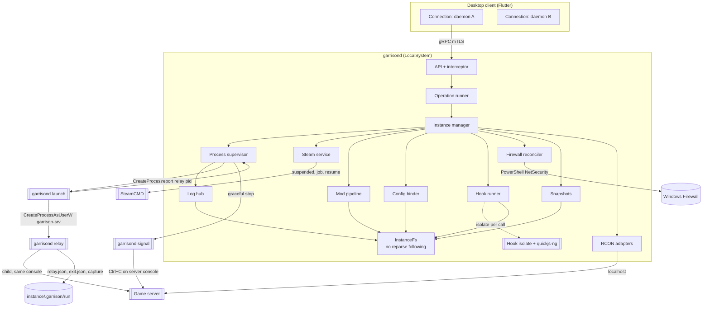
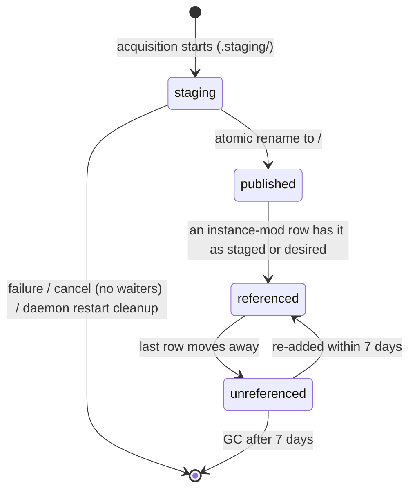
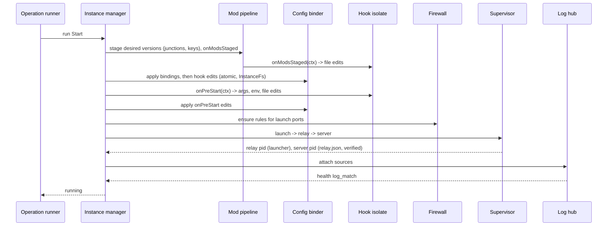
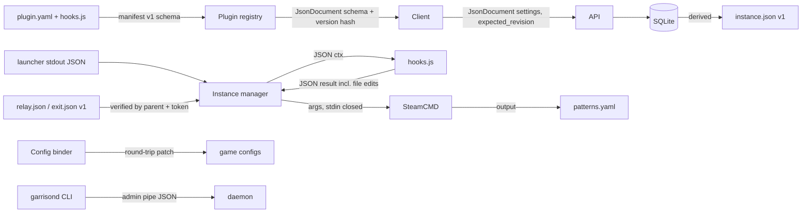

# Design

## Triage

| Trigger | Applies? | Evidence |
|---|---|---|
| T1 Components (new component, or 3+ with directed relationships) | yes | New system: daemon with ~13 components, launcher/relay/signal entry points, hook workers, SteamCMD, game servers, desktop client (`openspec/architecture.md` Components) |
| T2 State (persistent state, caches, 3+ state machine) | yes | SQLite state, versioned content store, 8-state instance machine with error reasons, operation queues, device certificates, snapshots |
| T3 Concurrency (background work, workers/isolates, async, retries) | yes | Per-instance operation queues, heavy-operation slots, SteamCMD installation locks, hook isolates with watchdogs, log tailers, RCON reconnect, mod update timer |
| T4 Boundaries (data format, migration, shared interface, IPC, external) | yes | gRPC `garrison.v1`, local admin channel, plugin manifest v1 + hook contract, config formats, `instance.json`, launcher report and relay files, SteamCMD output, OS firewall/service/DPAPI/account APIs |
| T5 Volume (grows without a fixed bound) | yes | Logs, operation events and history, audit log, workshop content versions, snapshots |
| T6 Risk (security, money, data loss, unrecoverable user data) | yes | Remote admin over the network, Steam credentials, firewall changes, SYSTEM file operations next to an untrusted account, world saves |

TIER: FULL

## Context

Greenfield: no code exists. The baseline in `openspec/architecture.md` (components, instance state machine, state ownership, contracts, failure and recovery, resource bounds) and ADRs 0001-0013 (`docs/adr/`, accepted after two baseline review rounds) are the frame; this design does not restate them. The protocol is `proto/garrison/v1/*.proto`, explained in `docs/protocol.md`; flows are in `docs/overview.md`.

Where this design refines a baseline table (the error-state exits in D17, the bounds in Resource Bounds), the refinement is authoritative for this change and task 21.3 writes it back into `openspec/architecture.md`.

Verified on 2026-10-16 against package docs and source: `package:grpc` server supports `requestClientCertificate`/`requireClientCertificate`, exposes `ServiceCall.clientCertificate`, and enforces a server keepalive policy (configured per ADR 0009 review, `docs/protocol.md`); Dart build hooks exist since Dart 3.10 and `native_toolchain_c` compiles C sources; `dart:io` `Process.start(detached)` on Windows sets only `DETACHED_PROCESS` (hence ADR 0009's native spawn); `quickjs_runtime` 0.3.6 has no Windows build path and no interrupt or memory limit; `x509` 0.2.4 lists `TbsCertificate` and `Signer`; WinSW 2.x is the stable line.

Unverified assumptions, each closed by a spike task in `tasks.md`: MSVC compile of quickjs-ng through `native_toolchain_c` (1.2); Ctrl+C delivery to a server on the relay's console and Valheim saving on it (1.3); TLS rejection of untrusted client certificates in request mode and `x509` signing (10.1); WinSW leaving relays running, the relay console starting as `garrison-srv` on its own window station, and `garrisond signal` running as LocalSystem delivering Ctrl+C to that console (Valheim saves) (11.3); SteamCMD Steam Guard behaviour with stdin closed (14.1); SCUM's reaction to Ctrl+C (19.3).

## Decisions

### D1: Dart pub workspace with apps, packages and plugins in one repo

- **Choice:** one repository, a pub workspace: `apps/garrisond` (daemon, AOT), `apps/garrison_desktop` (Flutter), `packages/garrison_proto` (generated from `proto/`), `packages/garrison_js` (quickjs-ng FFI + build hook), `packages/garrison_formats` (parsers), `packages/garrison_plugin` (manifest model, validation, templates; also behind `garrison plugin lint`), `plugins/<id>/`, `schemas/plugin-manifest.v1.json`, `tool/`.
- **Rejected:** separate repositories per app because protocol and manifest changes would need coordinated releases before any external consumer exists.
- **Reversal cost:** low.

### D2: One binary, four entry modes, implementing ADR 0009

- **Choice:** `garrisond` dispatches on its first argument: `run` (default; `--console` for development without a service account), `launch`, `relay`, `signal`. `launch` (service mode) logs on `garrison-srv`, loads its profile, builds its environment, and starts the relay with `CREATE_NEW_CONSOLE | CREATE_BREAKAWAY_FROM_JOB` (no `CREATE_NEW_PROCESS_GROUP`) on window station/desktop `GarrisonSrv\Default`; it writes `{relay_pid, relay_created}` as one JSON line to its stdout and exits. `relay` calls `SetConsoleCtrlHandler(NULL, FALSE)` to clear any inherited ignore flag, installs a handler that returns TRUE for itself, starts the server without `CREATE_NEW_PROCESS_GROUP` on the same console with stdout/stderr pipes, writes `relay.json` (relay and server PID, start times, executable paths; no command line) and later `exit.json`. `signal --console-of <server pid>` (falling back to the relay pid) attaches and calls `GenerateConsoleCtrlEvent(CTRL_C_EVENT, 0)`; the helper ignores the event itself (`SetConsoleCtrlHandler(NULL, TRUE)` in the helper only) and exits 0 after `GenerateConsoleCtrlEvent` returns. On Linux, `launch` asks systemd for a transient scope (`StartTransientUnit`) and `signal` sends SIGTERM to the server. Win32 calls sit behind a `ProcessHost` interface.
- **Rejected:** separate helper executables because they add build and signing targets while sharing all their code with the daemon.
- **Reversal cost:** low.

### D3: Operations are persisted rows driven by an in-memory runner

- **Choice:** each request inserts an operation row (`queued`) and enqueues it on the instance's FIFO (10 queued max, `queue_full`). Heavy operations are `install`, `update`, `validate`, `apply_mods` and `update_mods`; one of 4 host heavy slots is taken only when the operation is about to start real work, per step: a step acquires the SteamCMD installation lock it needs, then a heavy slot, and releases both when the step ends; no step holds a lock or slot while waiting for another installation's lock; while waiting the operation reports step `waiting_for_steamcmd` with its position. Events get per-operation sequence numbers; `Progress` events are coalesced per step (only the latest is retained), other events are retained up to 2,000 per operation. A resume below the retained window starts with `events_dropped{from,to}` followed by the current `Operation`. Terminal state is persisted; at startup unfinished operations become `interrupted` (D9).
- **Rejected:** a durable, resumable job queue because SteamCMD runs, hooks and spawns are not resumable and half-resumed work is riskier than an explicit retry.
- **Reversal cost:** low.

### D4: Hook worker is a fresh isolate per call, bounded from inside, with leak accounting

- **Choice:** each hook call takes one of 4 worker slots (waiting for a slot does not count against the hook deadline; the wait is bounded by the operation's own cancellation), spawns an isolate, creates a quickjs-ng runtime with 64 MiB heap, 1 MiB stack and an interrupt handler on a monotonic deadline, registers the pure `garrison.*` host functions, runs the hook and frees the runtime. A watchdog fires at deadline + 2 s: the operation fails with `hook_timeout`, the slot is released, `Isolate.kill` is requested, and if the isolate has not exited 5 s later it is counted as leaked. `GetHealth` reports leaked workers; at 2 leaked, hooks are refused with `hook_runtime_degraded` until the daemon restarts.
- **Rejected:** a warm runtime pool because state can leak between calls and instances, and hooks run a few times per operation.
- **Reversal cost:** low.

### D5: Settings schema version is a content hash

- **Choice:** `schema_version` = first 32 bits of SHA-256 of the canonical settings-schema JSON, so a reload that changes the schema changes the version.
- **Rejected:** a manually bumped number because authors forget to bump it and stale forms write removed fields.
- **Reversal cost:** low.

### D6: Log tailers poll files without following links

- **Choice:** each source is tailed by polling (250 ms while followed, 2 s otherwise) with handles opened under the trust-boundary rules (D13), truncation detection, `newest` switching by creation time, offsets persisted every 10 s.
- **Rejected:** `FileSystemEntity.watch` because change notifications are unreliable for appended data on some Windows volumes.
- **Reversal cost:** low.

### D7: SteamCMD runs are serialised per installation; only content-store items are single-flight

- **Choice:** the Steam service holds one lock per SteamCMD installation; app runs are keyed `(app, branch, instance directory)` and queue on the lock, so two instances of the same app each get their own run into their own directory. Single-flight applies only to content-store acquisitions, keyed `(source, app, item, version)`: concurrent requesters attach as waiters; cancelling one detaches it, and the shared run is killed only when no waiter remains. SteamCMD is spawned suspended, assigned to the daemon's kill-on-close job, then resumed, so its self-update relaunch cannot escape the job.
- **Rejected:** single-flight for app installs because each instance has its own target directory; joining would report success for an empty directory.
- **Reversal cost:** low.

### D8: Workshop metadata from the Steam Web API, downloads through SteamCMD

- **Choice:** titles, sizes, `time_updated` and visibility from `ISteamRemoteStorage/GetPublishedFileDetails` (no key), batched 100 items, 1 request/s; downloads always through SteamCMD.
- **Rejected:** parsing SteamCMD workshop output because it does not report `time_updated` reliably.
- **Reversal cost:** low.

### D9: Startup separates fatal steps from degraded ones

- **Choice:** fatal (exit non-zero, nothing served): data-directory lock (`LockFileEx`/`flock` on `garrisond.lock`, released by the OS when the holder dies; the PID inside is informational), database open and migration, secret store, daemon identity. Degraded (listener still opens, notice + `GetHealth` flag): stray SteamCMD sweep, plugin load failures, `.staging` cleanup, state recovery (`installing` → `not_installed`; `updating` → `error: update_interrupted`; `starting`/`running`/`stopping` → re-attach under D13 checks, else `stopped` or crash handling), firewall reconcile, log tailing, autostart (D14), `instance.json` rewrite. Per-instance failures affect only that instance.
- **Rejected:** "any failure before the listener exits" because a stopped firewall service would make WinSW restart the daemon in a loop and the admin could not connect to see why.
- **Reversal cost:** low.

### D10: Desktop client state per daemon connection

- **Choice:** one connection object per paired daemon owns its `WatchInstances` stream and snapshot cache; views subscribe through Riverpod providers keyed by daemon id; forms come from a schema-to-widget renderer with a read-only fallback. The connection renews the device certificate when under 30 days remain.
- **Rejected:** per-view polling because it multiplies calls and shows stale state.
- **Reversal cost:** low.

### D11: Plugins ship with the daemon and may be overridden locally

- **Choice:** reference plugins are installed into `<data>/plugins/` and updated with the daemon unless locally modified (shipped-file hashes compared, changed plugins skipped and reported).
- **Rejected:** a plugin download service because there is no second plugin author yet.
- **Reversal cost:** low.

### D12: Snapshots are directory copies on the snapshots volume

- **Choice:** snapshots copy `data_paths` into `<snapshots root>/<instance>/<id>/` (default `<data>/snapshots`, configurable per host) with a manifest; the free-space check is made on the snapshots volume. Retention: last 3 per instance; a snapshot being restored is pinned against pruning until the restore ends; `pre_delete` snapshots of deleted instances are kept 30 days and listed through `ListOrphanSnapshots`. `skip_snapshot` on Update is allowed, audited, and recorded in the operation result as `snapshot: skipped`.
- **Rejected:** zip archives because compressing multi-GB worlds would dominate update time.
- **Reversal cost:** low.

### D13: Trust boundary inside instance directories (implements ADR 0013)

- **Choice:** all daemon file access under an instance directory goes through one `InstanceFs` component: paths are opened relative to the instance root handle with `FILE_FLAG_OPEN_REPARSE_POINT`, each component is checked for reparse points, the final path is verified with `GetFinalPathNameByHandle` against the allowed root, and any reparse point other than a recorded mod junction (re-verified against its expected content-store target) fails with `sandbox_violation`. Recursive delete and snapshot copy never descend into reparse points. Atomic writes create the temp file through the same handle-relative path. During install, update and validate, the daemon removes `garrison-srv`'s access entry from the target instance root (the instance has no running server), runs the reparse-point check, runs `app_update`, re-runs the check, and only then restores the ADR 0013 ACL; a failure at any point leaves the ACL removed and the operation fails with `sandbox_violation` or its own reason. This holds against other instances' servers, which run as the same account. Process records: the relay PID comes from the launcher's report; the server PID from `relay.json` is accepted only if its parent is the recorded relay and its token user is `garrison-srv` (console mode: the current user); every terminate re-checks the token user. If `relay.json` fails verification, the daemon identifies the server as the verified relay's child running as `garrison-srv` (by parent PID and token user); if none is found, it terminates the verified relay, whose exit ends its console's processes, and reports `error` with reason `run_record_rejected`.
- **Rejected:** running file operations impersonating `garrison-srv` because the daemon must also write files (keys, configs) that the account should only read, and impersonation does not stop junction-based reads of SYSTEM-only files for operations that legitimately run as SYSTEM.
- **Reversal cost:** medium.

### D14: Instances that were running restart after a host or daemon restart

- **Choice:** each instance has `autostart` (default true). At startup, an instance whose last requested state was running (persisted when Start succeeds, cleared on Stop) and that is not running after re-attach is started through the normal Start operation, subject to the restart policy, 10 s apart per instance to avoid a thundering start. Instances in `error` are not autostarted; entering `error: crash_loop` clears the last requested state.
- **Rejected:** no autostart in v1 because Windows Update reboots are routine and every server would stay down until the admin notices.
- **Reversal cost:** low.

### D15: Instance stream sends slim deltas

- **Choice:** `WatchInstances` deltas omit `settings` (`settings_omitted: true`) unless settings changed; clients fetch with `GetInstance` on demand. Each subscriber queue is bounded at 1,000 events and 8 MiB, whichever comes first, then `resync_required`. Mod update counts travel on `Instance` (`mods_update_available`).
- **Rejected:** full documents on every state flip because 32 stalled subscribers × 1,000 large documents can reach gigabytes.
- **Reversal cost:** low.

### D16: Firewall desired state follows launched ports while running

- **Choice:** desired rules exist for every installed instance (not `not_installed`), for its exposed ports: while running, the ports the process was launched with; otherwise the saved ports. A port change on a running instance is saved, marks `restart_required`, and the rules change at the next start. Rule names stay `Garrison/<id>/<port-name>/<proto>`.
- **Rejected:** opening the new port immediately and keeping the old one because both rules would have the same name, and closing the old one at once cuts off connected players.
- **Reversal cost:** low.

### D17: Error-state reasons and their exits

- **Choice:** `error` always carries a reason, and each reason allows specific exits (this table refines the architecture state machine):

| Reason | Allowed | Result |
|---|---|---|
| `crash_loop` | Start | `starting` (restart counter reset) |
| `crash_loop` | Acknowledge | `stopped` |
| `update_interrupted`, update failure | Update, Validate | `updating` |
| `update_interrupted`, update failure | Acknowledge | `stopped` (warning kept: files may be inconsistent) |
| `settings_invalid` | UpdateSettings with valid settings | `stopped` |
| `plugin_missing` | ReloadPlugins that restores the plugin | `stopped` |
| any | Stop, Delete | refused only while an operation runs |

Start from `error: settings_invalid` or `plugin_missing` fails `invalid_state`. A running instance whose settings become invalid on reload keeps running with flag `settings_invalid` and a notice; its next Start is refused.
- **Rejected:** a single generic `error` that any Start clears because it would restart a crash-looping or half-updated server without the admin seeing why.
- **Reversal cost:** low.

### D18: Cancellation and stop-while-busy

- **Choice:** cancellation takes effect at the next step boundary, except SteamCMD and health waits, which are interruptible. Outcomes: Install → `not_installed`; Update/Validate before `stop` → state unchanged; after `stop` → `stopped`, snapshot kept, not restarted; Start during health wait → `stopping` then `stopped` within the grace period; ApplyMods → staging re-run on next start. A Stop request cancels any queued Start/Restart ahead of it and the running Start, then runs next; it does not cancel queued Update/Install.
- **Rejected:** strict FIFO for Stop because an admin trying to stop a misbehaving server would wait behind restarts.
- **Reversal cost:** low.

### D19: Key files are owned per mod, never over an admin's key

- **Choice:** each placed key is recorded `(instance, file name, content hash, providing mods)`. A key is removed only when no staged mod provides it any more; if a file of that name exists and Garrison did not place it, it is never overwritten and the mod gets a `key_conflict` warning.
- **Rejected:** removing a mod's keys with the mod because dependants commonly ship the same key (CF), which would break other mods.
- **Reversal cost:** low.

### D20: Device certificates are rows, audit failures aggregated

- **Choice:** `device_certificates(device_id, sha256, not_after)`; a device can hold its current and previous certificate; revocation disables all of them. Authentication failures are aggregated per remote address per 10-minute window into one counted row in a separate table (10,000 rows), so they cannot evict audit rows of state-changing calls. Pairing throttle: 5 wrong codes per remote address per 10 minutes block that address (`pairing_throttled`); 50 wrong codes in total within 10 minutes invalidate the code. The server certificate is checked daily and rotated in place (listener rebind) when under 30 days remain.
- **Rejected:** one certificate fingerprint per device because renewal would then reject one of the two valid certificates.
- **Reversal cost:** low.

### D21: Instance directories are placed and ACL'd by the daemon

- **Choice:** create and import accept a directory only under a configured instance root (default `<data>/instances`; admins add roots with `garrisond roots add`), not overlapping another instance, the data directory, the content store, the snapshots root or a system directory (`directory_not_allowed`). The daemon applies the ADR 0013 ACLs on create and import.
- **Rejected:** any path the client sends because an ACL grant or `delete_files` on a mistyped `D:\` would hit unrelated data.
- **Reversal cost:** low.

## Diagrams (FULL)

### T1 Components: process view

### T2 State

The instance state machine is the one in `openspec/architecture.md` (Instance state machine), with the error-reason exits of D17. The content-store version lifecycle:

### T3 Concurrency: start operation

### T4 Boundaries

## State & Ownership (FULL)

The system table is in `openspec/architecture.md`. Additions and refinements:

| State | Owner (sole writer) | Lifetime | Invalidation / rebuild | Authoritative copy |
|---|---|---|---|---|
| Per-instance operation queue | Operation runner | Daemon process | Unfinished rows become `interrupted` at startup (D9) | SQLite (terminal), memory (order) |
| Operation events | Operation runner | Until the operation is pruned | Progress coalesced per step; others ≤ 2,000; `events_dropped` on gaps (D3) | Memory; terminal persisted |
| Relay record | Process supervisor | One run | From the launcher report | Launcher report |
| Server record | Process supervisor | One run | Accepted from `relay.json` only after parent and token checks (D13) | Verified copy in SQLite |
| Last requested state (for autostart) | Instance manager | Instance lifetime | Set on successful Start, cleared on Stop | SQLite |
| Error reason, `settings_invalid` flag | Instance manager | Until an allowed exit (D17) | — | SQLite |
| Instance-mod `staged_version`, `desired_version` | Mod pipeline | Until removed | `staged := desired` on staging while stopped | SQLite |
| Placed keys | Mod pipeline | While a staged mod provides them | Recomputed at each staging (D19) | SQLite |
| Device certificates | Pairing + CA | Until `not_after` or revocation | Renewal adds a row | SQLite |
| Auth-failure aggregates | API server | 10,000 rows | Oldest pruned | SQLite (separate table) |
| Snapshot rows + files | Snapshots | Last 3 per instance; orphans 30 days | Pinned while restoring (D12) | Disk + SQLite |
| Leaked hook worker count | Hook runner | Daemon process | Reset on restart | Memory |
| Instance roots | Instance manager (via admin channel) | Host | — | SQLite |

## Failure & Visibility (FULL)

System-level rows are in `openspec/architecture.md` (Failure and recovery). Additions:

| Component | Fails / dies mid-operation → | Recovery | Retry safe? | Who finds out |
|---|---|---|---|---|
| Startup step (non-fatal, D9) | Firewall, plugin load, re-attach, autostart fails | Listener opens; component retried on its own schedule | Yes | Client notices; `GetHealth` flags |
| Hook worker stuck in native code | Watchdog fires; isolate does not exit | Slot released, leak counted; at 2 leaks hooks refused until restart (D4) | Yes after restart | Client `hook_timeout` / `hook_runtime_degraded`; `GetHealth.leaked_hook_workers` |
| InstanceFs check | Reparse point found | Operation fails `sandbox_violation` naming the path | After the admin removes it | Client error; audit entry |
| Launcher | Logon or desktop setup fails | Start fails `launch_logon_failed` / `launch_failed` with the Win32 error | Yes | Client error |
| Snapshot | Copy fails mid-way | Partial snapshot directory deleted; operation fails before any destructive step | Yes | Client error |
| Shared workshop download | One waiter cancels | Waiter detached; run continues for others | Yes | Cancelling client sees `cancelled` |
| Autostart | Start fails after reboot | Normal Start failure handling; no retry loop beyond the restart policy | Yes | Client notice |
| `instance.json` write | Fails after DB commit | Call succeeds; warning event; rewritten at next change and at startup | Yes | Client warning |

## Resource Bounds (FULL)

System-level bounds are in `openspec/architecture.md` (Resource bounds). This design adds or refines (refinements marked *):

| Queue / buffer / cache / transfer | Bound | At the bound | Timeout | At 10x / 100x |
|---|---|---|---|---|
| Per-instance operation queue | 10 queued | `RESOURCE_EXHAUSTED` / `queue_full` | — | 200 instances × 10 rows |
| Heavy slots* | 4 per host, taken after any SteamCMD lock is held | Wait with `waiting_for_steamcmd` / queue position | Stall timer starts when SteamCMD starts | Anonymous-installation games serialise; documented |
| Operation events* | Progress coalesced per step; other events 2,000 per operation | `events_dropped` marker on resume | — | 12 h install ≈ hundreds of non-progress events |
| Hook workers* | 4 slots; 2 leaked workers max | Queue (not counted in deadline) / `hook_runtime_degraded` | Deadline + 2 s watchdog | — |
| WatchInstances subscriber* | 1,000 events or 8 MiB | `resync_required` | — | 32 × 8 MiB = 256 MiB worst case |
| Auth-failure aggregates* | 10,000 rows, one per address per 10 min | Oldest pruned | — | Scanner floods do not touch the audit table |
| Pairing attempts* | 5 per address / 10 min; 50 total / 10 min | Address blocked / code invalidated | — | — |
| Snapshots* | 3 per instance; orphans 30 days; space check on the snapshots volume | Oldest pruned (never the one restoring) / `insufficient_disk` | — | Large worlds: admin moves the snapshots root |
| Workshop metadata | 100 items/request, 1 request/s | Batched | 15 s per request | 1,000 mods = 10 requests |
| Mod update timer | every 6 h ± 30 min | — | — | — |
| Console subscribers | 8 per instance | `too_many_subscribers` | — | — |
| Firewall PowerShell | 1 at a time, 30 s, one batched script per reconcile | Queued | `firewall_unavailable` | — |
| Autostart | 1 start per 10 s | Spaced | Normal start timeout | 20 instances ≈ 3 min after boot |

## Flow & State Gaps (FULL)

- **Daemon restart mid-operation:** D9; operations `interrupted`.
- **Two clients edit settings:** `expected_revision`; the revision changes only on configuration changes, so runtime state never causes a conflict; the loser gets `revision_conflict` and keeps its edits (desktop-client spec).
- **Settings changed while running:** saved, `restart_required`, applied at next start; ports per D16.
- **Plugin reload during an operation:** the operation keeps its manifest snapshot; reload effects per D17.
- **Mod list changed while staging:** staging uses the list captured at operation start.
- **Two instances need the same workshop item version:** single-flight with waiter detach (D7). Two instances installing the same app: separate runs (D7).
- **GC vs a new reference:** GC holds the mod pipeline lock and skips versions referenced after its scan started; both staged and desired versions count.
- **Stop while busy:** D18.
- **Update needing two installations (app anonymous, workshop account):** locks and slots are taken per step, so no circular wait.
- **Steam Guard answered by two devices:** first answer wins; the others receive `PromptResolved` and their answer fails `prompt_resolved`.
- **Hook edits a bound file:** bindings first, then hook edits, final hash recorded.
- **Relay killed, server alive:** `capture: broken`; file logs continue.
- **Host reboot:** D14 autostart.
- **Clock changes:** monotonic clocks for deadlines, windows and timers.
- **Instance directory deleted by hand:** next operation fails `instance_directory_missing`.
- **Secret bound into a config edited by hand:** the `external_edit` event masks values of keys bound to secret settings.

## Mechanism Ledger (FULL)

| Mechanism | Built? | Why (harm nobody catches / expensive later) | Evidence that would change the call |
|---|---|---|---|
| Relay + launcher (ADR 0009, D2) | yes | Without them servers die with the daemon, stdout is lost and graceful stop is impossible | — |
| InstanceFs reparse checks (D13) | yes | A compromised server could turn SYSTEM file operations into host takeover | — |
| ACL withdrawal during SteamCMD runs | yes | other instances' servers share `garrison-srv` and could plant junctions SteamCMD (SYSTEM) follows | per-instance accounts |
| Token-user check before terminate (D13) | yes | A forged `relay.json` could kill any process | — |
| Hook watchdog + leak cap (D4) | yes | A native hang would otherwise block every hook forever | — |
| Atomic config writes | yes | Truncated configs after a crash | — |
| Single-flight for content items (D7) | yes | Concurrent SteamCMD runs into one store directory corrupt it | — |
| Versioned content store + staged/desired refs | yes | Updates under running servers; GC deleting live files | — |
| Settings schema version hash (D5) | yes | Stale forms write removed fields | — |
| Instance revisions | yes | Silent overwrites between clients; expensive to add to the API later | — |
| Pre-update / pre-delete snapshots (D12) | yes | Broken updates or deletes destroy unrecoverable worlds | — |
| Autostart after restart (D14) | yes | Routine reboots leave every server down | Admins report unwanted starts |
| Key ownership per mod (D19) | yes | Removing one mod breaks another via shared keys | — |
| Auth-failure aggregation (D20) | yes | Scanner traffic erases audit evidence | — |
| Field-level merge of concurrent edits | no | Conflicts are rejected and the client keeps edits | Two admins editing one instance regularly |
| Scheduled backups and restarts | no | Out of v1 scope (strategy) | Admin requests |
| Plugin signing / marketplace | no | Plugins installed by the admin | Remote plugin install |
| Roles per device | no | All paired devices are trusted admins | A moderator user |
| CRL / OCSP | no | Revocation checked per call | Third-party verifiers |
| Resumable operations | no | Steps are not resumable (D3) | Large installs cut repeatedly by restarts |
| Metrics endpoint | no | Health visible in client and `GetHealth` | Admin runs monitoring |
| Hook async / timers | no | Hooks are short (ADR 0003) | A game needs waiting in a hook |

## Risks / Trade-offs

- [quickjs-ng does not build with MSVC through `native_toolchain_c`] → spike 1.2; fallback clang-cl, then a CI-built DLL loaded by path.
- [Ctrl+C does not reach the server on the relay console] → spike 1.3 before the process model is built; fallback: RCON or `kill` with a warning that the plugin cannot stop gracefully, which blocks the Valheim exit criterion and is escalated.
- [TLS request mode accepts unknown client certificates] → spike 10.1; fallback: separate pairing listener (`docs/protocol.md`).
- [WinSW stops relays or `garrison-srv` consoles fail to start] → spike 11.3; fallback: native service entry point (ADR 0012).
- [SteamCMD output wording changes] → patterns are data; unknown output shown raw and never retried blindly.
- [Junctions in instance dirs confuse a game or anti-cheat] → `copy_fallback`; verified with BattlEye in task 17.3.
- [`garrison-srv` lacks a right a game needs] → `data_paths` keep saves in the instance; every reference plugin runs under the account before M2 closes.
- [Umbrella change spans five milestones] → task groups tagged by milestone; roadmap explains how remaining groups move at each close.

## ADRs

- **In force, constraining this change:** 0001-0013.
- **To record during apply:** none.

## Open Questions

- Default bind address: all interfaces or the first non-loopback address? Answerable at M2 without changing specs.
