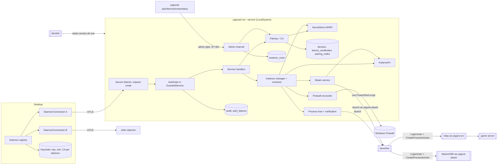
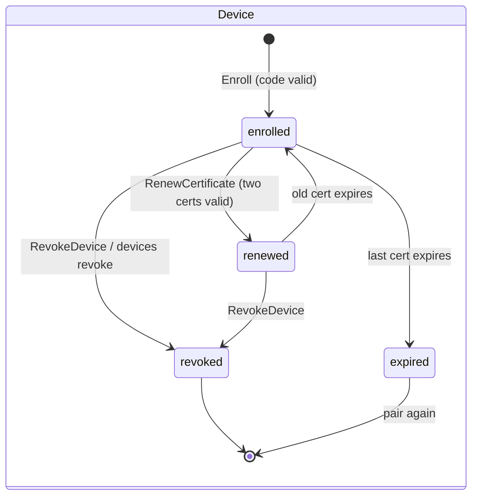
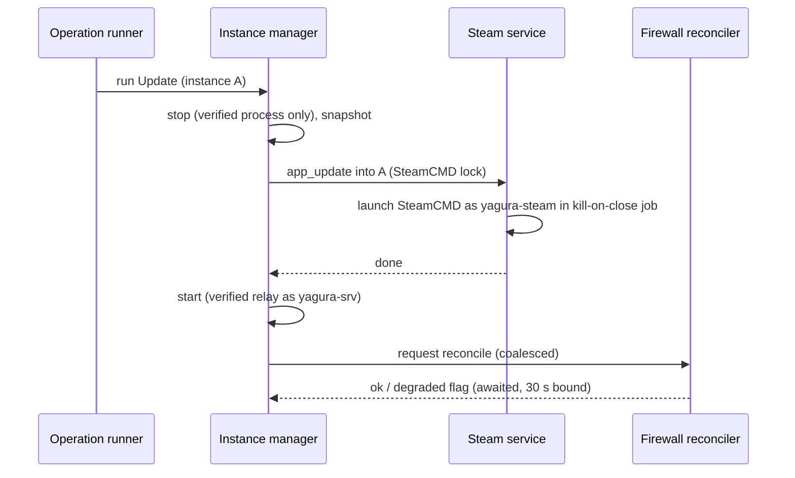
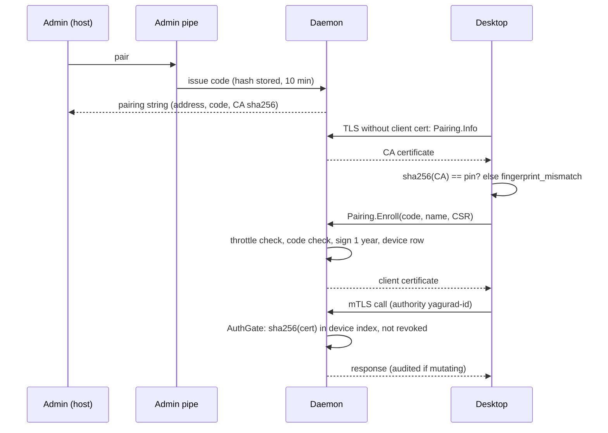

# Design

## Triage

| Trigger | Applies? | Evidence |
|---|---|---|
| T1 Components (new component, or 3+ with directed relationships) | yes | New: secret store, pairing + CA, auth gate, audit, local admin channel, firewall reconciler, InstanceFs, service installer, `yagura-srv` launch path; desktop daemon registry. None exist today (`api/stub_apis.dart:11-34`, no pipe server or DPAPI code) |
| T2 State (persistent state, caches, 3+ state machine) | yes | New tables (secrets, devices, device certificates, pairing codes, audit, auth failures, instance roots), the `revision` column (`instances/instance.dart:124` hard-codes 0), launched ports on runs, instance ACL state, the client's daemon list and keychain entries |
| T3 Concurrency (background work, workers/isolates, async, retries) | yes | Firewall reconcile queue, daily certificate checks (server and client), revocation closing open streams, pairing throttles, SteamCMD runs under their own account, concurrent revisioned writes, several client connections |
| T4 Boundaries (data format, migration, shared interface, IPC, external) | yes | mTLS and pairing over `proto/yagura/v1/pairing.proto`, admin pipe JSON (`admin_api: 1`), migration 4, WinSW XML, NetSecurity PowerShell, DPAPI, LogonUser/CreateProcessAsUser, NTFS ACLs |
| T5 Volume (grows without a fixed bound) | yes | Audit log, authentication failures, owned firewall rules, paired devices |
| T6 Risk (security, money, data loss, unrecoverable user data) | yes | Remote admin over the network, the CA key, firewall changes, SYSTEM file operations next to an untrusted account, terminating processes |

TIER: FULL

## Context

Scope and motivation: `proposal.md`. Baseline: `openspec/architecture.md` and ADRs 0001-0013. This design moves `platform-backlog` design rows D13, D16 and D20 (renumbered here) and grounds them in the code M1 built.

What M1 left in place:

- **Startup and listener.** `run_command.dart:133-142` refuses to start without `--dev` (`secure_mode_unavailable`). `Daemon.start` runs fatal steps (data dir, lock, database: `host/daemon.dart:149-157`), then degraded steps (`:234-265`). `ApiServer` serves plaintext only (`api/api_server.dart:73`), with `SystemApi(devMode: true)` hard-coded (`:43`).
- **No interceptor hook.** `YaguraGrpcServer` (`api/pressure.dart:364-394`) builds each call with `interceptors: const []` (`:314-315`), so interceptors passed to `Server.create` are ignored. Per-method wrapping lives in `GuardedService`/`GuardedMethod` (`api/service_support.dart:15-109`). The client certificate and remote address do reach the call (`pressure.dart:389-390`).
- **The protocol is already shaped for M2.** `Pairing` (Info, Enroll, ListDevices, RevokeDevice, RenameDevice, RenewCertificate), `Firewall` (ListRules, Reconcile), `System.ListAudit`, `Instance.revision` and `expected_revision` on UpdateSettings, SetSecret, DeleteSecret and DeleteInstance (`instances.proto:140-166`) all exist as stubs or unread fields. The desktop already sends `expectedRevision` (`ui/settings_editor.dart:84-112`).
- **Secrets.** No store exists. `settings.dart:163-180` refuses any secret value, and `instance_manager.dart:318-333` throws on SetSecret/DeleteSecret.
- **Process model.** `WindowsProcessHost.launch` spawns `yagurad launch`, which starts `yagurad relay` (`process/launcher_modes.dart:27-60`). Identity is pid + creation time + executable (`process/process_host.dart:46-72`, `windows_process_host.dart:150-182`). There is no token-user or parent check, and the Win32 bindings (`platform/win32.dart`) have no security or logon APIs. The signal helper attaches to the relay's console (`launcher_modes.dart:231-254`).
- **Instance files.** `files/instance_root.dart:10-79` resolves paths through links and is documented as not race-proof (`:9`). Log tailing (`logs/source_tailer.dart`), `instance.json` writes (`instances/instance_file.dart:48-61`) and delete-with-files (`instance_manager.dart:114-117`, `lifecycle.dart:611-615`, a plain recursive delete) bypass it.
- **Instance roots.** Only `<data>/instances` exists. `instance_manager.dart:443` notes that configured roots arrive in M2.
- **Ports.** Purpose and exposed are already carried per port (`instance_manager.dart:370-392`, `instance_ports` in migration 1). No plugin declares an `rcon` port (only `plugins/valheim`).
- **Database.** Migrations are append-only (`host/migrations.dart`, 3 so far), run in one transaction with a `VACUUM INTO` backup (`host/database.dart:57-101`).
- **Desktop.** One hard-coded daemon (`providers.dart:11`, `kDevDaemonId`) over insecure credentials (`grpc_transport.dart:10-28`). Providers are already keyed by daemon id (`providers.dart:15-39`). The reconnect loop is `connection.dart:174-219`.
- **CI.** Windows and Ubuntu runners (`.github/workflows/ci.yml`). Windows-tagged tests run outside the runner's job object (`tool/ci/outside-job.ps1`), with no explicit elevation. CI minutes are limited, so the regular CI workflow runs only the unprivileged rows; the elevated and service-level rows run only in the manual `elevated` workflow (`.github/workflows/elevated.yml`, on a GitHub Windows runner, which runs as administrator), never on a developer's desktop.

Unverified assumptions, each closed by a spike task:

- **(S1)** Dart's `SecureServerSocket` in request mode (`requestClientCertificate: true`) lets a connection without a certificate complete the handshake, so `Pairing.Info`/`Enroll` can share the listener. Also, the `x509` package can sign a CSR. **Spike result (task 1.2, `docs/milestones/m2.md`):** the handshake part holds, and TLS refuses foreign-CA and expired client certificates once the daemon CA is the server's trusted root. The `x509` part fails: 0.2.4 drops extensions when encoding and cannot sign, so D1 takes its fallback.
- **(S2)** A relay started as `yagura-srv` on the `YaguraSrv\Default` desktop gets a console, and `yagurad signal`, running as LocalSystem, can attach to that console to send Ctrl+C. Also, WinSW leaves relays running on stop and upgrade.

## Decisions

### D1: Certificates from a small DER builder over `pointycastle`, one listener in request mode

- **Choice:** Follows ADR 0007 (its named fallback). A P-256 CA (20 years) and a server certificate for `yagurad-<daemon-id>` plus `localhost` (2 years), built and signed by a new workspace package `packages/yagura_pki`: a minimal DER encoder and parser plus certificate and PKCS#10 CSR building, signing and verification over `pointycastle` (`SHA-256/ECDSA`, signatures as DER `SEQUENCE {r, s}`, keys as SEC1 `EC PRIVATE KEY` PEM). The daemon uses it for the CA, server and client certificates and to verify CSRs; the desktop uses it for the device key and CSR (D13). Its tests check every built certificate and CSR by parsing it back and by a real TLS handshake.
  - **Listener.** It calls `serve(security:, requestClientCertificate: true)`, which exists in grpc 5.2.0 (`server.dart:253-254`), with a `ServerTlsCredentials` subclass that sets the daemon CA as the context's only trusted root (grpc's own sets none, and then every presented certificate is refused). TLS then refuses a certificate from another CA or an expired one at the handshake (spike S1); a connection without a certificate completes it.
  - **Trust.** TLS alone does not decide trust: the auth gate (D2) accepts a call only when the presented certificate's SHA-256 belongs to an enrolled, non-revoked device, and it checks expiry itself in case TLS lets one through.
  - **Certificate profile.** Yagura owns the builder, so the profile is fixed here. CA: `CA:true`, `pathLen:0`, keyCertSign and cRLSign. Server certificate: `CA:false`, serverAuth, DNS SANs `yagurad-<daemon-id>` and `localhost`. Client certificate: `CA:false`, clientAuth; only the subject public key comes from the CSR and must be P-256, and the daemon sets the subject and extensions itself, never copying requested ones.
  - **CSR rules.** `Enroll` (and `RenewCertificate`) parse the CSR only after the throttle and code checks (T4), so the hand-written DER parser is unreachable without a valid code or an authenticated device. A CSR with attributes, another key type or a bad signature fails `INVALID_ARGUMENT` reason `csr_invalid` and leaves the code unused. A `yagura_pki` test checks that TLS refuses a chain that uses a client certificate as an issuer.
- **Rejected:**
  - the `x509` package (the original choice): spike S1 showed 0.2.4 dropping extensions on encoding and corrupting the key OID, with no signing API.
  - a second listener on port + 1 for pairing: not needed, since request mode lets a certificate-less handshake through (spike S1).
- **Reversal cost:** low (contained in Pairing + CA).

### D2: The auth gate lives in the per-method wrapper, fail-closed

- **Choice:** `GuardedService` gets an `AuthGate` that runs before every handler. It reads `call.clientCertificate`, hashes the DER, looks the fingerprint up in an in-memory device index (rebuilt from SQLite on every device change), and rejects with `UNAUTHENTICATED` (reason `device_revoked` for a revoked device, `certificate_expired` when `now > not_after` for that fingerprint). The gate checks expiry itself instead of relying on TLS verification (D1). The reflection services (`api_server.dart:63-64`, `reflection.dart:93,177`) do not go through `GuardedService`, so they are wrapped with the same gate. A test covers v1alpha explicitly, because it is not in the descriptor set. The exemption list is a constant naming `Pairing.Info` and `Pairing.Enroll`. A test walks every method in the descriptor set (`packages/yagura_proto/descriptor_set.dart`) and asserts that each non-exempt method rejects a call without a certificate. The gate also registers each authorised call under its device id, so revocation can cancel that device's open streams (5 s bound). Dev mode installs an `AllowAllGate`, and `SystemApi.devMode` comes from the gate type instead of the hard-coded `true` at `api_server.dart:43`.
- **Rejected:** a grpc `ServerInterceptor` passed to `Server.create`, because `YaguraGrpcServer` drops interceptors (`pressure.dart:314-315`). Changing that would mean re-plumbing the pressure layer M1 hardened for stream bounds.
- **Reversal cost:** low.

### D3: Secret store on DPAPI through FFI

- **Choice:** Follows ADR 0011. A `SecretStore` interface (`put`, `get`, `delete` by id) is backed on Windows by `CryptProtectData`/`CryptUnprotectData` (user scope, no `CRYPTPROTECT_LOCAL_MACHINE`). These are added to `platform/win32.dart`, and the blobs go in a `secrets` table. Each row records the SID whose DPAPI scope protected it (`scope_sid`). The store opens as a fatal startup step, after migration and before identity. Rows whose `scope_sid` is not the current process's user cannot be decrypted. Neither can rows of the right SID protected on another machine: LocalSystem is `S-1-5-18` everywhere, but its DPAPI key is per machine, so a data directory moved or restored to another host keeps matching SIDs. Service mode therefore test-decrypts its own-scope rows at open (one `CryptUnprotectData` each, the plaintext discarded at once) and treats a row that fails with a wrong-key error (`NTE_BAD_KEY_STATE`, `NTE_BAD_DATA` or `ERROR_INVALID_DATA`: the blob can never be opened by this key) as foreign. Any other DPAPI error is fatal: the step exits `secret_store_unavailable` naming the error and deletes nothing, so a transient fault never costs the CA key. Rows that are foreign:
  - **Service mode** deletes them in one transaction, then re-creates what it owns: the identity if the CA key was among them (every device is revoked, because its certificate came from the old CA, and must pair again), and the account passwords (D7). Secret settings among them become unset. Notice `secrets_reset` names the affected instances. No instance is lost.
  - **Dev mode** that finds rows of another scope (for example LocalSystem's) changes nothing and exits `secret_store_unavailable` naming both SIDs; a dev daemon uses its own `--data-dir` on a host where the service runs.

  Dev mode opens the store for secret settings but creates no identity (it serves plaintext). Secret settings reference a secret id per (instance, setting). Deleting an instance deletes its secret rows in the same transaction. Tests use an in-memory store. Linux has no secret store until M5: the store opens empty and refuses to store a secret (`secret_store_unavailable`), as in M1.

As the published contract already says (`docs/protocol.md:93`, `instances.proto:143`), a secret value enters only through `SetSecret` and is cleared with `DeleteSecret`. CreateInstance and UpdateSettings take only the placeholder or an omitted key, and a plain value fails `secret_via_set_secret`. `settings.dart:163-180` changes its refusal code from `secret_store_unavailable` to that reason. The client's create flow calls `SetSecret` for each entered secret after `CreateInstance` returns. Because an instance is created without its secrets, a `required` secret is checked at Start, which fails `secret_required` naming the setting (`settings.dart:83-84` stops checking secrets for `required` at validation).
- **Rejected:** keeping secret values in the settings JSON and masking them on the way out, because every reader (hooks, `instance.json`, views, audit) would then have to remember to mask. Splitting them out at validation makes leaking one the hard path.
- **Reversal cost:** low (behind one interface; the table format is internal).

### D4: Devices, certificate rows, pairing throttles and audit tables

- **Choice:** From backlog D20.
  - **Device rows.** `devices(id, name, enrolled_at, last_seen_at, last_address, revoked_at, revoked_by)` plus `device_certificates(device_id, sha256, not_after)`. A device holds its current certificate and, after renewal, the previous one until that expires. Revocation marks the device, so every certificate it has stops working.
  - **Pairing codes.** `pairing_codes(code_hash, created_at, expires_at, used_at)` holds one active code; a new `yagurad pair` replaces it.
  - **Code format.** 10 characters of Crockford base32 from a CSPRNG (50 bits). Only its SHA-256 is stored.
  - **Throttles.** In memory: 5 wrong codes per remote address per 10 minutes block that address (`pairing_throttled`), with IPv6 counted per /64. The map holds at most 10,000 addresses; at the bound the oldest window is evicted. 50 wrong codes in total within 10 minutes invalidate the active code.
  - **Audit.** `audit(time, device_id, method, target, result)`, bounded at 100,000 rows (architecture.md resource bounds). Entries are written by the gate after a mutating handler returns; mutating methods are flagged in the same constant table as the exemptions, and the descriptor test checks that every method is classified.
  - **Authentication failures.** `auth_failures(address, window_start, count, last_reason)`, one row per address per 10-minute window, bounded at 10,000 rows, oldest pruned. This is a separate table, so a flood never evicts audit rows. Counts aggregate in memory and are flushed every 10 s in one transaction, so a flood costs one write per flush, not one per call.
  - **Server certificate rotation.** Checked at startup and daily. Under 30 days left, a new server certificate is issued and the listener is closed and served again with it. If the new bind fails, the daemon serves again with the old certificate, raises notice `server_cert_rotation_failed` and retries the next day. If that bind fails too (the port was taken meanwhile), the daemon exits non-zero, so the service manager restarts it. Open streams drop and clients resume through their normal reconnect. `DaemonHealth` gains `server_cert_not_after`.
- **Rejected:** one certificate fingerprint per device row, because renewal would then reject one of two valid certificates.
- **Reversal cost:** low.

### D5: Local admin channel over an ACL'd named pipe

- **Choice:** Follows ADR 0012. A named-pipe server at `\\.\pipe\yagurad-admin`, created through FFI (`CreateNamedPipeW` with `FILE_FLAG_FIRST_PIPE_INSTANCE` and a security descriptor from SDDL `D:P(A;;GA;;;SY)(A;;GA;;;BA)`), speaking length-prefixed JSON with `admin_api: 1`. If the name already exists at startup, the daemon raises notice `admin_channel_squatted` and sets `GetHealth.admin_channel_ok: false`. After connecting, the CLI checks the server: `GetNamedPipeServerProcessId`, then that process's token user must be LocalSystem; otherwise it fails `admin_channel_untrusted` before sending anything. A CLI run from an administrator without elevation (deny-only Administrators SID) reports `elevation_required` rather than `access_denied`. It serves `pair [--address]`, `devices list|revoke`, `status` and `roots add|remove|list`. It is the only writer path for instance roots. `roots add` sets a protected DACL on the root (SYSTEM and Administrators full, `yagura-srv` and `yagura-steam` traverse only; ADR 0015) and fails `root_not_protected` if it cannot. `roots remove` fails `root_in_use` while an instance lives under it. The CLI never opens the database while a daemon holds the data-directory lock; it connects to the pipe or fails `daemon_not_running`. Admin calls are audited with device `host-admin`. Because the CLI trusts only a LocalSystem server, the admin channel works only in service mode; this is why a daemon started from a console without `--dev` exits `service_mode_required` (`run_command.dart:133-142` changes its reason), and `--service` itself checks that its token user is LocalSystem. The pairing string's address defaults to the first non-loopback IPv4 address and is overridden with `--address`.
- **Rejected:** a loopback TCP endpoint with a token file readable by Administrators, because it adds a second network listener and a credential file to protect, where the pipe ACL gives the same rule from the OS.
- **Reversal cost:** low.

### D6: WinSW service with versioned install directories

- **Choice:** Follows ADR 0012. `yagurad service install` (elevated, running as the admin user) does only what needs no secrets:
  1. Copies the running bundle (`bin\yagurad.exe` and `lib\` as `dart build cli` lays them out, plus `winsw\`) into `%ProgramFiles%\Yagura\<version>\`.
  2. Writes `yagurad.xml` (from the template in `tool/winsw/`) beside the WinSW executable in `%ProgramFiles%\Yagura\`, pointing at `<version>\bin\yagurad.exe run --service --bind <bind>`. The bind defaults to `0.0.0.0:7443` and is set with `--bind`.
  3. Registers and starts the service, then polls `status` over the admin pipe (60 s) and prints what it reports: accounts ready, API port rule present or missing, and the `yagurad pair` command to run next.

  Everything that touches secrets or ACLs is done by the daemon itself as LocalSystem, on every service-mode start and idempotently: it creates or repairs `yagura-srv` and `yagura-steam` (D7), stores their passwords in its own DPAPI scope, sets the ACLs, and lets the reconciler add the API port rule (D11). A failure there is a degraded startup step reported by `status` and `GetHealth.service_accounts_ok`, and launches fail `launch_logon_failed` until it is fixed.

  **ACL application never walks a tree as SYSTEM through links.** Every DACL is written with `SetKernelObjectSecurity` on a handle opened with `FILE_OPEN_REPARSE_POINT` (the InstanceFs/ConfinedFs root open, D8). Unlike `SetSecurityInfo` and `SetNamedSecurityInfoW`, which push inheritable entries down to existing children, it changes only that object. Inherited entries on existing children are written only by the no-follow walk, one handle at a time with the same call. Every DACL write also sets the owner to Administrators (`OWNER_SECURITY_INFORMATION`), so a root added from a folder a standard user created no longer leaves that user implicit `WRITE_DAC`. The data directory and `<data>/instances` get protected SYSTEM/Administrators DACLs; each instance directory gets its own protected DACL (ADR 0015, D10), so nothing propagates across it. An instance whose `instances.acl_layout` (migration 4) is below the current layout, which covers M1 instances and ones created by a `--dev` daemon, gets the instance DACL once and its existing contents get the inherited entries through the InstanceFs no-follow walk. A reparse point met there leaves the layout unchanged and raises warning `acl_migration_failed` naming the path, and that instance's launches fail until the link is removed.

  **Data directory first, before the database opens.** The directories `DataDirectory.prepare` creates, the lock file and `yagura.db` otherwise keep the `Users` entries inherited from `%ProgramData%` (read everywhere, create folders in subfolders, `CREATOR OWNER` full), and both accounts are in Users. So in service mode, before `DataDirectory.prepare` creates anything, the daemon creates the data directory if it is absent, opens it with `FILE_OPEN_REPARSE_POINT` and without `FILE_SHARE_DELETE`, and exits `data_dir_not_protected` if it is a reparse point or its final path (`GetFinalPathNameByHandleW`) differs from the configured one. It keeps that handle open, so the directory cannot be renamed or replaced, and right after taking the lock and before the database is opened it sets owner Administrators and the protected DACL through that handle, then closes it. While the layout version in `<data>/acl-layout` (a one-line file written atomically after a successful walk; the directory is SYSTEM/Administrators-only by then) is below the current one, it walks the data directory with the no-follow walk. The version is taken as 0 unless `acl-layout` is opened without following reparse points, is a regular file with one link, and is owned by SYSTEM or Administrators, because before the first service start any `Users` process could have created it. The walk sets the DACL on `<data>/instances` itself but does not descend into it; instance directories get their own DACL and migration (above), once the database is open. For every other child it sets owner Administrators and writes the entries it inherits from its parent's new DACL (SYSTEM/Administrators; plus `yagura-steam` modify below `<data>/steamcmd` and `yagura-srv` read and execute below the content store), and sets the explicit DACLs of `<data>/steamcmd` and the content store on those directories themselves. A reparse point met there is fatal: startup exits non-zero with `data_dir_not_protected` naming the path, since `snapshots/`, `logs/` and `<data>/steamcmd` are written by SYSTEM. Accounts and the remaining ACLs (roots, instances) stay a degraded step after recovery. The account entries need the account SIDs, so the walk runs in two phases: before the database opens it sets the owner and the SYSTEM/Administrators entries (phase 1, fatal on a reparse point); after recovery, once account creation and repair (its own degraded step, reason `service_accounts`, `GetHealth.service_accounts_ok` false) has succeeded, it adds the account entries (phase 2), before the reconciler runs. `acl-layout` is written only when phase 2 completes, so a start whose account step failed walks again at the next start. The first service start trusts an existing data directory's contents (database, plugins, settings) and only re-protects them: Yagura targets a dedicated host with one administrator, so no other local user is expected to have pre-created `%ProgramData%\Yagura`. The operator docs state this, and tell an admin on a shared host to check or remove an existing data directory before the first `service install`. The step runs behind a `DataDirProtector` interface. In-process daemon tests inject a fake that records the calls and can be set to fail, and only `elevated` rows use the real Win32 one.

  `yagurad service configure --bind <address:port>` checks the new port against instance ports over the admin pipe when the daemon runs (`port_conflict` naming the instance), then rewrites the XML argument; the new port applies at the next service start, where the instance manager's API-port check (`DaemonConfig.apiPort`, `daemon.dart:198`) and the reconciler both read it from the running daemon's bind. Run from a newer bundle on an installed host, `service install` copies the new version, rewrites the XML keeping the bind, and restarts the service. It does not overwrite the old version's files: the relays of running servers execute the old `yagurad.exe`, which stays locked while they run. A version directory is deleted at daemon startup once no run record names its executable. Before copying, install checks every folder above the install root without following links (no link, owner SYSTEM, Administrators or TrustedInstaller, and no delete, delete-child, WRITE_DAC, WRITE_OWNER or generic-all grant to anyone else, delete on the volume root itself excepted; an ACE it cannot read, and a NULL or missing DACL, count as granting everything; the root must be on a local drive letter, so UNC and `\\?\` paths are refused; otherwise `install_dir_not_protected`). A missing install root is created by `CreateDirectoryW` with its protected descriptor (owner Administrators; SYSTEM and Administrators full control, Users read and execute) set at creation; an existing root is used only when it already carries exactly that protection, and is never adopted or rewritten. Each version directory gets the same protected DACL and writes a `.yagura-install` marker naming the service into the version directory; startup and uninstall delete only version directories carrying their own service's marker. A version directory that already exists (a reinstall after uninstall, or a re-run after a failed install) is reused: files matching the bundle are kept, differing ones are rewritten, and the directory is never deleted while its files may be in use. The same version gives `service_exists`. `service uninstall` stops and removes the service and its API port rule and leaves running servers, the data directory, the accounts and their secret rows, so a reinstall resumes; `--purge-accounts` also deletes both accounts (after `LsaRemoveAccountRights` removes their logon rights, so no orphaned SID stays in the local security policy), their profiles (`DeleteProfileW`, after the processes using them have exited; a profile still in use is reported and the account is kept so a later purge can finish) and their rows, and is refused with `servers_running` while a server runs. `--service` turns on the service-only paths: account and ACL setup, the `yagura-srv` and `yagura-steam` launches (D7, D10) and the firewall reconciler (D11).
- **Rejected:** upgrading by stopping the service and overwriting files in place, because the relay executables are locked by running servers and replacing them would require stopping those servers, which breaks exit criterion 3. A native service entry point (ADR 0012's fallback) is taken only if S2 shows WinSW stopping relays.
- **Reversal cost:** medium (the install layout is visible to admins and to upgrade logic).

### D7: Game servers launched as `yagura-srv`

- **Choice:** Follows ADR 0015 (which restates ADR 0013).
  - **Accounts.** The service-mode daemon (D6) creates `yagura-srv` and `yagura-steam`, each with a random password kept in its secret store (32 CSPRNG bytes encoded to 64 characters that always include upper case, lower case, digits and symbols, to pass complexity policy), `SeBatchLogonRight` granted, `SeDenyInteractiveLogonRight`, `SeDenyRemoteInteractiveLogonRight` and `SeDenyNetworkLogonRight` assigned, and membership of Users only. At every start the daemon sets each account's password to the stored one (`NetUserSetInfo` level 1003; a new one is generated when none is stored) without a test logon, so a drifted password never produces a failed logon counting toward lockout; it also removes any group membership other than Users. One logon module (token, profile, environment, window station and desktop) serves both accounts, each on its own window station and desktop: `YaguraSrv\Default` for game servers, `YaguraSteam\Default` for SteamCMD, each ACL'd to its account SID (not the per-logon SID, so the ACL does not grow with every launch; spike S2 used the account SID). The launcher uses it for game servers; the daemon uses it in-process for SteamCMD (D10). A game server cannot then hook or message SteamCMD's windows.
  - **Launch.** In service mode the launcher (still spawned by the daemon as LocalSystem) calls `LogonUserW(LOGON32_LOGON_BATCH)`, `LoadUserProfileW` and `CreateEnvironmentBlock`, then starts the relay with `CreateProcessAsUserW` on window station and desktop `YaguraSrv\Default`, whose ACLs grant the `yagura-srv` SID. It calls `UnloadUserProfile` once the relay is started and before it exits; the relay keeps running. A profile load is counted per `LoadUserProfileW` call and outlives its caller, so an unbalanced load keeps the hive loaded until reboot and the profile cannot be deleted (spike S2). A logon failure surfaces as `launch_logon_failed` with the Win32 error.
  - **Dev mode** keeps the current-user path.
  - **Signal.** `yagurad signal` keeps attaching to the relay's console. If S2 shows LocalSystem cannot attach to that console, the launcher starts the signal helper as `yagura-srv` on the same desktop through the same logon path.
- **Rejected:** per-instance accounts, because of account sprawl and ACL churn for a single-admin host (ADR 0013). They can be added later behind the launcher.
- **Reversal cost:** high (fixed by ADR 0013, restated without change to the account model by ADR 0015).

  Console processes in dev mode keep the logged-in user's path; dev mode has no account, firewall or ACL work and lists `firewall`, `service_accounts` and `steam_account` in `DaemonHealth.not_built`.

### D8: InstanceFs replaces InstanceRoot as the only file path into instance directories

- **Choice:** From backlog D13, implementing ADR 0013's trust boundary.
  - **Root.** `InstanceFs` opens the instance directory with `FILE_OPEN_REPARSE_POINT`, refuses it if it is a reparse point, and compares its final path (`GetFinalPathNameByHandleW`) with the stored directory. That catches a server that renamed its directory away and planted a junction in its place. ADR 0015 also leaves `DELETE` on the instance directory itself out of both accounts' entries (D10), and instance roots are admin-only (D5), so the rename is refused in the first place; the check covers roots created before M2.
  - **Path walk.** Each path component is then opened relative to its parent handle (`NtCreateFile` with `RootDirectory`, `FILE_OPEN_REPARSE_POINT`). Any component that is a link-like reparse point (a symbolic link, a junction or mount point, an app execution alias, any name-surrogate tag, or any tag not known to be data-only) fails `sandbox_violation` naming the relative path. WOF-compressed and deduplicated files carry data-only reparse tags and are ordinary files. The final handle's path is checked with `GetFinalPathNameByHandleW` against the root.
  - **Operations.** Read, list, atomic write (temp file created through the same handle walk, then rename), recursive delete (removes a reparse point itself and never descends into it) and copy-for-snapshot (refuses links, as today at `directory_snapshotter.dart:95-102`, but now with `sandbox_violation`).
  - **Callers moved.** SteamCMD's install-directory creation (`steamcmd_service.dart:135`) and its size recording (`_recordSize`, `:186-188`), the file-edit writer (`file_edit_writer.dart:73`), hook host reads (`hooks/host_api.dart:202-232`, `hook_worker.dart:173`), lifecycle (`lifecycle.dart:74`), snapshots and restore, log tailing (`source_tailer.dart`), `instance.json` writes (`instance_file.dart:48-61`), delete-with-files (`instance_manager.dart:114-117`, `lifecycle.dart:611-615`) and the marked-directory sweep.
  - **Enforcement.** `InstanceRoot` is deleted, and a test asserts that no `dart:io` file call under `lib/src/` takes an instance path outside `files/instance_fs.dart`.

  - **Same walk for `<data>/steamcmd`.** The walk is a `ConfinedFs` rooted at one protected directory; InstanceFs is its per-instance use, and `<data>/steamcmd` is a second root, because `yagura-steam` can write there (D10). The daemon's download, archive cleanup and recursive delete of an installation (`steamcmd_bootstrap.dart:53-98`, `steamcmd_service.dart:207,250`) go through it; the `tar -xf` extraction runs as `yagura-steam`, started by the daemon in the operation's kill-on-close job like every SteamCMD run (D10). The ready marker and app sizes (`steamcmd_service.dart:60,202`) move to the database (migration 4). The enforcement test covers steamcmd paths too.

  M2 has no recorded mod links, so every link-like reparse point is refused. M3 adds the recorded-junction exception.
- **Rejected:** running file operations impersonating `yagura-srv`, because the daemon must also write files the account may only read, and impersonation does not stop junction reads of SYSTEM-only files for operations that legitimately run as SYSTEM.
- **Reversal cost:** medium.

### D9: Terminate only verified processes

- **Choice:** From backlog D13.
  - **Identity check.** Before any signal, kill or re-attach, the process host checks the process's token user (`OpenProcessToken` + `GetTokenInformation(TokenUser)`) against the `yagura-srv` SID (dev mode: the daemon's user). A server is also checked for parentage: its parent PID, from a Toolhelp32 snapshot, must be the recorded relay, and the relay must have been created earlier. This is in addition to today's pid + creation time + executable identity (`windows_process_host.dart:150-182`).
  - **Forged `relay.json`.** The daemon looks for the verified relay's child running as the account. If it finds one, that child is the server, and notice `run_record_rejected` is raised. If not, nothing is terminated: the stop fails `run_record_rejected` naming the relay PID, and the instance goes to `error: run_record_rejected`, whose exits are Stop (retry) and Acknowledge (to `stopped`, run record cleared, warning kept). This is a MODIFIED "Error reasons have defined exits" in the instance-lifecycle spec, and a new row in architecture.md's error-reason table.
- **Rejected:** trusting `relay.json` because the relay wrote it, because the relay's directory is writable by `yagura-srv`, so any server or mod can rewrite it.
- **Reversal cost:** low.

### D10: SteamCMD runs as a low-privilege account `yagura-steam` (ADR 0014)

- **Choice:**
  - **Account.** With `--service`, every SteamCMD run (install, update, validate) starts as `yagura-steam` on `YaguraSteam\Default`. The daemon itself calls `LogonUserW(LOGON32_LOGON_BATCH)` and `CreateProcessAsUserW` through D7's logon module, with `CREATE_SUSPENDED`, assigns the process to the operation's kill-on-close job and then resumes it, and unloads the profile (`UnloadUserProfile`) after the process exits; stdout and stderr go to pipes the daemon reads for progress, Guard detection and the stall timer, as `steam_process.dart:300-327` does today. The process is created with inheritance limited to its three pipe ends (`STARTUPINFOEX` + `PROC_THREAD_ATTRIBUTE_HANDLE_LIST`), so no other daemon handle crosses to the low-privilege process. It does not go through `yagurad launch`, whose job breakaway and early exit serve game servers (ADR 0009). Dev mode keeps M1's behaviour (SteamCMD as the logged-in user).
  - **Instance directory DACL (ADR 0015).** Protected: SYSTEM and Administrators full control; for each of `yagura-srv` and `yagura-steam`, one entry on the directory itself granting read and execute, list, add file, add subdirectory and `FILE_DELETE_CHILD` but not `DELETE`, plus one `(OI)(CI)(IO)` modify entry for the contents.
  - **What it can write.** `yagura-steam` has modify on `<data>/steamcmd`, the instance entries above, traverse on roots, and what any standard account has (its own profile, `C:\Users\Public`). It has nothing on system folders or the rest of the data directory (D6's data-directory walk strips the inherited `Users` entries). A link planted by any `yagura-srv` process, including another instance's server, can redirect SteamCMD's writes and deletes only to places `yagura-steam` may write: writes into system folders and the rest of the data directory fail with access denied, while SteamCMD installations and `yagura-steam`'s profile can still be reached. That bound is accepted: the worst case is a corrupted installation (bootstrapped again) or a lost cached login (the admin logs in again, Steam Guard included); the token stays unreadable to `yagura-srv`. SYSTEM-side work in `<data>/steamcmd` goes through the no-follow walk (D8), so a link `yagura-steam` plants there cannot redirect the daemon.
  - **No ACL window and no tree scan.** The ACL entries are set once at create (or at the first service start for older instances, D6) and never withdrawn. Start does not walk the tree; the daemon's own file operations stay protected by InstanceFs (D8).
  - **ACL mechanism.** ACLs (instance create, roots, data directory at service start) are written with `SetKernelObjectSecurity` on no-follow handles, which never propagates, from SDDL-built descriptors (D6), added to the hand-written Win32 bindings.
  - **Workshop content (M3).** Workshop items are downloaded by SteamCMD as `yagura-steam` into a tree it can write; the daemon publishes them into the content store (ADR 0005) by a no-follow copy into `content/.staging/<op-id>/` that refuses any reparse point, then renames the copy into place. It never renames a tree `yagura-steam` can still write, and `yagura-steam` has no entry on the content store. M2 builds no workshop path; this fixes the boundary for M3.
  - **Linux (M5).** SteamCMD runs as the system user `yagura-steam` with the same directory rules, never as the daemon's root user.
  - **ADR.** ADR 0014 restates ADR 0010's decision with this account and supersedes 0010.
- **Rejected:**
  - Withdrawing `yagura-srv`'s ACL entry while SteamCMD writes: handles opened before the withdrawal keep their access, and owner rights on files the server created survive it, so the window does not close.
  - Staging updates in a SYSTEM-only tree and copying in: full copies of multi-GB trees per update.
  - Spawning `icacls`: localised output parsing and one more external process per operation.
- **Reversal cost:** medium (account lifecycle and ACL layout are part of the service install).

### D11: Firewall reconciler, single-flight, desired state computed from instances and runs

- **Choice:** From backlog D16 and ADR 0012.
  - **Desired rules.** Computed on each reconcile, never stored. For every instance not in `not_installed`, one rule per exposed port and protocol (`both` gives two rules), using the run record's launched ports while a run is active and the saved ports otherwise. Ports with purpose `rcon` count only when set exposed. Plus `Yagura/daemon/api/tcp` for the API port.
  - **Launched ports.** Recorded on the run record at launch (migration 4 adds `runs.launched_ports`).
  - **Actual rules.** Read from `Get-NetFirewallRule -Group Yagura` with port filters, in one PowerShell script that also applies the creates, updates and deletes. One script per reconcile, 30 s timeout. A name that fails `^Yagura/(daemon|inst-[0-9a-f]{12})/[a-z0-9_-]+/(tcp|udp)$` is `unmanaged` and never touched; a round-trip test feeds a generated instance id and every port name the plugin schema allows through the name builder and the regex.
  - **Triggers.** Startup (degraded step), install, start, stop, port change, delete and `Firewall.Reconcile`. Requests coalesce into at most one pending reconcile behind the running one. An operation that triggers a reconcile awaits the coalesced run before it reports (at most 60 s: 30 s for a running reconcile, then 30 s for its own), so its result carries any `firewall_unavailable` warning. The first firewall task measures one script run with 300 rules in the `elevated` workflow (task 10.2); over 10 s, the design is revisited before the reconciler is wired to every trigger.
  - **Failure.** A failure or timeout sets an in-memory `firewall: degraded` flag on affected instances and `GetHealth.firewall_ok: false`, and deletes nothing. The reconciler runs only in service mode; dev mode lists `firewall` in `DaemonHealth.not_built`.
- **Rejected:** storing desired rules in a table, because a second copy of port state (already in `instance_ports` and runs) could drift and would need its own recovery.
- **Reversal cost:** low.

### D12: Revisions checked inside the instance manager's write transaction

- **Choice:** Migration 4 adds `instances.revision INTEGER NOT NULL DEFAULT 1`.
  - **Checked calls.** UpdateSettings, SetSecret, DeleteSecret, RestoreSnapshot and DeleteInstance must carry `expected_revision > 0` (all five requests have the field: `instances.proto:142-212`, and `docs/protocol.md:82` lists them). Proto3's 0 means omitted, which gives `revision_required`. A mismatch gives `revision_conflict` with the current revision in the error details, before any operation is created. An accepted restore increments the revision in the transaction that creates its operation, so a second restore sent with the same revision fails `revision_conflict` while the first is queued.
  - **Where.** The check and the increment run in the same `database.transaction()` as the write (`host/database.dart:108`), so two concurrent saves cannot both pass.
  - **What does not count.** Runtime state changes never touch the revision. UpdateSettings leaves `autostart` and `restart_policy` unchanged when the request does not set them.
  - **Desktop.** The client already sends the revision and shows a banner (`settings_editor.dart:84-174`). This change makes it reload, show which fields differ, and keep the user's edits.
- **Rejected:** optimistic merge per field, because conflicts are rare for a single-admin host and a merge rule would be a new contract to test. Reject and keep the user's edits instead (mechanism ledger).
- **Reversal cost:** medium (`expected_revision` semantics are part of the public API).

### D13: Desktop daemon registry with one connection per daemon

- **Choice:**
  - **Registry.** A list of daemons (id, name, address, CA fingerprint), kept in the app's support directory, capped at 32. Per daemon, the device key (P-256, generated in-process with `pointycastle`; its CSR built by `packages/yagura_pki`, D1), client certificate and CA certificate live in `flutter_secure_storage`.
  - **Connections.** Each daemon gets its own `DaemonConnection` (today's class, keyed by id: `providers.dart:15-39`). It uses `ChannelCredentials.secure` with a `SecurityContext` built from the CA as the only root, the client certificate and key, and authority `yagurad-<daemon-id>`. The dev daemon stays as a registry entry with insecure credentials, allowed only to loopback.
  - **Errors to states.** `device_revoked` → `revoked`. The stored client certificate's `not_after` is checked locally before every connect attempt; past it, the daemon is `expired` with no network call. A refused renewal → `expired`. `certificate_expired` from the gate (a connection opened before expiry) → `expired`. These stop the reconnect loop. A TLS failure verifying the server against the pinned CA → `offline` with last error `server_ca_mismatch` and an offer to pair again.
  - **Renewal.** On connect and every 24 h while connected, when under 30 days remain.
  - **Pairing.** Parse the string (no network on failure), `Pairing.Info`, compare the fingerprint, then `Enroll` with a CSR. On failure the generated key is deleted.
- **Rejected:** one shared multiplexed channel layer with a daemon-id routing key, because each daemon has its own trust root and failure state, and today's per-id connection already isolates them.
- **Reversal cost:** low.

## Diagrams (FULL)

### T1 Components added or changed in M2

### T2 State: device lifecycle

### T3 Concurrency: update under yagura-steam and reconcile

### T4 Boundaries: pairing and per-call authentication

## State & Ownership (FULL)

| State | Owner (sole writer) | Lifetime | Invalidation / rebuild | Authoritative copy |
|---|---|---|---|---|
| Secrets (CA key, `yagura-srv` and `yagura-steam` passwords, secret settings) | SecretStore, called by the owning component | Until replaced or deleted | — | `secrets` table (DPAPI blobs, each row with its `scope_sid`) |
| CA and server certificate | Pairing + CA | CA 20 years; server certificate 2 years | Server certificate replaced at startup or by the daily check under 30 days | SQLite + secret store |
| Devices, device certificates | Pairing + CA | Until revoked; certificate rows until `not_after` | In-memory device index rebuilt after every change | SQLite |
| Pairing code | Pairing + CA | 10 min, single use; one active | Replaced by the next `pair`; invalidated after 50 wrong guesses | SQLite (hash only) |
| Pairing throttle counters | Pairing + CA | 10-minute windows | Lost on restart (acceptable: a restart also needs host access) | Memory |
| Audit entries | AuthGate (API) and admin channel | 100,000 rows | Oldest pruned | SQLite |
| Auth-failure aggregates | AuthGate | 10,000 rows | Oldest pruned | SQLite (separate table) |
| Active calls per device | AuthGate | Call duration | Cancelled on revocation | Memory |
| Instance roots | Admin channel | Host | `roots remove` refused while in use | SQLite `instance_roots` (default root implicit) |
| Instance revision | Instance manager | Instance lifetime | Incremented in the write transaction | SQLite |
| Launched ports | Process supervisor | One run | Written with the run record | SQLite `runs` |
| Instance ACL entries for `yagura-srv` and `yagura-steam` | Instance manager (via the ACL helper) | Instance lifetime | Set at create, or at the first service start for older instances (`instances.acl_layout`); never withdrawn (ADR 0015) | NTFS DACL |
| SteamCMD ready marker and app sizes | Steam service | Host | Rewritten after each install | SQLite (moved from `<data>/steamcmd`) |
| Service accounts and their passwords | Daemon in service mode (D6, D7) | Host | Created or repaired at every service start | Local SAM + secret store |
| Owned firewall rules | Firewall reconciler | While wanted | Recomputed every reconcile | Windows Firewall (actual) vs computed desired |
| Firewall degraded flags | Firewall reconciler | Until the next successful reconcile | Cleared on success | Memory |
| Installed version directories | Service installer (create, with the `.yagura-install` marker), daemon startup (delete when unused and marked by this service) | Until no run names their executable | — | Disk + run records |
| Client daemon list | Desktop registry | Until removed | — | App support file |
| Client key, certificate, CA per daemon | Desktop registry | Until unpaired | Renewal replaces the certificate | OS keychain |

## Failure & Visibility (FULL)

| Component | Fails / dies mid-operation → | Recovery | Retry safe? | Who finds out |
|---|---|---|---|---|
| SecretStore at startup | DPAPI fails | Fatal: exit `secret_store_unavailable`, no listener | After the admin fixes it | Service exit code, console |
| SecretStore scope mismatch | Rows protected for another account (a `--dev` run on the same data directory) | Service mode: rows deleted, identity and passwords re-created, secret settings unset (D3). Dev mode: exit `secret_store_unavailable`, nothing changed | Yes | Notice `secrets_reset` naming instances; if the CA was reset, paired clients fail server verification against their pinned CA and show `server_ca_mismatch` until paired again |
| ACL migration of an older instance | Reparse point met in the walk | Layout not advanced; that instance's launches fail | After the admin removes the link | Warning `acl_migration_failed` naming the path |
| SecretStore on a write | DPAPI refuses | Call fails `secret_store_unavailable`, previous state kept | Yes | Client error |
| Enroll mid-way | Crash after signing, before the device row | No device row means the certificate never authenticates; the code is marked used only in the same transaction as the device row, so it stays usable | Yes | Client sees a failed enroll and retries |
| AuthGate device index | Index stale after a revoke | Rebuilt synchronously before RevokeDevice returns; active calls cancelled | — | Revoked client gets `device_revoked` |
| Listener rebind (rotation) | Rebind fails | Served again with the old certificate, retried daily; health notice `server_cert_rotation_failed`. Both binds fail → exit non-zero, service manager restarts | Yes | Client notice via health |
| Admin pipe | Pipe creation fails | Degraded startup step; CLI fails `daemon_not_running` | Yes, at restart | Daemon log, health flag `admin_channel_ok: false` |
| Service install | Fails after copying the version directory, or the service does not report ready within 60 s | Steps are idempotent; re-running install continues. Accounts are created by the daemon after registration (D6), so their failure is a degraded step, not an install failure | Yes | CLI error naming the step, or `status` output |
| Launcher (service mode) | Logon or desktop setup fails | Start fails `launch_logon_failed` / `launch_failed` with the Win32 error | Yes | Client error |
| Verification | `relay.json` names a foreign process | Fallback to the verified relay's child; otherwise `error: run_record_rejected`, nothing terminated | Stop retry | Client notice/error naming the relay PID |
| InstanceFs | Reparse point met | Operation fails `sandbox_violation` naming the path | After the admin removes it | Client error; audit entry of the call |
| SteamCMD as `yagura-steam` | Logon fails, or a write through a planted link is denied | Operation fails `launch_logon_failed` or SteamCMD's own reason; an interrupted update gives `error: update_interrupted` (existing recovery) | Yes | Client error |
| Account setup at service start | Account creation, password reset or ACL repair fails | Degraded step; launches fail `launch_logon_failed` until fixed | Yes, at the next start | `status`, `GetHealth`, daemon log |
| Data-directory protection at service start | The data directory itself is a reparse point, or a reparse point under the data directory (outside instance directories) during the one-time walk, or the owner/DACL write fails | Fatal: exits non-zero with `data_dir_not_protected` naming the path, before the database opens; WinSW restarts it and it fails the same way | Yes, once the admin removes the link | Service log, `status` (not running) |
| Firewall reconciler | PowerShell unavailable, timeout or partial failure | Nothing deleted; degraded flags; retried at the next trigger | Yes (idempotent) | Client badge, `GetHealth.firewall_ok`, operation warning |
| Client renewal | Refused or expired | Daemon `expired`, reconnect stops | After re-pairing | Client daemon list |
| Client keychain | Unavailable | Pairing refused with `keychain_unavailable`; existing daemons listed `offline` with that error | Yes | Client |

## Resource Bounds (FULL)

| Queue / buffer / cache / transfer | Bound | At the bound | Timeout | At 10x / 100x |
|---|---|---|---|---|
| Audit log | 100,000 rows | Oldest pruned | — | Mutating calls only: 100x a busy admin is still days of history |
| Auth-failure aggregates | 10,000 rows, one per address per 10 min | Oldest pruned | — | A 100k-call scan from 3 addresses is 3 rows per window |
| Pairing attempts | 5 per address / 10 min; 50 total / 10 min | Address blocked / code invalidated | Code 10 min | — |
| Devices | 100 enrolled (non-revoked) | Enroll fails `RESOURCE_EXHAUSTED` reason `too_many_devices` | — | Single-admin host: a handful |
| API listener, unauthenticated | 64 connections before or without a client certificate; 8 per remote address (IPv6 per /64) | Over 8 from one address: closed at accept. Pool full: the oldest unauthenticated connection is closed (one waiting after its handshake first) | TLS handshake 10 s from accept; a connection without a client certificate is closed 30 s after accept, whatever it sends | A scan from one address holds 8 sockets; a device's handshake can only be displaced by many distinct addresses |
| API listener, devices | 256 connections that presented a valid client certificate | The newest is closed | None (HTTP/2 keepalive) | Single-admin host: a handful |
| Revocation stream close | All of a device's open calls | — | 5 s | — |
| Admin pipe | 4 concurrent clients, 64 KiB per message | Extra clients wait for a free instance | 5 s read | — |
| Firewall reconcile | 1 running + 1 coalesced pending; one script per reconcile | Further requests join the pending one | 30 s per run; an operation waits at most 60 s | 100 instances × 3 ports = 300 rules in one script |
| Client daemon list | 32 daemons | Add refused with `too_many_daemons` | Per-connection backoff 1→30 s | — |
| Client renewal checks | 1 per daemon per 24 h | — | Call deadline 10 s | — |
| Installed version directories | One per version with a live run, plus current | Deleted at startup when unused | — | — |

## Flow & State Gaps (FULL)

- **Two clients edit settings.** `expected_revision` decides. The loser gets `revision_conflict` and keeps its edits (D12).
- **Settings changed while running.** Port rules follow the launched ports until the next start, and the instance shows `restart_required` (D11).
- **Revocation during a long stream.** The device's calls are cancelled within 5 s. A new call on the same connection fails at the gate.
- **Enroll and revoke race.** Device-index rebuilds are serialised with device writes, so a revoke issued after an enroll commits always sees the new device.
- **Two `yagurad pair` runs.** The second replaces the first code, and the first stops working.
- **Certificate renewal and revocation at once.** RenewCertificate checks revocation in the same transaction that inserts the new certificate row.
- **Service upgrade while an operation runs.** The service stop marks operations `interrupted` (existing recovery). Running servers keep running under the old version's relay, and the new daemon re-attaches.
- **Daemon dies during a SteamCMD run.** The kill-on-close job ends SteamCMD; the instance ends `error: update_interrupted` (M1 recovery). No ACL is left changed, because none is withdrawn (D10).
- **Firewall reconcile overlaps an instance delete.** The reconcile computes desired state at its start. A delete that commits later triggers the coalesced pending reconcile, which removes the rules.
- **Data directory used by a `--dev` daemon, then by the service.** Both use `%ProgramData%\Yagura` by default (`run_command.dart:198-200`). Secrets protected under the user's DPAPI scope cannot be read by LocalSystem: each secret row records its `scope_sid`, and the service deletes the foreign rows, re-creates its own secrets and keeps every instance, with notice `secrets_reset` (D3). The instances' directories get the account entries at the same start (D6).
- **Clock skew.** Certificates start 1 hour in the past (ADR 0007). Larger skew fails the TLS handshake, and the client shows the error text.

## Mechanism Ledger (FULL)

| Mechanism | Built? | Why (harm nobody catches / expensive later) | Evidence that would change the call |
|---|---|---|---|
| Descriptor-driven fail-closed test (D2) | yes | A new method added without the gate would be silently open to the network | — |
| Per-call device check (not TLS-only) | yes | Revocation must apply on the next call without rebuilding trust | — |
| Separate auth-failure table | yes | Scanner traffic would erase audit evidence | — |
| Active-call cancellation on revoke | yes | A revoked device could keep watching streams indefinitely | — |
| InstanceFs handle-relative walk (D8) | yes | A compromised server could turn SYSTEM file operations into host takeover | — |
| SteamCMD under its own account `yagura-steam` (D10) | yes | Other instances' servers share `yagura-srv` and could plant junctions that SteamCMD as SYSTEM would follow into system folders | SteamCMD gaining a safe no-follow mode |
| Hand-written Win32 bindings instead of `package:win32` | yes | M1 already keeps a small hand-written `platform/win32.dart`; the added calls (DPAPI, pipes, ACLs, `NtCreateFile`, accounts) are few, and one binding style keeps review simple | The binding file growing past what one reviewer reads in a sitting |
| Token-user and parent checks before terminate (D9) | yes | A forged `relay.json` could kill any process | — |
| Versioned install directories (D6) | yes | In-place upgrade cannot replace locked relay executables without stopping servers | WinSW or Windows offering a file-replace that keeps running images |
| Instance revisions (D12) | yes | Silent overwrites between clients; already part of the public API | — |
| Field-level merge of concurrent edits | no | Conflicts are rejected and the client keeps edits | Two admins editing one instance regularly |
| Roles per device | no | All paired devices are trusted admins (ADR 0007) | A moderator user |
| CRL / OCSP | no | Revocation checked per call | Third-party verifiers |
| Persisted pairing throttle counters | no | A restart needs host access, which already allows `yagurad pair` | Evidence of remote restart abuse |
| Firewall rules scoped to the server executable | no | Port-scoped rules are what the admin can read in the firewall UI; scoping needs per-rule program paths that change on update | A game that shares ports with other software |

## Risks / Trade-offs

- [Owning DER encoding code in `packages/yagura_pki` (S1 ruled out `x509`)] → the package covers only the structures Yagura issues (P-256 keys, v3 certificates with basic constraints, key usage, extended key usage and DNS SANs, PKCS#10 without attributes); its tests parse every output back and complete a TLS handshake with it.
- [S2: WinSW stops relays, or LocalSystem cannot signal a `yagura-srv` console] → native service entry point (ADR 0012), and the signal helper launched as `yagura-srv` (D7).
- [`NtCreateFile` through FFI is undocumented-ish API surface] → it is the documented native API used by the Win32 layer. Tests cover each refusal, plus a CI row on the real filesystem.
- [`yagura-steam` lacks a right SteamCMD needs (its self-update into `<data>/steamcmd`, temp folders)] → the spike S2 run includes a SteamCMD install as `yagura-steam`; the account's profile holds its temp folder.
- [`yagura-srv` lacks a right Valheim needs] → `data_paths` keep saves in the instance, and exit criterion 5 runs Valheim under the account before M2 closes.
- [Elevated and service rows create local accounts, a service and firewall rules, so they must not run on a developer's desktop, and they cost CI minutes] → they run only in the manual `elevated` workflow (`.github/workflows/elevated.yml`, on a GitHub Windows runner, which runs as administrator; started by hand with `workflow_dispatch` once it is on `main`, or by pushing an `elevated/<name>` branch until then), started by hand when a group that owns `elevated` rows is verified, with results recorded in `docs/milestones/m2.md`. The regular CI workflow runs the unprivileged rows.
- [The first-run experience misses the 5-minute target] → exit criterion 2 is user-verified on a fresh VM, and `service install` prints the pairing command as its last line.

## ADRs

- **In force, constraining this change:** 0001, 0006, 0007, 0008, 0009, 0010, 0011, 0012, 0013.
- **To record during apply**, each reviewed as a baseline round in `openspec/architecture-review.md` before it is accepted:
  - 0014 (SteamCMD runs as `yagura-steam`, D10) restates ADR 0010's SteamCMD decision with the account and supersedes 0010.
  - 0015 (game-server account and directory ACLs, D7, D8, D10) restates ADR 0013 with the ACL layout: roots admin-only with traverse for both accounts; a protected instance-directory DACL giving `yagura-srv` and `yagura-steam` list, add and delete-child on the directory itself (no `DELETE`) and modify on its contents (D10); `<data>/steamcmd` modify for `yagura-steam`. It supersedes 0013.

## Open Questions

None. The backlog's open question on the default bind address is settled in D6 (`0.0.0.0:7443` in service mode) and D5 (the pairing string takes the first non-loopback IPv4 address unless `--address` is given).
