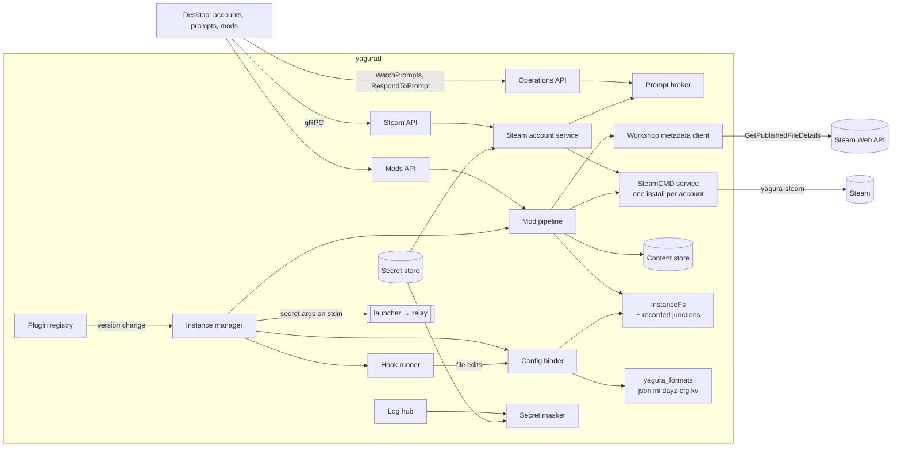
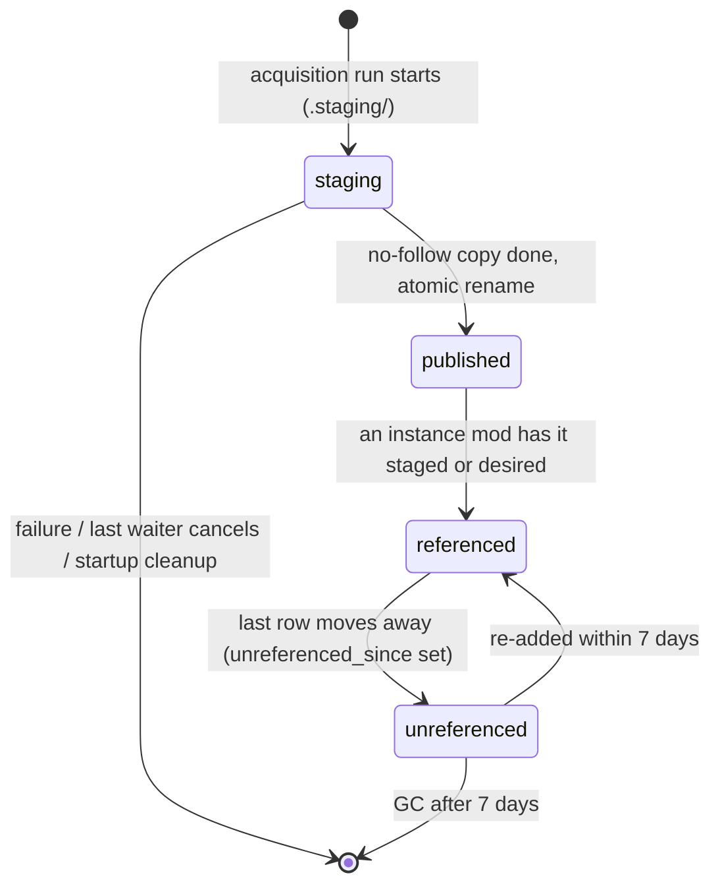
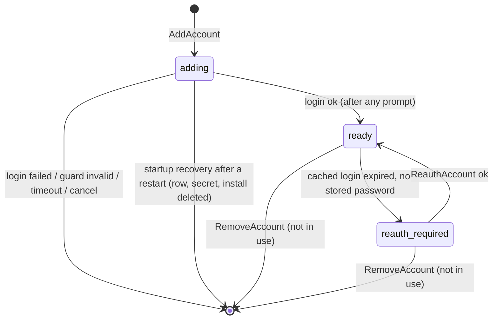
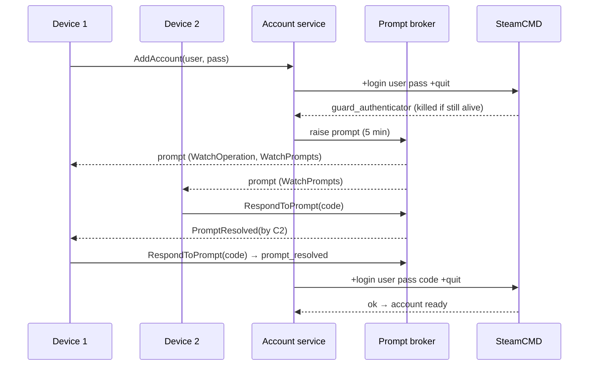
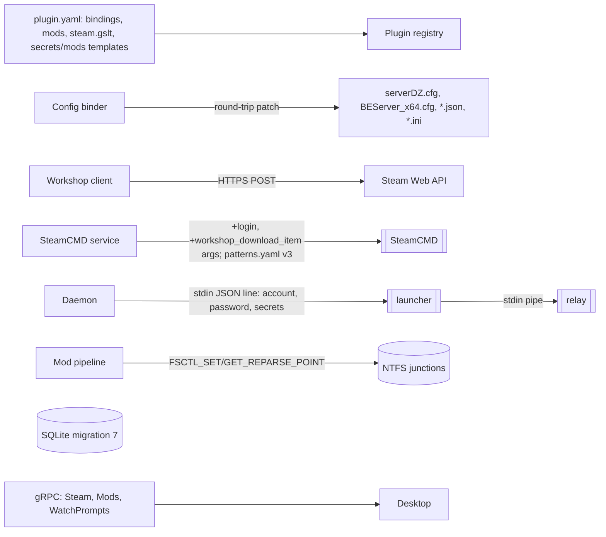

# Design

## Triage

| Trigger | Applies? | Evidence |
|---|---|---|
| T1 Components (new component, or 3+ with directed relationships) | yes | New: Steam account service and prompt broker, workshop metadata client, content store, mod pipeline, config binder, log masker, the `Steam` and `Mods` APIs (stubs today, `api/stub_apis.dart`), `plugins/dayz/`, desktop accounts, prompts and mods views. None exist (`steam/steamcmd_service.dart:67` has only the anonymous installation; no workshop code; `files/file_edit_writer.dart:65-73` is JSON-only) |
| T2 State (persistent state, caches, 3+ state machine) | yes | Migration 7: Steam accounts, instance mods, content versions, placed keys, bound-file hashes, replaced secrets, account operations. Also the content-store version lifecycle, account status (`adding`/`ready`/`reauth_required`), mod status (`pending`/`downloading`/`staged`/`failed`/`unavailable`), and `operation.status = waiting_for_input` (exists, never set: `operations/operation.dart:6`) |
| T3 Concurrency (background work, workers/isolates, async, retries) | yes | Single-flight workshop downloads with waiter detach, prompts answered by several devices, the 6-hourly update check with backoff, content GC concurrent with staging, migration runs while operations are queued, and the 5 s lock retry |
| T4 Boundaries (data format, migration, shared interface, IPC, external) | yes | Four config formats with round-trip guarantees, the manifest's `bindings`/`mods`/`steam.gslt` schema, the `mods`/`secrets` template namespaces, the hook context and two new hook points, SteamCMD workshop and Steam Guard output, the Steam Web API, NTFS junctions, the launcher stdin line, `instance.json` mods, migration 7, `Operations.WatchPrompts` |
| T5 Volume (grows without a fixed bound) | yes | Workshop content versions (GBs), mods per instance, prompt subscribers, bound files, placed keys |
| T6 Risk (security, money, data loss, unrecoverable user data) | yes | Steam passwords and GSLTs, junctions inside directories `yagura-srv` controls, overwriting admin-edited configs and admin key files |

TIER: FULL

## Context

Scope and motivation: `proposal.md`. Baseline: `openspec/architecture.md` and the in-force ADRs. This design moves `platform-backlog` decisions D8 and D19 (renumbered D5 and D8 here) and grounds the backlog's groups 14-17 in the code M1 and M2 built.

What M1 and M2 left in place:

- **SteamCMD.** `SteamcmdService` keeps one installation per name under `<data>/steamcmd/`, readiness in `steamcmd_installations` (`steam/steam_state.dart:49-92`). Only `anonymous` is used (`steamcmd_service.dart:67,152`). Arguments are hard-coded to `+login anonymous` (`:311-322`). One run per installation goes through a `Semaphore(1)` (`:155-158`). Runs launch as `yagura-steam` through `_AccountJobProcess` (`steam/steam_process.dart:421+`) and are capped at 15 min without progress and 12 h in total (`:450-506`). Output is classified by `steam/patterns.yaml` (version 2, embedded by `tool/embed_steam_patterns.dart`), which has no login or Steam Guard patterns. `steam.login: account` is always refused with `steam_account_required` and `account_optional` installs anonymously (`packages/yagura_plugin/lib/src/manifest.dart:282`, `steamcmd_service.dart:144-151`). `lifecycle.dart:130` already keys the heavy lock as `account:<id>`.
- **Fake SteamCMD.** `test/fixtures/fake_steamcmd/fake_steamcmd.dart` is driven by environment variables (`:8-23`). It parses `+force_install_dir`, `+login`, `+app_update` and `+quit` only (`:53-69`). It has no workshop command and no login prompts.
- **Operations.** There is a per-instance FIFO queue of 10 (`operations/operation_runner.dart:130-163`). Events are retained in memory, 2,000 per operation plus the latest progress per step (`:488-507`), and `events_dropped` exists (`:285-296`). `ctx.heavy` takes the installation lock, then one of 4 host slots (`:626-661`). Only `_steamRun` calls it, and `OperationKind.heavy` is read nowhere (`operation.dart:26-40`). `operations.instance_id` is `NOT NULL` (`host/migrations.dart:38-51`). `RespondToPrompt` answers `not_implemented` (`api/operations_api.dart:140-147`).
- **Protocol.** `steam.proto` (ListAccounts, AddAccount, ReauthAccount, RemoveAccount; status `ready|reauth_required|adding`), `mods.proto` (ListMods, SetMods with `expected_revision`, ApplyMods, CheckModUpdates, UpdateMods), and `Prompt`/`PromptResolved`/`Operation.pending_prompt` already exist. The `Steam` and `Mods` services are `UNIMPLEMENTED` stubs (`api/stub_apis.dart`). `instances.proto:73,137,147` carries `steam_account_id`, stored in `instances.steam_account_id` (migration 1).
- **Secrets.** `DatabaseSecretStore` (`host/secret_store.dart:135-251`) holds DPAPI blobs keyed `instance:<id>:<setting>` (migration 4, `migrations.dart:104-113`). Nothing masks secrets anywhere: operation log events take SteamCMD lines raw (`steamcmd_service.dart:431`), and the log hub has no masking. Templates refuse `secret` settings (`templates.dart:104-110`) and have no `secrets` namespace (`:179-181`).
- **Launch path.** The daemon writes `launch.json` with the rendered args into the run directory inside the instance directory (`process/run_files.dart:101-110`), where `yagura-srv` can read it, and the relay reads the args from there (`launcher_modes.dart:238`). The launcher already reads its account credentials from standard input, never from the command line or environment (`launcher_modes.dart:28-56`).
- **Files.** `ConfinedFs` refuses every link-like reparse point (`files/confined_fs_windows.dart:469-480`). The recorded-junction exception that ADR 0015 promises is not built. Snapshots throw on a link (`confined_fs.dart:379-432`), while delete removes a link without entering it (`confined_fs_windows.dart:797-836`). No FFI creates junctions. `FileEditWriter` is the only config writer: JSON only, two-phase temp-and-rename with rollback (`file_edit_writer.dart:166-233`), and no lock retry. `packages/yagura_formats` holds only `JsonDocument` (`lib/src/json_document.dart`). `host/acl_layout.dart:17,204-208` already grants `yagura-srv` read and execute on `<data>/content` if it exists. `DataDirectory.prepare` does not create it (`host/data_directory.dart:27-45`).
- **Hooks.** The hook points are `onPostInstall`, `onPostUpdate`, `onPreStart` and `onPostStop` (`hooks/hook_point.dart:5-16`). The context has no mods (`hook_context.dart:68-76`), and `yagura.formats` has `json` only (`hooks/host_api.dart:36-42`).
- **Plugins.** The loader rejects `bindings`, `mods`, `rcon`, `stop: rcon` and `health: query` (`packages/yagura_plugin/lib/src/loader.dart:404-426`), and the schema types them as bare objects (`manifest_schema.g.dart:126-128`). `InstanceManager.reconcilePlugins` (`instances/instance_manager.dart:1287-1339`) already re-validates settings on reload and sets `plugin_missing`/`settings_invalid`, but the plugin version has no migration step.
- **Desktop.** `connection.dart:564-643` drops prompt, prompt-resolved and events-dropped events (`_ => current`). `DaemonTransport` (`lib/src/transport.dart:36-67`) has no Steam, Mods or prompt methods. Widget tests use `test/support/fake_daemon.dart`.
- **CI.** `ci.yml` runs Windows and Ubuntu, with `windows`-tagged tests run outside the job. `elevated.yml` is manual (repository memory: elevated rows never run on the developer's desktop).

Unverified assumptions, each closed by a task:

- **(A1)** With stdin on NUL, SteamCMD exits or stops on a Steam Guard request with output that tells email, authenticator and mobile approval apart. `+login <user> <pass> <code>` completes a login. A mobile approval completes within the same run without input. After a login run, no file under the account installation (SteamCMD's `logs/` and `config/`, `config.vdf` aside) holds the password in clear. With the cached login expired and no password passed, `+login <user>` with stdin on NUL ends or prints a recognisable password request instead of looping. Closed by spike task 1.1 with a test account run by the user, which records each behaviour and scans the installation's files. If a run keeps waiting on stdin, the daemon kills it as soon as a prompt or password-request pattern matches (D2 works either way). If SteamCMD's files carry the password, D3's fallback applies.
- **(A2)** A DayZ server started under the relay saves and exits on Ctrl+C. If not, the plugin uses `kill` after the grace period (DayZ persists continuously) and records that in the milestone notes (task 10.3).
- **(A3)** BattlEye and the DayZ server load mods through junctions in the server folder. This is the backlog's open risk. If they do not, `copy_fallback: true` is the plugin's documented fallback (task 10.3).

## Decisions

### D1: Steam accounts own a SteamCMD installation each, and their operations queue per account

- **Choice:** Migration 7 adds `steam_accounts(id, username, status, password_secret_id, last_login_at, created_at)`. The id is `acct_<12 hex>`, and its installation is `<data>/steamcmd/<id>/` (never the username, which can contain characters a path cannot). `AddAccount` and `ReauthAccount` are operations of kind `add_steam_account` and `reauth_steam_account`, queued under subject `account:<id>`. Migration 7 adds `operations.account_id TEXT NOT NULL DEFAULT ''`, and account operations store `instance_id = ''`. The runner keys its queues by subject instead of instance id, with the same FIFO-of-10 rule. They take the same installation lock as instance installs that use the account (`lifecycle.dart:130`'s `account:<id>` key), so a login never races an update in one installation. `RemoveAccount` is a call, refused with `account_in_use` while `instances.steam_account_id` references the account or an operation for it is queued or running. It deletes the account row, its secret and its installation through the no-follow `ConfinedFs` delete (ADR 0014). `steam.login: account_optional` uses the linked account when one is set (fixing `manifest.dart:282`, which reads only `!= 'account'`).
  - **Rows while adding.** `AddAccount` inserts the row as `adding` when it creates the operation. `account_exists` is checked against every row, `adding` included, and `too_many_accounts` counts them.
  - **Startup recovery.** Before the runner accepts work, and after it marks interrupted operations (`operation_runner.dart:329-345`), every row still `adding` is deleted with its `steam:<id>` secret and its installation (no-follow `ConfinedFs` delete). No ghost account then counts toward the bound, blocks the username, or leaves a stored password behind. An interrupted `ReauthAccount` leaves the account as it was, because the secret is replaced only when the login succeeds.
- **Rejected:** one shared installation that switches `+login` per run. SteamCMD caches one login per installation, so two accounts would evict each other's cached login and every switch would need Steam Guard again (ADR 0014).
- **Reversal cost:** medium (installation layout and the operations subject column are stored data).

### D2: Steam Guard is an operation prompt raised between SteamCMD runs

- **Choice:** The login step runs `+login <user> <pass> +quit` in the account's installation. A versioned pattern group `login` (added to `steam/patterns.yaml` by the spike) classifies the output as `ok`, `guard_email`, `guard_authenticator`, `guard_mobile`, `login_invalid` (`steam_login_invalid`), `rate_limited` (`steam_rate_limited`) or `reauth_needed` (`steam_reauth_required`, also matched by a password request when no password was passed). When a run is still alive after a `guard_*` pattern matched, it is killed for the code kinds (A1).
  - **Code kinds.** A `PromptBroker` (one per daemon) creates `Prompt{id, kind, message, steam_account, expires_at = now + 5 min}` and attaches it to the operation. The operation moves to `waiting_for_input`, and the event goes to the operation's watchers and to `WatchPrompts` (D13). `RespondToPrompt(operation_id, prompt_id, code)` resolves it compare-and-set: the first valid answer wins. Later answers fail `FAILED_PRECONDITION` reason `prompt_resolved`, and every watcher gets `PromptResolved{by_device_id, outcome}`. The step then runs `+login <user> <pass> <code> +quit` once. A rejection is `steam_guard_invalid`. No answer within the expiry is `steam_guard_timeout`. A cancel resolves the prompt with outcome `cancelled`.
  - **Mobile approval.** The prompt has no answer field. The run stays alive, and the step waits for the `ok` pattern for up to 2 minutes, then kills the run (`steam_guard_timeout`).
  - **Timing.** The waits sit between runs (code kinds) or inside the login step's 10-minute cap (architecture Resource bounds), so they never meet the 15-minute download stall timer. Account operations take the installation lock but no heavy slot. A prompt raised inside an instance install, update or mod download run (remembered password, expired cache) waits inside that run's installation lock and heavy slot, so it holds one of the 4 host slots for at most 5 minutes. That bound is accepted.
  - **Instance operations.** Install, update and mod downloads with an expired cached login use the same step when the password is remembered. Without one they fail `steam_reauth_required` and set the account `reauth_required`.
  - **Prompts in pipeline runs.** A mod download run belongs to the mod pipeline (D6), not to one operation. A prompt it raises has one prompt id, which is attached to every operation waiting on the run and published once on `WatchPrompts`. `RespondToPrompt` accepts that id with any of those operation ids, compare-and-set as above. A waiter that is cancelled only detaches. The prompt resolves `cancelled` only when the run itself is cancelled, which happens when its last waiter detaches.
- **Rejected:** driving SteamCMD's own interactive prompt over stdin. ADR 0014 rejected it: prompt timing and buffering differ by platform and version.
- **Reversal cost:** low (inside the Steam service and the broker; the proto already has these messages).

### D3: A Steam password lives in memory for one operation, and every SteamCMD line is scrubbed before use

- **Choice:** `AddAccount`/`ReauthAccount` pass the password to the operation closure in memory. The operations table stores no request parameters, and the audit log records method, target and result only (`security/audit.dart:170-188`). With `remember_password` it is stored as secret `steam:<account-id>` before the account row turns `ready`. A refused write fails the operation with `secret_store_unavailable`. Without it, the reference is dropped when the operation ends.
  - **Scrubbing.** Each SteamCMD run gets a `Scrubber` holding the password and the Guard code. It replaces them with `***` in every output line before the line reaches the pattern classifier, the reporter (operation log events), the last-50-lines failure tail or the daemon log (`steamcmd_service.dart:431` becomes the single entry point).
  - **Exposure.** The password is a SteamCMD argument (ADR 0014: never a script file). It is therefore visible in the process list to administrators and to processes running as `yagura-steam` for the length of a login run, and nowhere else.
  - **SteamCMD's own files.** If spike 1.1 finds the password in files SteamCMD writes under the installation (its `logs/`), every login run is followed, before the step ends, by a scrub of those files: the same scrubber over each file, written back through `ConfinedFs` temp-and-rename, and a file that cannot be scrubbed is deleted. Startup scrubs every account installation the same way, which covers a crash between the run and the scrub. The data-directory secret scan (task 11) covers the installations either way. SteamCMD's cached login token in `config/config.vdf` stays the accepted exception that ADR 0014 names, and it is not the password.
- **Rejected:** a `+runscript` file. It puts the password on disk, which ADR 0014 forbids.
- **Reversal cost:** low.

### D4: Secret launch arguments reach the relay over standard input, never through `launch.json`

- **Choice:** The template namespace `secrets.<setting>` is allowed only in `launch.args`, for top-level `secret` settings. `{{settings.<secret>}}` stays rejected, and `secrets.<non-secret>` is rejected (`templates.dart:104-110,179-181`). The renderer produces each such argument as a structured entry. `launch.json` records it as `{"secret": "<setting>"}` (plus any literal prefix and suffix), never the value. The values never reach a file. They travel over standard input in both modes:
  - **Daemon to launcher.** Today the daemon writes the `AccountCredentials` line only with `--as-account`, and the launcher reads it only then (`windows_process_host.dart:173-185`, `run_command.dart:195-205`). The line becomes `LaunchInput{account?, password?, secrets}`. The daemon writes it on every launch, console mode included, and the launcher always reads it. A missing or malformed line fails the launch with `launch_input_missing`, and nothing starts.
  - **Launcher to relay.** The relay gets no standard handles today (`CREATE_NEW_CONSOLE`, `launcher_modes.dart:72-80,128-146`). The launcher creates an anonymous pipe and passes its read end as the relay's stdin with `STARTF_USESTDHANDLES`, stdout and stderr on NUL, in both `CreateProcessAsUserW` (service mode) and `spawnProcess` (console mode). It writes one JSON line holding the secrets, then closes its end before it exits.
  - **Relay.** The relay reads that line first, before `writeRelay` and before it spawns the server (`launcher_modes.dart:248,280-300`). It substitutes the values into argv in memory just before `spawnProcess`. A missing line ends the relay with an `exit.json` error and no server.
  - **Tests.** Console mode runs in Windows CI; service mode runs in the elevated workflow. The rendered args the daemon logs or reports show `***`. `steam.gslt: {setting: <name>, required: <bool>}` names the GSLT setting. When it is required and unset, start fails `gslt_required` before `secret_required` is checked for it.
- **Rejected:**
  - Writing the value into `launch.json` and deleting it after the start: a daemon or launcher crash leaves it in a directory `yagura-srv` can read, and the relay's re-reads would need it again.
  - Passing it in the server's environment: the game reads its GSLT from argv, and the environment block is no less visible to the same account.
- **Reversal cost:** low (the run-file format is internal, `format_version: 1` stays and the field is additive).

### D5: Workshop metadata from the Steam Web API, downloads through SteamCMD, published by no-follow copy

- **Choice:**
  - **Metadata.** Titles, sizes, `time_updated`, visibility and `result` come from `ISteamRemoteStorage/GetPublishedFileDetails/v1` (POST, no key) through `dart:io` `HttpClient`, in batches of 100 items, at most 1 request/s per daemon, with a 15 s timeout. The base URL is configurable so tests use a fake server. Metadata for newly added mods is fetched in the background after `SetMods` commits (D7, Names), and again by each acquire step and update check.
  - **Download.** Through SteamCMD in the instance's account installation (anonymous when none is linked): one run per acquisition batch, with one `+workshop_download_item 221100 <id>` per owned item (D6). SteamCMD writes `<install>/steamapps/workshop/content/<app>/<item>/` as `yagura-steam`.
  - **Version.** The version is the `time_updated` read right before the run. After the run the metadata is read again: a changed value downloads once more (SteamCMD fetches the delta) and publishes under the new value. A second change fails the item with `workshop_item_changing`.
  - **Publish.** Per ADR 0014: a no-follow copy into `content/.staging/<run-id>/<item>/` that refuses any reparse point, then a rename to `content/steam_workshop/<app>/<item>/<version>/`. SteamCMD's tree stays as the download cache, so updates are deltas. Its size counts in the disk check.
- **Rejected:** parsing SteamCMD's workshop output or `appworkshop_<app>.acf` for versions. The output does not report `time_updated` reliably, and the ACF needs a VDF reader, which arrives in M4.
- **Reversal cost:** low.

### D6: Content store with single-flight acquisition per item version

- **Choice:**
  - **Versions table.** Migration 7 adds `content_versions(source, app, item, version, size_bytes, published_at, unreferenced_since)`. A row exists only for a published directory.
  - **Runs belong to the pipeline.** The mod pipeline owns each acquisition run, not an operation. An in-memory map keyed by `(source, app, item, version)` holds each in-flight key with its waiting operations. An operation's acquire step registers as a waiter on every key it needs. The pipeline starts a run for the keys no run has yet, one run per installation (the requesting instance's account, or anonymous).
  - **Locks and slots.** Each run takes its installation's lock, then a heavy slot, from the runner's own lock map and 4-slot semaphore, so the host limit and the one-run-per-installation rule still count it. Each run has its own cancel token and fans its progress events out to every waiting operation. A waiting operation holds no installation lock and no heavy slot. It shows step `waiting_for_steamcmd` with its position until its run gets a slot.
  - **Cancel.** A cancelled operation detaches from its keys and ends `cancelled` at once. A run is cancelled only when no key in it has a waiter left. Results are delivered per key, so one `workshop_item_unavailable` fails only that item.
  - **Disk check.** Free space on the content volume must be at least twice the reported size, else `insufficient_disk`. It is checked per batch before SteamCMD starts.
  - **Collection.** At startup and daily, under the mod-pipeline lock, `unreferenced_since` is set for versions no `instance_mods` row has as `staged_version` or `desired_version`, cleared for referenced ones, and directories older than 7 days are deleted (no-follow). Startup also deletes `content/.staging/*`.
  - **Layout.** `DataDirectory.prepare` creates `content/` (and `content/.staging/`). The service ACL walk applies the existing content entry (`acl_layout.dart:204-208`): `yagura-srv` read and execute, no `yagura-steam`.
- **Rejected:** a per-item mutable directory updated in place: ADR 0005 rejected it (it rewrites files a running instance has open).
- **Reversal cost:** high on layout (ADR 0005 already fixes it); low on the in-memory single-flight.

### D7: Mods are instance rows; staging is a stopped-only step that creates recorded junctions

- **Choice:**
  - **Rows.** Migration 7 adds `instance_mods(instance_id, position, source, item_id, role, staged_name, stage_kind, desired_version, staged_version, status, last_error, warnings_json, remote_updated, update_available)`. `stage_kind` is `link`, `copy` or empty, set when staging creates the entry. `SetMods` replaces the ordered list in the instance manager's write transaction with `expected_revision`, so the revision increments and `instance.json` is rewritten with the list.
  - **Frame of reference.** Every manifest path (bindings, `data_paths`, log sources, key rule targets, `mods.stage_dir`) is relative to the instance root. Launch arguments resolve against the server's working directory `<instance>/server` (`lifecycle.dart:31`). Links are staged in `mods.stage_dir` (default `server`). The template's `mods.<role>` lists staged names, so a plugin whose stage directory is not `server` prefixes the relative path in its template.
  - **Names.** `SetMods` never waits for the Web API. It commits new mods as `pending` with no staged name and starts one background metadata fetch for them (D5 pacing). The fetch's outcome fixes each new mod's name once: the rendered link template from the title, or `@<item id>` when the request fails or the item is private or missing. Names are sanitised to `[A-Za-z0-9._-]` and de-duplicated with `-2`, `-3` against the instance's other staged names and against the entries present in the stage directory at that moment. An apply that reaches a mod whose fetch is still running waits for it, which the 15 s timeout bounds. A mod with no name after a restart gets a fresh fetch at startup. A fixed name never changes, even when the title does.
  - **Apply step.** `apply_mods` runs as its own `ApplyMods` operation and as the `stage_mods` step of `Start` (before bindings) and of `Update` (`update_mods`). In order:
    1. Refuse `instance_running`.
    2. Acquire every missing desired version (D6).
    3. For each mod, look at the entry at its staged path without following it. With no entry, create it. An entry is recorded when the row's `stage_kind` is `link` and the entry is a junction or other link, whatever its target (removing a link never touches what it points at, so a link the server replaced is removed too), or when `stage_kind` is `copy` and the entry is a directory holding the marker file `.yagura-staged` with this instance id and item id. Remove a recorded entry without following it, then create the new one. Anything else (an admin's folder, an unmarked copy, any entry where the row records none) fails the step with `stage_name_conflict` naming the path, and the entry is left unchanged. Creation is a junction to `<data>/content/<source>/<app>/<item>/<version>/` (mode `link`), or a no-follow copy into `.yagura/stage-<op>/` with the marker, renamed into place (mode `copy`, or `link` failing with `copy_fallback`). Set `staged_version := desired_version` and `stage_kind`.
    4. Remove the recorded entries of mods no longer listed, by the same rule. An entry that is not recorded is left.
    5. Run key rules (D8), then `onModsStaged`, which runs on every stage step, even one with nothing changed, so its edits are re-applied with the bindings (D9).
    6. Unchanged mods are left alone.
  - **Junctions.** Created by a new FFI call: `NtCreateFile` of the directory relative to the instance root handle, then `DeviceIoControl(FSCTL_SET_REPARSE_POINT)` with mount-point data (no privilege needed).
  - **The ADR 0015 exception.** `InstanceFs` receives the instance's recorded `{staged path → expected target}` map. When a walk meets a mount-point reparse point at a recorded path, it reads the target with `FSCTL_GET_REPARSE_POINT`. If the target equals the expected content-store path, the walk continues read-only in a `ConfinedFs` rooted at that version directory. Any other reparse point, or a recorded one with another target, stays `sandbox_violation`. Writes and edits below a recorded path are always refused. Snapshot walks skip recorded paths instead of failing, delete removes the link only, and log sources may not point into a mod.
  - **Server-managed.** For source `server_managed` (stage `none`) nothing is acquired or staged. The role lists carry item ids.
  - **Template.** The template's `mods.<role>` is the ordered list of staged names (or item ids for stage `none`).
- **Rejected:** symbolic links (need `SeCreateSymbolicLinkPrivilege` or developer mode on Windows), or copying every mod into every instance (multi-GB per instance, and no sharing for exit criterion 4).
- **Reversal cost:** medium (instance-mod rows and the junction exception in the file boundary).

### D8: Key files are owned per mod, never placed over an admin's key

- **Choice:** Migration 7 adds `placed_keys(instance_id, file_name, content_hash, providers_json)`. After staging, each rule (`from: "**/*.bikey"`, `to: server/keys/`) collects candidate files from each staged mod's content version, read through the content-store root, never through the instance link. For each file name:
  - **Not present.** Write it through `InstanceFs.writeAtomic` and record it.
  - **Present and recorded.** Update its providers, and rewrite it if its content changed.
  - **Present, not recorded, same content.** Adopt it: record it with providers.
  - **Present, not recorded, different content.** Leave it and add a `key_conflict` warning, naming the file, to every providing mod.

  A recorded key whose provider set becomes empty is deleted.
- **Rejected:** removing a mod's keys with the mod. Dependants commonly ship the same key (CF), so removing one mod would break the others.
- **Reversal cost:** low.

### D9: One config binder writes bound files and hook edits, with four lossless parsers

- **Choice:**
  - **Parsers.** `packages/yagura_formats` gains `IniDocument`, `DayzCfgDocument` and `KvDocument`, each with the same surface as `JsonDocument` (`parse`, `toSource`, `get(path)`, `set(path, value)`), built on a token tree that keeps comments, whitespace, line endings, BOM and order. `toSource(parse(x)) == x` is a corpus test per format. JSON hook edits stay RFC 7386 merge patches. For the other three formats a hook patch is `{<key path>: <value or null>}`.
  - **Binder.** `ConfigBinder` replaces `FileEditWriter` as the only writer (`file_edit_writer.dart` is folded in). Each operation makes one binder pass, after its hooks have returned their edits. `Start` collects the `onModsStaged` edits from `stage_mods` and the `onPreStart` edits, then makes one pass with bindings, `onModsStaged` edits and `onPreStart` edits, in that order. `ApplyMods` makes one pass with bindings and `onModsStaged` edits. `Update` makes one pass with bindings, `onModsStaged` edits and `onPostUpdate` edits (step `apply_config`). The rollback covers every file of the pass. Each pass:
    1. reads each target once through `InstanceFs` (16 MiB cap kept);
    2. creates missing files from `templates/` in the plugin directory when `create: true`, else fails `binding_file_missing`;
    3. compares the file's SHA-256 with `bound_files.hash` (migration 7: `bound_files(instance_id, path, hash)`). When it differs, it lists the bound keys whose current value differs from the value about to be written, as `external_edit{file, keys:[{key, old, new}]}`, with values of keys bound to secret settings shown as `***`. A file with any `game_writes: true` binding skips the event;
    4. applies bindings, then hook edits in order, to the in-memory document;
    5. writes only files whose bytes changed, all in the existing two-phase temp-and-rename with rollback;
    6. records the final hashes.
  - **Locks.** A sharing violation on open, temp write or rename is retried every 250 ms for up to 5 s, then fails `file_locked` naming the file, after rolling back files already replaced.
  - **Paths.** Binding file paths are templates over `settings`, `ports`, `paths` and `os` and must resolve inside the instance root.
  - **Values.** Secret values are bound from the secret store at apply time only.
  - **Load-time refusals.** `ue-ini`, `xml` and `vdf` are refused at load and in hook edits with `unsupported_in_this_version`.
- **Rejected:** keeping the hook writer and adding a separate binder. Two writers to one file would each record a hash the other invalidates, so every hook edit would look like an external edit.
- **Reversal cost:** medium (the binding syntax is part of the manifest, ADR 0004; parsers are internal).

### D10: Plugin version changes migrate through a queued `migrate_settings` operation

- **Choice:** `reconcilePlugins` compares each instance's recorded `plugin_version` with the reloaded one. It no longer writes the new version itself: the `pluginVersion` write at `instance_manager.dart:1312-1320` moves into the migration. For each instance whose version changed, it puts a `migrate_settings` operation (not heavy) at the head of the instance's queue. The operation waits only for the running operation, which keeps the manifest it started with (`Plugin reload without restart`), so no queued operation runs on the new manifest with unmigrated settings. The head place is outside the 10-operation bound, so a full queue still takes the migration. A second reload before it runs replaces the queued migration's target version instead of queueing another. Startup reconciliation queues migrations the same way. The operation:
  1. calls `migrateSettings({settings, fromVersion, toVersion})` when the hook is exported (secrets as placeholders, the result's secret fields must be the same placeholders);
  2. validates the result, or the unchanged settings when no hook is exported, against the new schema;
  3. on success, commits the settings and the new version in one revisioned transaction and rewrites `instance.json`;
  4. on failure (an invalid result or a throwing hook), leaves the stored settings unchanged. A stopped instance goes to `error: settings_invalid`. A running one gets the `settings_invalid` flag with a notice naming the fields or the hook error, and its next Start fails `invalid_state`.

  - **Gate.** An operation that starts while the recorded version still differs from the loaded manifest's (only possible after a failed migration) fails `invalid_state` naming `settings_invalid`. `Stop` and delete are exempt.
  - **Recovery.** A valid settings save on a `settings_invalid` instance is validated against the loaded manifest and records that manifest's version in the same transaction, so the next reload does not migrate those settings again.

  An instance whose version did not change keeps today's re-validation path (`instance_manager.dart:1287-1339`).
- **Rejected:** migrating inline inside `ReloadPlugins`. The call would block on N hook runs, and it would race operations already running on the old manifest.
- **Reversal cost:** low.

### D11: Secret masking in the log hub at ingestion

- **Choice:** Each instance has a `SecretMasker` built from the secret store: current values plus values replaced or deleted within 24 hours. Migration 7 adds `replaced_secrets(instance_id, setting, blob, replaced_at)`, DPAPI blobs pruned hourly after 24 h. The masker is rebuilt on every `SetSecret`/`DeleteSecret`. Values of 6 or more characters are matched as substrings; shorter ones only between non-word characters. The log hub masks each decoded line before it enters the ring, so followers, backlog, health `log_match` and crash notices (built from ring lines, `instance_manager.dart:1711-1713`) all see masked text. Capture files on disk are the game's own output and are not rewritten.
- **Rejected:** masking at fan-out only. Backlog, crash notices and `log_match` read the ring directly, so each would need its own masking call, and one missed path leaks.
- **Reversal cost:** low.

### D12: `plugins/dayz` as the reference account-and-mods plugin

- **Choice:**
  - **Manifest.** `steam: {app_id: 223350, login: account}`, `executable.windows: DayZServer_x64.exe`, ports `game` 2302/udp plus derived, settings `hostname`, `maxPlayers` (1-127), `verifySignatures`, `logs`, and the secrets `serverPassword`, `adminPassword` and `rconPassword`.
  - **Frame.** Manifest paths are relative to the instance root, and launch arguments to the working directory `<instance>/server` (D7). The game, its depot `mpmissions/`, the staged mods, `keys/` and `profiles/` all sit under `server/`.
  - **Bindings.** `dayz-cfg` bindings into `server/yagura/serverDZ.cfg`, created from `templates/serverDZ.cfg`. `kv` bindings `RConPort`/`RConPassword` into `server/yagura/battleye/BEServer_x64.cfg`, created from a template.
  - **Mods.** `mods: {source: steam_workshop, workshop_app_id: 221100, stage: link, stage_dir: server, link_name: "@{{mod.name_safe}}", copy_fallback: true, keys: [{from: "**/*.bikey", to: server/keys/}], roles: [client, server]}`.
  - **Launch.** `-config=yagura/serverDZ.cfg`, `-BEpath=yagura/battleye`, `-profiles=profiles`, `-port`, and `mods.client` → `-mod=`, `mods.server` → `-serverMod=`, each staged name relative to `<instance>/server`.
  - **Other.** `data_paths: [server/mpmissions/, server/profiles/]`; log sources `server/profiles/*.RPT` (newest) and `server/profiles/script_*.log`; health `log_match` on the RPT; `stop: {strategy: signal, grace_seconds: 60}` (A2).
  - **No `rcon`.** No `rcon` section and no `rcon` stop until M4.
- **Rejected:** writing into the server's own `server/serverDZ.cfg`. SteamCMD's `app_update validate` would restore Valve's copy and erase the bindings' file. `server/yagura/` holds no depot file, so validate leaves it alone.
- **Reversal cost:** low.

### D13: `Operations.WatchPrompts` lets every device see every pending prompt

- **Choice:** An additive server stream on `Operations`. It sends a snapshot of all pending prompts (with their operation id and subject), then `raised`/`resolved` events. The `PromptBroker` (D2) publishes to it. Bounds: 32 subscribers, 256 events behind per subscriber, then `resync_required` and a fresh snapshot (the `WatchInstances` pattern, `api/operations_api.dart:82-131`). `security/method_access.dart` gains `Operations/WatchPrompts` with the same access as `WatchOperation`. The desktop opens it per connected daemon and drives the prompt dialog from it. Spec: daemon-protocol "Pending prompts reach every client". `connection.dart:564-643` handles `prompt`, `promptResolved` and `eventsDropped` instead of dropping them.
- **Rejected:** surfacing prompts only through `WatchInstances`. Account operations belong to no instance, and the instance stream would have to carry prompt payloads that are not instance state.
- **Reversal cost:** low (additive within v1).

### D14: The update check is a daemon timer with jitter and backoff

- **Choice:** Every 6 h ± 30 min (first run 10 min after start), and on `CheckModUpdates`, the mod pipeline batches the metadata of every distinct workshop item referenced by any instance (D5 bounds). It compares each item's `time_updated` with each row's `desired_version`, stores `remote_updated`/`update_available`, and emits instance deltas with `mod_updates_available`. A failed check keeps the previous flags, records `update_check: unknown` with the error, and retries after 5 min, doubling up to 6 h. `CheckModUpdates` for one instance is a `check_mod_updates` operation on that instance's queue. With an empty `instance_id` it runs under the queue subject `host`, which the timer also uses, so two host-wide checks never overlap. Updates run only through `UpdateMods` or the instance's `Update` (`update_mods` step), never from the timer.
- **Rejected:** updating automatically when the timer sees a new version. That restarts servers unattended, and the architecture keeps timed restarts out of v1 scope.
- **Reversal cost:** low.

## Diagrams (FULL)

### T1 Components added or changed in M3



### T2 State: content-store version lifecycle and account status





### T3 Concurrency: Steam Guard prompt and a start with mods



```mermaid
sequenceDiagram
  participant R as Operation runner
  participant I as Instance manager
  participant M as Mod pipeline
  participant W as Web API
  participant S as SteamCMD (account install)
  participant B as Config binder
  participant H as Hook isolate
  participant P as Launcher/relay
  R->>I: Start
  I->>M: stage_mods
  M->>W: metadata (≤100/request)
  M->>S: pipeline run: installation lock, heavy slot, workshop_download_item × items
  S-->>M: files in SteamCMD tree
  M->>M: no-follow copy → .staging → rename
  M->>M: recorded junctions, keys
  M->>H: onModsStaged(ctx) → edits
  I->>H: onPreStart → args, env, edits
  I->>B: one pass: bindings, onModsStaged edits, onPreStart edits; hash check, atomic write
  I->>P: launch (secret args on stdin)
```

### T4 Boundaries added in M3



## State & Ownership (FULL)

| State | Owner (sole writer) | Lifetime | Invalidation / rebuild | Authoritative copy |
|---|---|---|---|---|
| Steam account rows and status | Steam account service | Until removed | `reauth_required` on an expired login; `ready` on a successful login | SQLite |
| Account SteamCMD installation and cached login | Steam service | Per account | Re-bootstrapped and re-logged in if corrupted (ADR 0014) | SteamCMD's files (ACL'd) |
| Remembered Steam password | Secret store, called by the account service | Until reauth without remember, or account removal | Replaced on reauth | SQLite `secrets` (DPAPI) |
| Pending prompts | Prompt broker | One operation step | Resolved by first answer, expiry or cancel; lost on daemon restart (the operation becomes `interrupted`) | Memory |
| Content versions | Mod pipeline (publish and GC) | Until unreferenced for 7 days | Startup deletes `.staging`; GC sets/clears `unreferenced_since` | Disk + SQLite `content_versions` |
| In-flight acquisition runs and their waiters (each run holds its installation lock and heavy slot) | Mod pipeline | One run | Gone on restart (the staging dir is cleaned) | Memory |
| Instance-mod rows (order, role, staged name, stage kind, desired/staged versions, status, flags) | Mod pipeline, inside the instance manager's revisioned transaction | Until removed | `staged := desired` on staging | SQLite |
| Recorded junction map | Derived from instance-mod rows | Per instance | Rebuilt from rows for each `InstanceFs` | SQLite |
| Placed keys | Mod pipeline | While a staged mod provides them | Recomputed at each staging (D8) | SQLite |
| Bound-file hashes | Config binder | Per bound file | Updated after each apply | SQLite |
| Replaced secrets for masking | Secret store | 24 h | Pruned hourly | SQLite (DPAPI) |
| Secret masker | Log hub | Per instance | Rebuilt on secret change and at startup | Memory, from the secret store |
| Mod update flags and check status | Mod pipeline | Until the next check | Each check | SQLite |
| Account operations | Operation runner | Operation history bounds | As instance operations | SQLite `operations` (`account_id`) |

## Failure & Visibility (FULL)

| Component | Fails / dies mid-operation → | Recovery | Retry safe? | Who finds out |
|---|---|---|---|---|
| Account login | Wrong password, Guard rejected or timed out, rate limit | Account not saved (add) or stays `reauth_required` (reauth); password dropped | Yes | Client operation error with reason |
| Account add | Daemon restarts during `AddAccount` | Startup deletes the `adding` row, its `steam:<id>` secret and its installation (no-follow) | Yes | Client: operation `interrupted`; account absent from `ListAccounts` |
| Prompt broker | Daemon restarts while a prompt is pending | Operation `interrupted` at startup; no account saved | Yes | Client: the operation ends `interrupted`, and the `WatchPrompts` snapshot after reconnect no longer lists the prompt, so the dialog closes |
| Workshop metadata | HTTP error or timeout | Item or check fails; flags kept; check retried with backoff | Yes | Client: mod `failed`/check `unknown` |
| Workshop download | SteamCMD failure or stall for one batch | Each owned item fails with its reason; nothing published | Yes (SteamCMD resumes) | Client operation error + mod status |
| Publish copy | Reparse point in SteamCMD's tree, crash mid-copy | `sandbox_violation` for that item / `.staging` cleaned at startup | Yes | Client error; daemon log |
| Staging | Link creation, copy or key write fails, crash mid-stage | Next apply recomputes links and keys from rows; recorded entries removed without following; unrecorded entries never touched (`stage_name_conflict`) | Yes | Client: operation error, mod `failed` |
| Recorded junction replaced | Wrong target found | `sandbox_violation` on any walk through it; restaged on next apply | Yes | Client error naming the path |
| GC | Delete fails (file in use) | Left for next run; logged | Yes | Daemon log |
| Config binder | Parse error, lock, crash mid-write | Two-phase write with rollback leaves old or new files; lock retried 5 s | Yes | Client error with file/line or `file_locked` |
| Migration operation | Hook throws, result invalid | Settings and recorded version unchanged; `settings_invalid`; later operations except stop and delete fail `invalid_state` until a valid save records the loaded version | Yes, after a fix | Client notice + instance flag |
| Secret args | Launcher or relay dies before the server starts | Start fails with the launcher error; nothing on disk | Yes | Client operation error |
| Update check timer | Daemon down | Next check 10 min after start | Yes | — |

## Resource Bounds (FULL)

| Queue / buffer / cache / transfer | Bound | At the bound | Timeout | At 10x / 100x |
|---|---|---|---|---|
| Workshop metadata | 100 items/request, 1 request/s per daemon | Batched and paced | 15 s per request | 1,000 items = 10 requests (10 s); 10,000 = 100 s, acceptable for a 6 h check |
| SteamCMD workshop run | Keys no other run has, one run per installation at a time, owned by the mod pipeline | Others queue on the installation lock | 15 min without progress, 12 h total (existing) | 120 mods in one run; progress is per item, so the stall timer stays valid |
| Mods per instance | 256 | `SetMods` fails `INVALID_ARGUMENT` reason `too_many_mods` | — | Message size stays far under 4 MiB |
| Content store disk | Free ≥ 2× reported size per batch, SteamCMD tree counted | `insufficient_disk` before download | — | GBs per version; GC after 7 days unreferenced |
| Steam accounts | 32 per daemon, `adding` rows included | `RESOURCE_EXHAUSTED` reason `too_many_accounts` | — | One SteamCMD install each (~300 MB) |
| Account operation queue | 10 per account (runner rule) | `queue_full` | — | — |
| Pending prompts | 1 per operation | A second raise on the same step fails the operation (bug guard) | 5 min codes, 2 min mobile | — |
| `RespondToPrompt` code | 16 characters, `[A-Za-z0-9]` | `INVALID_ARGUMENT` reason `prompt_answer_invalid` | — | — |
| `WatchPrompts` subscribers | 32 per daemon; 256 events behind | Refused / `resync_required` + snapshot | — | — |
| Bound files per instance | 64 distinct files; each ≤ 16 MiB (existing cap) | Plugin rejected at load / `file_too_large` | Lock retry 5 s | — |
| Placed keys | One row per key file; key rules match ≤ 1,024 files per mod | Rule fails `key_rule_too_broad` | — | — |
| Secret masker | Secrets per instance (manifest-bounded) + 24 h history | — | — | Matching cost scales with secret count, small |
| Migration operations | One per instance per version change, queued | Instance queue rules | Hook deadline 5 s (manifest up to 60 s) | 100 instances = 100 queued, non-heavy operations |
| Update check | Every 6 h ± 30 min; backoff 5 min doubling to 6 h | — | Per request 15 s | See metadata row |

## Flow & State Gaps (FULL)

- **Mod list changed while applying:** the apply uses the rows read at operation start; a `SetMods` meanwhile is committed and applied next time (the mod shows `pending`).
- **Two instances need the same item version:** one run, two waiters (D6). Runs, not operations, hold installation locks and heavy slots, and each run takes one lock and then one slot (architecture rule). Waiting operations hold neither, so no circular wait arises.
- **Different accounts for one item:** the key includes the version, not the account; whichever owner downloads it publishes it, and both instances link the same content.
- **GC vs a new reference:** GC holds the mod-pipeline lock; staging and `SetMods` take it to read/write references; versions referenced after the scan started are skipped.
- **Item updated on the workshop during download:** D5's re-read and second download; `workshop_item_changing` after two changes.
- **Steam Guard answered by two devices:** first answer wins; others get `prompt_resolved` (D2).
- **Prompt pending when the daemon restarts:** the operation is `interrupted`; the client sees the operation end and its dialog closes. An `adding` account is removed by startup recovery (D1).
- **Admin folder at a staged name:** never deleted; `stage_name_conflict` (D7).
- **Reload while operations are queued:** the migration goes to the queue head (D10).
- **Hook edits a bound file:** bindings first, then hook edits; one write; final hash recorded (D9).
- **Secret bound into a config edited by hand:** the `external_edit` event masks those values (D9).
- **Mod removed while its key is shared:** D8 provider sets.
- **Reload during a running operation:** the operation keeps its manifest; the migration runs right after it, ahead of queued operations (D10).
- **Instance deleted with staged mods:** delete removes links without following them (existing `deleteTree`); content stays and becomes unreferenced.
- **Account removed while an install for it is queued:** refused with `account_in_use` (D1).
- **Crash after `staged_version` written but before the junction:** the next apply sees the link target differs from the row and recreates it.

## Mechanism Ledger (FULL)

| Mechanism | Built? | Why (harm nobody catches / expensive later) | Evidence that would change the call |
|---|---|---|---|
| Single-flight acquisition with waiter detach | yes | Two SteamCMD runs into one item tree, and a cancel by one requester killing another's download | — |
| Versioned store + staged/desired refs + 7-day GC | yes | Updates under running servers; GC deleting live files (ADR 0005) | — |
| Recorded-junction exception with target re-verification | yes | Without it every staged mod fails `sandbox_violation`; without re-verification a planted junction is followed as SYSTEM (ADR 0015) | — |
| Key ownership per mod | yes | Removing one mod breaks another via shared keys, or an admin's key is overwritten silently | — |
| Hash-based external-edit detection | yes | Admin edits overwritten with no trace | — |
| Two-phase atomic writes with rollback and 5 s lock retry | yes (atomic exists; retry new) | Truncated configs; spurious failures while a game holds a file briefly | — |
| Scrubber on every SteamCMD line | yes | Password echoed into operation history and daemon logs, which nobody reviews | — |
| Secret args over stdin | yes | GSLT in a server-readable file | — |
| Masking at log ingestion with 24 h history | yes | Old RCON password in a log line after rotation | — |
| Content-store deduplication across versions (hardlinks between versions) | no | Disk only; GC bounds growth | Hosts running out of disk with many updates |
| Deleting SteamCMD's workshop tree after publish | no | Saves disk but makes every update a full download | Disk-pressure reports from hosts with large mod sets |
| Automatic updates from the timer | no | Unattended restarts are out of v1 scope | A scheduler milestone |
| Steam Web API key support | no | The public endpoint needs none | Rate limiting observed in practice |

## Risks / Trade-offs

- [SteamCMD's Steam Guard behaviour with stdin closed differs from A1] → spike task 1.1 before any account code; the pattern table is versioned and unknown output fails verbatim, never retried.
- [Junctions in the server folder are refused by DayZ or BattlEye] → `copy_fallback: true` in the DayZ plugin; verified on a real host in task 10.3 (A3).
- [Disk doubles per mod (SteamCMD tree + store)] → counted in the disk check; recorded as a not-built mechanism with its trigger.
- [The Steam Web API changes or rate-limits] → 1 request/s, batched; a failed check keeps flags and backs off; downloads still work through SteamCMD.
- [DayZ ignores Ctrl+C] → A2; the plugin falls back to `kill` after the grace period, documented in the milestone notes.
- [Exit criteria need a real Steam account with Steam Guard] → those rows are user-verified on a real host (never on CI, which has no account), recorded in `docs/milestones/m3.md`.

## ADRs

- **In force, constraining this change:** 0001, 0002, 0003, 0004, 0005, 0006, 0008, 0009, 0011, 0014, 0015 (also 0007 and 0012 for the API gate and the service).
- **To record during apply:** an amendment note on ADR 0004 for D9's single pass (bindings no longer apply before `onPreStart`). D6 and D7 implement ADR 0005 and the junction exception ADR 0015 already states; D2 and D3 implement ADR 0014.

## Open Questions

None.
