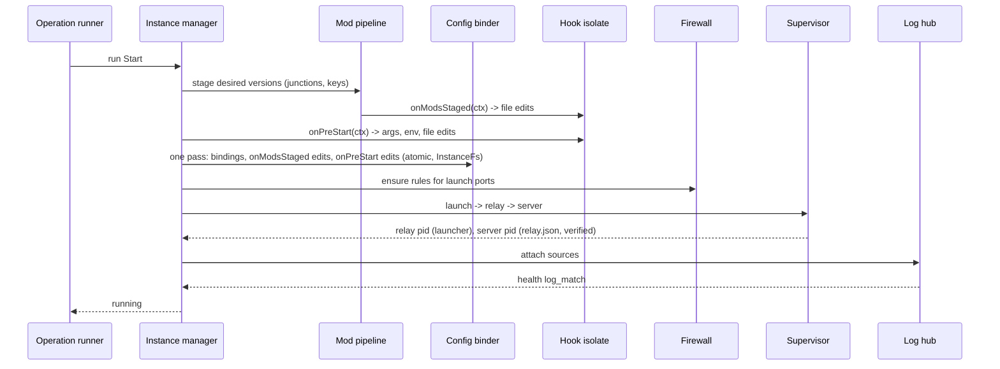
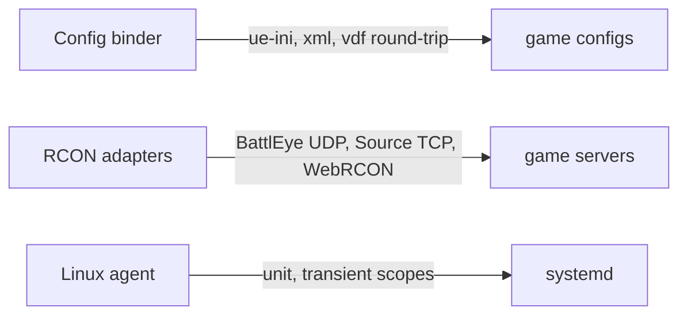

# Design

Parked backlog for milestones M4-M5 (M2 and M3 have been taken out). This file holds the decisions and design rows that only later milestones build. Decisions shared with M1 (D1-D7, D9-D12, D14, D15, D17, D18, D21-D24) are in `openspec/changes/init-core-platform/design.md` (in `openspec/changes/archive/` once M1 is archived), and their **M1 scope** lines name the parts that land here. Decision numbers continue that file's numbering. Each milestone change taken out of this backlog copies the decisions and rows it depends on and gets its own design review.

## Extraction notes

Several MODIFIED requirements here mix clauses from different milestones, because each holds the final text of a requirement M1 created. When a milestone change is taken out of this backlog, write each such requirement as it stands at that milestone: the clauses and scenarios of that milestone and earlier ones go into the new change's MODIFIED requirement, and the rest stays here. The M2 parts of the rows below are done.

| Spec → requirement | Clauses by milestone |
|---|---|
| instance-lifecycle → Graceful stop per plugin strategy | M4: the `rcon` strategy |
| desktop-client → Forms rendered from plugin schemas | M4: list tables |
| desktop-client → Logs and console views | M4: the RCON console |
| plugin-hooks → Sandboxed host API | M4: the `ue-ini`, `xml` and `vdf` formats (the M3 text with staged mods and four formats is in `m3-steam-accounts-and-mods`) |
| plugin-manifest → Stop and health declarations | M4: the `rcon` strategy and section. `query` health has no milestone yet: assign it when M4 is taken out, and keep rejecting it until then |
| config-bindings → Supported formats | M4: `ue-ini`, `xml`, `vdf` and `repeat` lists. Written here as ADDED because the capability is created by M3; it becomes MODIFIED when M4 is taken out after M3 is archived |

M3 replaced M1 decision D23's file-edit writer with the config binder (`m3-steam-accounts-and-mods` D9); M4's formats plug into it.

## Triage

| Trigger | Applies? | Evidence |
|---|---|---|
| T1 Components (new component, or 3+ with directed relationships) | yes | RCON adapters, Linux agent |
| T2 State (persistent state, caches, 3+ state machine) | yes | RCON sessions per instance |
| T3 Concurrency (background work, workers/isolates, async, retries) | yes | RCON reconnect and keep-alives |
| T4 Boundaries (data format, migration, shared interface, IPC, external) | yes | `ue-ini`, `xml` and `vdf` formats, RCON protocols, systemd |
| T5 Volume (grows without a fixed bound) | yes | Console subscribers |
| T6 Risk (security, money, data loss, unrecoverable user data) | yes | RCON passwords |

TIER: FULL

## Context

The baseline is `openspec/architecture.md` and ADRs 0001-0015, as for M1 and M2. Where a decision here refines a baseline table, task 21.3 writes it back into `openspec/architecture.md`.

Unverified assumptions, each closed by a task in `tasks.md`: SCUM's reaction to Ctrl+C (19.3).

## Decisions

None yet: the M4 and M5 decisions are written when those milestones are taken out. D8 and D19 went to `m3-steam-accounts-and-mods` (its D5 and D8).

## Diagrams (FULL)

The process view (T1) is in the M1 design, and the M3 components are in `m3-steam-accounts-and-mods`. The full start sequence and the remaining boundaries:

### T3 Concurrency: start operation (all milestones)

### T4 Boundaries added after M3

## State & Ownership (FULL)

The M3 rows (instance mods, placed keys, content versions) are in `m3-steam-accounts-and-mods`. The M4 and M5 rows are written when those milestones are taken out.

## Failure & Visibility (FULL)

As above: the M3 rows are in `m3-steam-accounts-and-mods`.

## Resource Bounds (FULL)

| Queue / buffer / cache / transfer | Bound | At the bound | Timeout | At 10x / 100x |
|---|---|---|---|---|
| Console subscribers | 8 per instance | `too_many_subscribers` | — | — |

## Flow & State Gaps (FULL)

The M3 gaps (shared downloads, GC, Steam Guard answers, bound files) are in `m3-steam-accounts-and-mods`.

## Mechanism Ledger (FULL)

The M3 rows are in `m3-steam-accounts-and-mods`.

## Risks / Trade-offs

- [This backlog drifts from what M1 actually built] → each milestone change is reviewed against the code when it is taken out of the backlog.

## ADRs

- **In force, constraining this backlog:** 0001-0009, 0011, 0012, 0014 and 0015 (0010 and 0013 are superseded by 0014 and 0015).
- **To record during apply:** none.

## Open Questions

None.
