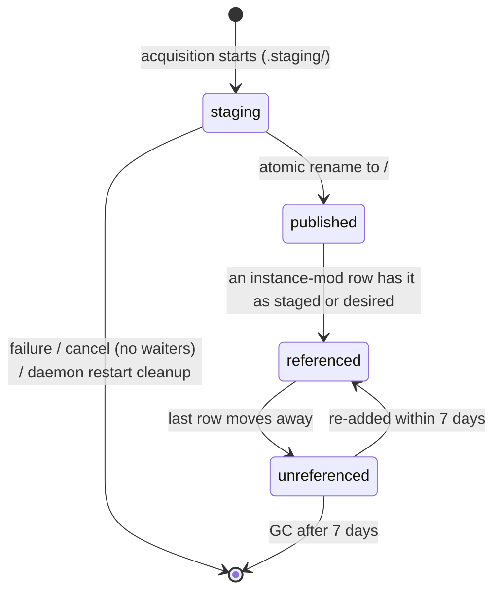
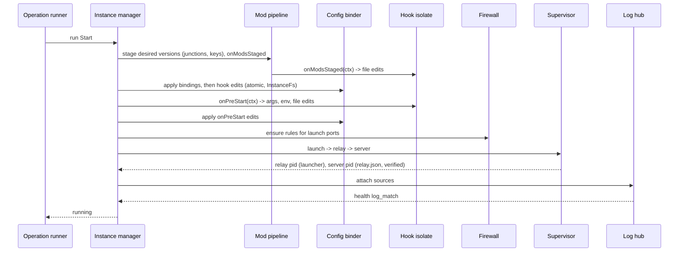
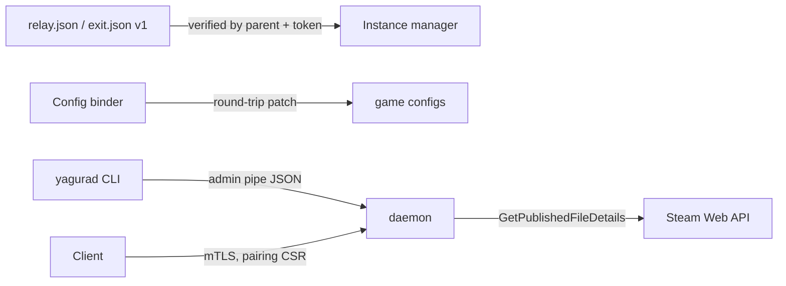

# Design

Parked backlog for milestones M2-M5. This file holds the decisions and design rows that only later milestones build. Decisions shared with M1 (D1-D7, D9-D12, D14, D15, D17, D18, D21-D24) are in `openspec/changes/init-core-platform/design.md` (in `openspec/changes/archive/` once M1 is archived), and their **M1 scope** lines name the parts that land here. Decision numbers continue that file's numbering. Each milestone change taken out of this backlog copies the decisions and rows it depends on and gets its own design review.

## Extraction notes

Several MODIFIED requirements here mix clauses from different milestones, because each holds the final text of a requirement M1 created. When a milestone change is taken out of this backlog, write each such requirement as it stands at that milestone: the clauses and scenarios of that milestone and earlier ones go into the new change's MODIFIED requirement, and the rest stays here.

| Spec → requirement | Clauses by milestone |
|---|---|
| instance-lifecycle → Graceful stop per plugin strategy | M2: servers started by the service as `yagura-srv`; M4: the `rcon` strategy |
| instance-lifecycle → Durable state with a portable instance file | M2: stored secret values excluded; M3: mods |
| instance-lifecycle → Instance creation validates settings | M2: instance roots and ACLs |
| host-service → Data directory layout | M2: instance roots added locally; M3: the content store |
| desktop-client → Forms rendered from plugin schemas | M2: `revision_conflict`; M4: list tables |
| desktop-client → Logs and console views | M4: the RCON console |
| plugin-hooks → Hook input and output contract | M2: a set secret shown as a placeholder; M3: staged mods |
| plugin-hooks → Sandboxed host API | M3: staged mod folders, more formats, external-edit tracking |
| plugin-manifest → Stop and health declarations | M4: the `rcon` strategy. `query` health has no milestone yet: assign it when M4 is taken out, and keep rejecting it until then |
| plugin-manifest → Settings schema types and constraints | M2 (with the REMOVED "Secret settings stay unset without a secret store") |
| daemon-security → Development mode is localhost only | M2 (dev mode stops being the only mode) |
| daemon-protocol → both requirements | M3: pending prompts, mod update counts |

M1 decision D22 (resolved-path checks) is replaced by D13 (InstanceFs) in M2; D23's file-edit writer is reused by the config binder (task 15.3).

## Triage

| Trigger | Applies? | Evidence |
|---|---|---|
| T1 Components (new component, or 3+ with directed relationships) | yes | Pairing and CA, firewall reconciler, mod pipeline and content store, config binder, RCON adapters, InstanceFs, Windows service, Linux agent |
| T2 State (persistent state, caches, 3+ state machine) | yes | Versioned content store with staged/desired references, device certificates, placed keys, audit and auth-failure tables, instance revisions |
| T3 Concurrency (background work, workers/isolates, async, retries) | yes | Workshop single-flight with waiter detach, mod update timer, RCON reconnect, firewall reconcile, certificate rotation |
| T4 Boundaries (data format, migration, shared interface, IPC, external) | yes | mTLS and pairing, local admin channel, config formats, Steam Web API, OS firewall/service/DPAPI/account APIs, systemd |
| T5 Volume (grows without a fixed bound) | yes | Audit log, workshop content versions |
| T6 Risk (security, money, data loss, unrecoverable user data) | yes | Remote admin over the network, Steam credentials, firewall changes, SYSTEM file operations next to an untrusted account |

TIER: FULL

## Context

The baseline is `openspec/architecture.md` and ADRs 0001-0013, as for M1. Where a decision here refines a baseline table, task 21.3 writes it back into `openspec/architecture.md`.

Unverified assumptions, each closed by a spike task in `tasks.md`: TLS rejection of untrusted client certificates in request mode and `x509` signing (10.1); WinSW leaving relays running, the relay console starting as `yagura-srv` on its own window station, and `yagurad signal` running as LocalSystem delivering Ctrl+C to that console (Valheim saves) (11.3); SteamCMD Steam Guard behaviour with stdin closed (14.1); SCUM's reaction to Ctrl+C (19.3).

## Decisions

### D8: Workshop metadata from the Steam Web API, downloads through SteamCMD

- **Choice:** titles, sizes, `time_updated` and visibility from `ISteamRemoteStorage/GetPublishedFileDetails` (no key), batched 100 items, 1 request/s; downloads always through SteamCMD.
- **Rejected:** parsing SteamCMD workshop output because it does not report `time_updated` reliably.
- **Reversal cost:** low.

### D13: Trust boundary inside instance directories (implements ADR 0013)

- **Choice:** all daemon file access under an instance directory goes through one `InstanceFs` component: paths are opened relative to the instance root handle with `FILE_FLAG_OPEN_REPARSE_POINT`, each component is checked for reparse points, the final path is verified with `GetFinalPathNameByHandle` against the allowed root, and any reparse point other than a recorded mod junction (re-verified against its expected content-store target) fails with `sandbox_violation`. Recursive delete and snapshot copy never descend into reparse points. Atomic writes create the temp file through the same handle-relative path. During install, update and validate, the daemon removes `yagura-srv`'s access entry from the target instance root (the instance has no running server), runs the reparse-point check, runs `app_update`, re-runs the check, and only then restores the ADR 0013 ACL; a failure at any point leaves the ACL removed and the operation fails with `sandbox_violation` or its own reason. This holds against other instances' servers, which run as the same account. Process records: the relay PID comes from the launcher's report; the server PID from `relay.json` is accepted only if its parent is the recorded relay and its token user is `yagura-srv` (console mode: the current user); every terminate re-checks the token user. If `relay.json` fails verification, the daemon identifies the server as the verified relay's child running as `yagura-srv` (by parent PID and token user); if none is found, it terminates nothing, because the relay's exit does not end the server (the server survives it with broken capture, architecture.md failure table), and reports `error` with reason `run_record_rejected`, keeping the instance's process state as unresolved and naming the relay PID so the operator can act. Only a verified server is ever terminated.
- **Rejected:** running file operations impersonating `yagura-srv` because the daemon must also write files (keys, configs) that the account should only read, and impersonation does not stop junction-based reads of SYSTEM-only files for operations that legitimately run as SYSTEM.
- **Reversal cost:** medium.

### D16: Firewall desired state follows launched ports while running

- **Choice:** desired rules exist for every installed instance (not `not_installed`), for its exposed ports: while running, the ports the process was launched with; otherwise the saved ports. A port change on a running instance is saved, marks `restart_required`, and the rules change at the next start. Rule names stay `Yagura/<id>/<port-name>/<proto>`.
- **Rejected:** opening the new port immediately and keeping the old one because both rules would have the same name, and closing the old one at once cuts off connected players.
- **Reversal cost:** low.

### D19: Key files are owned per mod, never over an admin's key

- **Choice:** each placed key is recorded `(instance, file name, content hash, providing mods)`. A key is removed only when no staged mod provides it any more; if a file of that name exists and Yagura did not place it, it is never overwritten and the mod gets a `key_conflict` warning.
- **Rejected:** removing a mod's keys with the mod because dependants commonly ship the same key (CF), which would break other mods.
- **Reversal cost:** low.

### D20: Device certificates are rows, audit failures aggregated

- **Choice:** `device_certificates(device_id, sha256, not_after)`; a device can hold its current and previous certificate; revocation disables all of them. Authentication failures are aggregated per remote address per 10-minute window into one counted row in a separate table (10,000 rows), so they cannot evict audit rows of state-changing calls. Pairing throttle: 5 wrong codes per remote address per 10 minutes block that address (`pairing_throttled`); 50 wrong codes in total within 10 minutes invalidate the code. The server certificate is checked daily and rotated in place (listener rebind) when under 30 days remain.
- **Rejected:** one certificate fingerprint per device because renewal would then reject one of the two valid certificates.
- **Reversal cost:** low.

## Diagrams (FULL)

The process view (T1) is in the M1 design. The full start sequence and the remaining boundaries:

### T2 State: content-store version lifecycle

### T3 Concurrency: start operation (all milestones)

### T4 Boundaries added after M1

## State & Ownership (FULL)

| State | Owner (sole writer) | Lifetime | Invalidation / rebuild | Authoritative copy |
|---|---|---|---|---|
| Server record (M2) | Process supervisor | One run | Accepted from `relay.json` only after parent and token checks (D13) | Verified copy in SQLite |
| Instance-mod `staged_version`, `desired_version` | Mod pipeline | Until removed | `staged := desired` on staging while stopped | SQLite |
| Placed keys | Mod pipeline | While a staged mod provides them | Recomputed at each staging (D19) | SQLite |
| Device certificates | Pairing + CA | Until `not_after` or revocation | Renewal adds a row | SQLite |
| Auth-failure aggregates | API server | 10,000 rows | Oldest pruned | SQLite (separate table) |
| Instance roots | Instance manager (via admin channel) | Host | — | SQLite |

## Failure & Visibility (FULL)

| Component | Fails / dies mid-operation → | Recovery | Retry safe? | Who finds out |
|---|---|---|---|---|
| Startup step (non-fatal, D9) | Firewall reconcile fails | Listener opens; reconcile retried on its own schedule | Yes | Client notice; `GetHealth.firewall_ok` |
| InstanceFs check | Reparse point found | Operation fails `sandbox_violation` naming the path | After the admin removes it | Client error; audit entry |
| Launcher (service mode) | Logon or desktop setup fails | Start fails `launch_logon_failed` / `launch_failed` with the Win32 error | Yes | Client error |
| Shared workshop download | One waiter cancels | Waiter detached; run continues for others | Yes | Cancelling client sees `cancelled` |

## Resource Bounds (FULL)

| Queue / buffer / cache / transfer | Bound | At the bound | Timeout | At 10x / 100x |
|---|---|---|---|---|
| Auth-failure aggregates* | 10,000 rows, one per address per 10 min | Oldest pruned | — | Scanner floods do not touch the audit table |
| Pairing attempts* | 5 per address / 10 min; 50 total / 10 min | Address blocked / code invalidated | — | — |
| Workshop metadata | 100 items/request, 1 request/s | Batched | 15 s per request | 1,000 mods = 10 requests |
| Mod update timer | every 6 h ± 30 min | — | — | — |
| Console subscribers | 8 per instance | `too_many_subscribers` | — | — |
| Firewall PowerShell | 1 at a time, 30 s, one batched script per reconcile | Queued | `firewall_unavailable` | — |

## Flow & State Gaps (FULL)

- **Two clients edit settings:** `expected_revision`; the revision changes only on configuration changes, so runtime state never causes a conflict; the loser gets `revision_conflict` and keeps its edits (desktop-client spec).
- **Settings changed while running:** ports per D16.
- **Mod list changed while staging:** staging uses the list captured at operation start.
- **Two instances need the same workshop item version:** single-flight with waiter detach (D7).
- **GC vs a new reference:** GC holds the mod pipeline lock and skips versions referenced after its scan started; both staged and desired versions count.
- **Update needing two installations (app anonymous, workshop account):** locks and slots are taken per step, so no circular wait.
- **Steam Guard answered by two devices:** first answer wins; the others receive `PromptResolved` and their answer fails `prompt_resolved`.
- **Hook edits a bound file:** bindings first, then hook edits, final hash recorded.
- **Secret bound into a config edited by hand:** the `external_edit` event masks values of keys bound to secret settings.

## Mechanism Ledger (FULL)

| Mechanism | Built? | Why (harm nobody catches / expensive later) | Evidence that would change the call |
|---|---|---|---|
| InstanceFs reparse checks (D13) | yes | A compromised server could turn SYSTEM file operations into host takeover | — |
| ACL withdrawal during SteamCMD runs | yes | other instances' servers share `yagura-srv` and could plant junctions SteamCMD (SYSTEM) follows | per-instance accounts |
| Token-user check before terminate (D13) | yes | A forged `relay.json` could kill any process | — |
| Atomic config writes | yes | Truncated configs after a crash | — |
| Single-flight for content items (D7) | yes | Concurrent SteamCMD runs into one store directory corrupt it | — |
| Versioned content store + staged/desired refs | yes | Updates under running servers; GC deleting live files | — |
| Key ownership per mod (D19) | yes | Removing one mod breaks another via shared keys | — |
| Auth-failure aggregation (D20) | yes | Scanner traffic erases audit evidence | — |
| Instance revisions | yes | Silent overwrites between clients; expensive to add to the API later | — |
| Field-level merge of concurrent edits | no | Conflicts are rejected and the client keeps edits | Two admins editing one instance regularly |
| Roles per device | no | All paired devices are trusted admins | A moderator user |
| CRL / OCSP | no | Revocation checked per call | Third-party verifiers |

## Risks / Trade-offs

- [TLS request mode accepts unknown client certificates] → spike 10.1; fallback: separate pairing listener (`docs/protocol.md`).
- [WinSW stops relays or `yagura-srv` consoles fail to start] → spike 11.3; fallback: native service entry point (ADR 0012).
- [Junctions in instance dirs confuse a game or anti-cheat] → `copy_fallback`; verified with BattlEye in task 17.3.
- [`yagura-srv` lacks a right a game needs] → `data_paths` keep saves in the instance; every reference plugin runs under the account before M2 closes.
- [This backlog drifts from what M1 actually built] → each milestone change is reviewed against the code when it is taken out of the backlog.

## ADRs

- **In force, constraining this backlog:** 0001-0013.
- **To record during apply:** 0014 (ACL withdrawal during SteamCMD runs, task 11.4).

## Open Questions

- Default bind address: all interfaces or the first non-loopback address? Answerable at M2 without changing specs.
