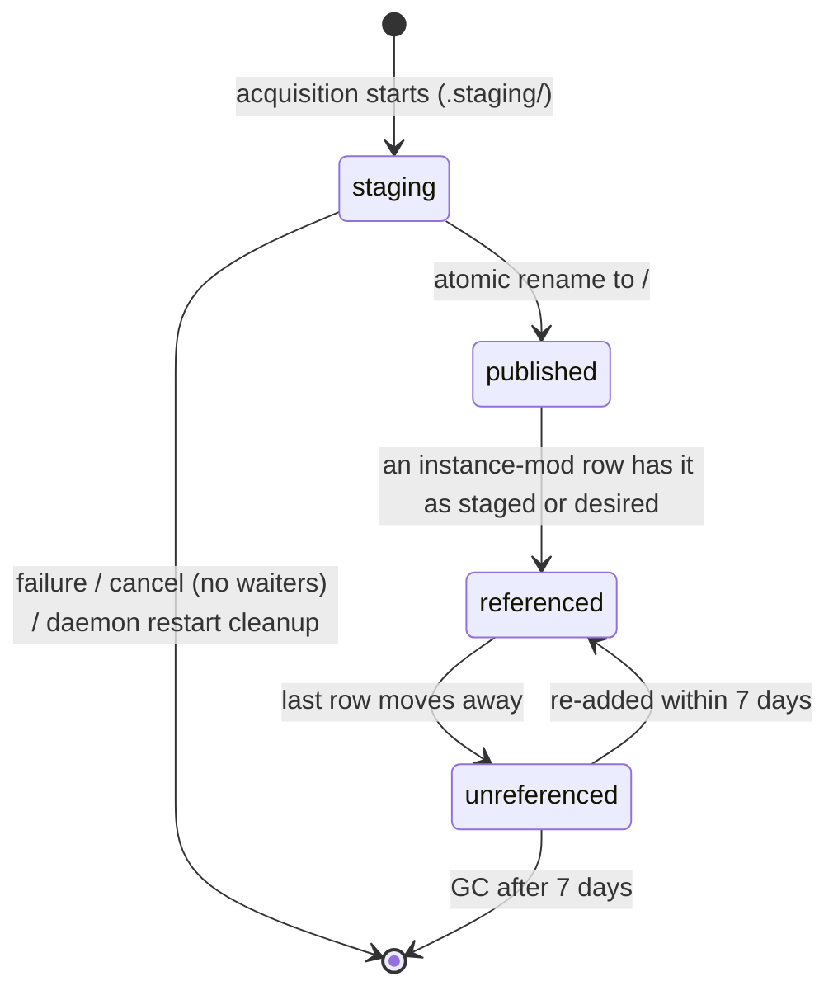
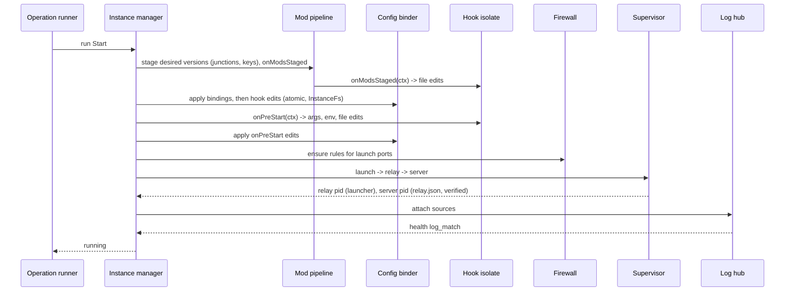
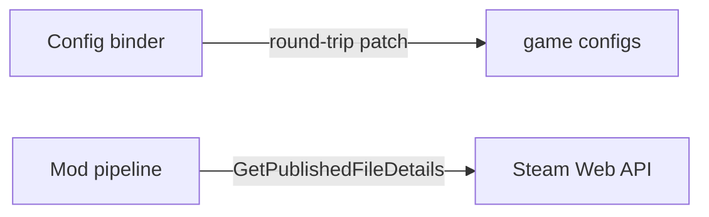

# Design

Parked backlog for milestones M2-M5. This file holds the decisions and design rows that only later milestones build. Decisions shared with M1 (D1-D7, D9-D12, D14, D15, D17, D18, D21-D24) are in `openspec/changes/init-core-platform/design.md` (in `openspec/changes/archive/` once M1 is archived), and their **M1 scope** lines name the parts that land here. Decision numbers continue that file's numbering. Each milestone change taken out of this backlog copies the decisions and rows it depends on and gets its own design review.

## Extraction notes

Several MODIFIED requirements here mix clauses from different milestones, because each holds the final text of a requirement M1 created. When a milestone change is taken out of this backlog, write each such requirement as it stands at that milestone: the clauses and scenarios of that milestone and earlier ones go into the new change's MODIFIED requirement, and the rest stays here. The M2 parts of the rows below are done.

| Spec → requirement | Clauses by milestone |
|---|---|
| instance-lifecycle → Graceful stop per plugin strategy | M4: the `rcon` strategy (M2 service-start wording removed from the Valheim scenario) |
| instance-lifecycle → Durable state with a portable instance file | M3: mods (M2 secret-value wording removed; the placeholder clause and scenario are M1) |
| host-service → Data directory layout | M3: the content store (M2 instance-roots clause and scenarios removed, taken by `m2-secure-remote-host`) |
| desktop-client → Forms rendered from plugin schemas | M4: list tables (M2 `revision_conflict` scenario removed, taken by `m2-secure-remote-host`) |
| desktop-client → Logs and console views | M4: the RCON console |
| plugin-hooks → Hook input and output contract | M3: staged mods (M2 secret-value wording removed; the placeholder clause and scenario are M1) |
| plugin-hooks → Sandboxed host API | M3: staged mod folders, more formats, external-edit tracking |
| plugin-manifest → Stop and health declarations | M4: the `rcon` strategy. `query` health has no milestone yet: assign it when M4 is taken out, and keep rejecting it until then |
| daemon-protocol → both requirements | M3: pending prompts, mod update counts |

M1 decision D23's file-edit writer is reused by the config binder (task 15.3).

## Triage

| Trigger | Applies? | Evidence |
|---|---|---|
| T1 Components (new component, or 3+ with directed relationships) | yes | Mod pipeline and content store, config binder, RCON adapters, Linux agent |
| T2 State (persistent state, caches, 3+ state machine) | yes | Versioned content store with staged/desired references, placed keys |
| T3 Concurrency (background work, workers/isolates, async, retries) | yes | Workshop single-flight with waiter detach, mod update timer, RCON reconnect |
| T4 Boundaries (data format, migration, shared interface, IPC, external) | yes | Config formats, Steam Web API, systemd |
| T5 Volume (grows without a fixed bound) | yes | Workshop content versions |
| T6 Risk (security, money, data loss, unrecoverable user data) | yes | Steam credentials |

TIER: FULL

## Context

The baseline is `openspec/architecture.md` and ADRs 0001-0015, as for M1 and M2. Where a decision here refines a baseline table, task 21.3 writes it back into `openspec/architecture.md`.

Unverified assumptions, each closed by a spike task in `tasks.md`: SteamCMD Steam Guard behaviour with stdin closed (14.1); SCUM's reaction to Ctrl+C (19.3).

## Decisions

### D8: Workshop metadata from the Steam Web API, downloads through SteamCMD

- **Choice:** titles, sizes, `time_updated` and visibility from `ISteamRemoteStorage/GetPublishedFileDetails` (no key), batched 100 items, 1 request/s; downloads always through SteamCMD.
- **Rejected:** parsing SteamCMD workshop output because it does not report `time_updated` reliably.
- **Reversal cost:** low.

### D19: Key files are owned per mod, never over an admin's key

- **Choice:** each placed key is recorded `(instance, file name, content hash, providing mods)`. A key is removed only when no staged mod provides it any more; if a file of that name exists and Yagura did not place it, it is never overwritten and the mod gets a `key_conflict` warning.
- **Rejected:** removing a mod's keys with the mod because dependants commonly ship the same key (CF), which would break other mods.
- **Reversal cost:** low.

## Diagrams (FULL)

The process view (T1) is in the M1 design. The full start sequence and the remaining boundaries:

### T2 State: content-store version lifecycle

### T3 Concurrency: start operation (all milestones)

### T4 Boundaries added after M1

## State & Ownership (FULL)

| State | Owner (sole writer) | Lifetime | Invalidation / rebuild | Authoritative copy |
|---|---|---|---|---|
| Instance-mod `staged_version`, `desired_version` | Mod pipeline | Until removed | `staged := desired` on staging while stopped | SQLite |
| Placed keys | Mod pipeline | While a staged mod provides them | Recomputed at each staging (D19) | SQLite |

## Failure & Visibility (FULL)

| Component | Fails / dies mid-operation → | Recovery | Retry safe? | Who finds out |
|---|---|---|---|---|
| Shared workshop download | One waiter cancels | Waiter detached; run continues for others | Yes | Cancelling client sees `cancelled` |

## Resource Bounds (FULL)

| Queue / buffer / cache / transfer | Bound | At the bound | Timeout | At 10x / 100x |
|---|---|---|---|---|
| Workshop metadata | 100 items/request, 1 request/s | Batched | 15 s per request | 1,000 mods = 10 requests |
| Mod update timer | every 6 h ± 30 min | — | — | — |
| Console subscribers | 8 per instance | `too_many_subscribers` | — | — |

## Flow & State Gaps (FULL)

- **Mod list changed while staging:** staging uses the list captured at operation start.
- **Two instances need the same workshop item version:** single-flight with waiter detach (D7).
- **GC vs a new reference:** GC holds the mod pipeline lock and skips versions referenced after its scan started; both staged and desired versions count.
- **Update needing two installations (app anonymous, workshop account):** locks and slots are taken per step, so no circular wait.
- **Steam Guard answered by two devices:** first answer wins; the others receive `PromptResolved` and their answer fails `prompt_resolved`.
- **Hook edits a bound file:** bindings first, then hook edits, final hash recorded.
- **Secret bound into a config edited by hand:** the `external_edit` event masks values of keys bound to secret settings.

## Mechanism Ledger (FULL)

| Mechanism | Built? | Why (harm nobody catches / expensive later) | Evidence that would change the call |
|---|---|---|---|
| Atomic config writes | yes | Truncated configs after a crash | — |
| Single-flight for content items (D7) | yes | Concurrent SteamCMD runs into one store directory corrupt it | — |
| Versioned content store + staged/desired refs | yes | Updates under running servers; GC deleting live files | — |
| Key ownership per mod (D19) | yes | Removing one mod breaks another via shared keys | — |

## Risks / Trade-offs

- [Junctions in instance dirs confuse a game or anti-cheat] → `copy_fallback`; verified with BattlEye in task 17.3.
- [This backlog drifts from what M1 actually built] → each milestone change is reviewed against the code when it is taken out of the backlog.

## ADRs

- **In force, constraining this backlog:** 0001-0009, 0011, 0012, 0014 and 0015 (0010 and 0013 are superseded by 0014 and 0015).
- **To record during apply:** none.

## Open Questions

None.
